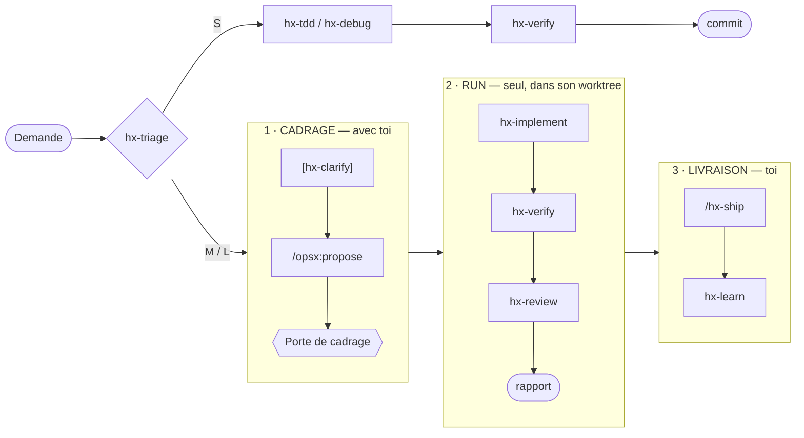

# Harness

**Un cadre de travail prêt à l'emploi pour Claude Code, quelle que soit la stack.**

Tu décris ce que tu veux, tu valides le cadrage une fois, et Claude livre seul : spec, code testé, revue, PR. Le harness installe dans ton projet les **skills**, **agents**, **rules**, **hooks** et **contrôles CI** qui rendent ce cycle fiable, autour d'[OpenSpec](https://github.com/Fission-AI/OpenSpec).

| | |
|---|---|
| 🎯 **Un seul arrêt** | Tu valides la spec à la porte de cadrage. Ensuite, le run va jusqu'au rapport sans te solliciter. |
| ⚡ **En parallèle** | Chaque run tourne dans son propre worktree : tu cadres le change suivant pendant ce temps. |
| ✅ **Jamais vert sans test** | `hx check` lance les mêmes contrôles en local et en CI, et relie chaque scénario de spec à un test. |
| 🧩 **Toute stack** | `/hx-setup` adapte les commandes (lint, tests, typecheck…) à ton projet. |

> Pensé pour **Claude Code Desktop** ; le terminal reste pris en charge. Statut : éprouvé sur un vrai projet. [Présentation en schémas →](https://patayencroute.github.io/Harness/)

---

## Démarrer

**1. Installer** — dans Claude Code Desktop, ouvre une session sur le dossier du projet et dis :

> « Installe le harness github.com/PatayEnCroute/Harness en suivant son INSTALL.md »

**2. Personnaliser** — ouvre une **nouvelle** session sur le même dossier et tape `/hx-setup`. Il adapte le harness à ta stack et finit par `hx doctor`.

C'est tout.

<details>
<summary><b>Installer depuis un terminal</b> (lanceur <code>npx</code>)</summary>

Prérequis : `git` et Node ≥ 20.19. Dans le dossier du projet (vide, ou dépôt git sans changement en cours) :

```bash
npx github:PatayEnCroute/Harness
```

| Le lanceur… | Pourquoi |
|---|---|
| fait `git init` dans un dossier vide ; refuse un arbre git sale | `/hx-setup` retrouve dans git les fichiers que l'installation remplace |
| installe [uv](https://docs.astral.sh/uv/) s'il manque, après accord | uv lance Copier, le moteur du template |
| lance `uvx copier@9.19.1 copy --trust` | pose 4 questions : nom du projet, workflow CI (`ci`), branche par défaut (`default_branch`), relecteurs obligatoires (`codeowners`) |
| ouvre Desktop sur le dossier (`claude --desktop`), sinon dit comment faire | tu y tapes `/hx-setup` |

Options : `--vcs-ref vX.Y.Z` (version précise) · `--defaults` (sans questions) · `--terminal` (Claude Code dans le terminal au lieu de Desktop) · `--no-claude` · `--help`.

Sans le lanceur : `uvx copier@9.19.1 copy --trust gh:PatayEnCroute/Harness .`, puis `/hx-setup`.

</details>

<details>
<summary><b>Projet existant</b></summary>

L'installation remplace `CLAUDE.md`, `.claude/settings.json` et `openspec/config.yaml` s'ils existent. Accepte : `/hx-setup` récupère ensuite leur contenu utile depuis git.

</details>

<details>
<summary><b>Ce que fait <code>--trust</code></b></summary>

Il autorise les tâches post-installation : `openspec init` à l'installation, puis `openspec update` et `hx migrate` à chaque mise à jour. La CLI OpenSpec (commandes `/opsx:*`) s'installe au premier démarrage de session si elle manque. Copier 9.19.1 est la version testée en CI et le minimum exigé.

</details>

> **Agent IA** : pour installer le harness à la demande d'un utilisateur, suis [`INSTALL.md`](INSTALL.md).

---

## Travailler avec le harness

Chaque demande passe par `hx-triage`, qui choisit la piste selon sa taille.



### Les trois temps d'un change M ou L

| Temps | Qui | Ce qui se passe |
|---|---|---|
| **1 · Cadrage** | toi + Claude | `hx-clarify` si la demande est floue, puis proposition OpenSpec. En M avec `design.md` et en L, un `hx-architect` neuf conteste le cadrage (garder, simplifier, retirer, changer). En L : `hx-architect` et `hx-adr`. **La porte** : tu vérifies que la spec dit ce que tu as demandé, sans plus. |
| **2 · Run** | Claude seul | `hx worktree <change>` crée sa branche et son worktree. Lance-le en **mode Auto** : Desktop → nouvelle session sur le worktree, `Cmd/Ctrl+Shift+M`, puis `/hx-implement <change>`. Il ne s'arrête que sur un vrai blocage (3 échecs sur une tâche, spec fausse, piste qui monte, outillage cassé). Le rapport finit dans `run-report.md`. |
| **3 · Livraison** | toi | Réponds à la question du rapport sur les mineurs, puis `/hx-ship` : il reprend la base, vérifie, et fait de l'archive OpenSpec le dernier commit de la PR. |

> 💡 Pendant un run, cadre le change suivant dans le dossier principal. `hx status` montre où en est chaque run.

### Hors workflow, à la demande

| Skill | Usage |
|---|---|
| `/hx-security-audit` | CVE des dépendances, injections SQL. Lecture seule. |
| `/hx-explain` | Pour un non-développeur : expliquer une décision, faire le bilan de son usage, expliquer une notion. |
| `/hx-dream` | Consolider la mémoire du projet : oublier le périmé, fusionner, hiérarchiser. Plan validé avant écriture. |

---

## Ce qui est installé

| Composant | Contenu |
|---|---|
| **15 skills** | Workflow : `hx-setup`, `hx-triage`, `hx-clarify`, `hx-tdd`, `hx-implement`, `hx-verify`, `hx-review`, `hx-ship`, `hx-adr`, `hx-debug`, `hx-learn`, `hx-discover` · À la demande : `hx-security-audit`, `hx-explain`, `hx-dream` |
| **7 agents** | `hx-explorer`, `hx-implementer`, `hx-spec-reviewer`, `hx-code-reviewer`, `hx-security-reviewer`, `hx-architect`, `hx-verifier` |
| **4 rules** | `openspec` · `testing` · `architecture` (feature-first, proportionnée) · `comments` (aucun par défaut, liste fermée d'exceptions) |
| **4 hooks** | Contexte au démarrage · rappel quand Claude édite un fichier sensible (spec, contrat, hooks, permissions) · lint du fichier édité · contrôles rapides et chemins protégés avant de rendre la main |
| **CLI `hx`** | `hx check` (openspec, archives, pistes, trace `@scenario`, lint, typecheck, arch, test) · `hx status` (état des runs) · `hx stats` (mesures d'élagage) · `hx doctor` · `hx worktree` |

<details>
<summary><b>Permissions</b> : pourquoi aucune confirmation n'est imposée</summary>

Autorisés sans confirmation : `node .harness/hx.mjs`, `openspec`, git local (lecture, `add`, `commit`, `pull`, `branch -d`, `worktree list`), `gh pr create/checks/view`, lectures shell (`ls`, `cat`, `head`, `tail`, `wc`).

**Aucune règle `ask`** : une confirmation que personne ne relit ne protège rien, et elle interromprait le mode Auto. Le reste (`git push`, `git rm`, `git worktree remove`, `git bisect`, `gh issue create`…) revient au mode de permission ; en Auto, son classifieur décide. Les permissions du dossier principal (`.claude/settings.local.json`) sont reprises dans chaque worktree.

Interdit : éditer `hx.mjs`, `hooks.mjs` et `versions.json` (gérés par Copier). Un test vérifie que chaque commande citée par un skill est autorisée ou laissée exprès au mode.

</details>

### Générique ou spécifique ?

| 🔄 Générique — mis à jour par `copier update` | 📌 Spécifique — rempli par `/hx-setup`, jamais écrasé |
|---|---|
| `CLAUDE.md`, `.claude/`, `.harness/hx.mjs`, `.harness/hooks.mjs`, `openspec/config.yaml`, `.github/workflows/hx-check.yml` | `.harness/config.json`, `.harness/project.md`, `.harness/ci/setup/action.yml`, `.github/dependabot.yml`, `.github/CODEOWNERS`, `.claude/rules/stack-*.md` |

Un fichier générique s'améliore dans Harness, pas dans le projet.

---

## Maintenir

| Action | Comment |
|---|---|
| **Mettre à jour** | Sur un arbre git propre : `uvx copier@9.19.1 update --trust`, puis `node .harness/hx.mjs doctor`. Copier prend le dernier tag ; `hx doctor` signale un projet en retard. |
| **Résoudre un conflit** | `hx doctor` liste les marqueurs `<<<<<<<` et fichiers `.rej`. Garde la version du template sauf personnalisation voulue, nettoie, relance `hx doctor`, commite. |
| **Protéger le harness** | Avec `codeowners`, `.github/CODEOWNERS` couvre `.harness/`, `.claude/settings.json`, `.github/` et `openspec/specs/`. À combiner avec « Require review from Code Owners ». |

<details>
<summary><b>Désinstaller</b></summary>

1. Supprime `.harness/`, `.copier-answers.yml`, `.claude/skills/hx-*`, `.claude/agents/hx-*`, les rules `openspec`, `testing`, `architecture` et `comments`, `.github/workflows/hx-check.yml` (et `CODEOWNERS`, `dependabot.yml` s'ils viennent du template).
2. Dans `.claude/settings.json`, retire les hooks vers `.harness/hooks.mjs`, les permissions `hx.mjs`, `openspec` et `git` du template, et `OPENSPEC_TELEMETRY`.
3. Dans `CLAUDE.md`, retire les sections du harness.

`openspec/` reste utilisable sans le harness : garde-le si les specs servent encore.

</details>

---

## Contribuer au template

```bash
npm test                # unitaires, hermétiques (CI : Linux, macOS, Windows)
npm run test:contract   # contrat OpenSpec sur la version épinglée (réseau)
npm run e2e             # 5 stacks, cycle OpenSpec complet, copier update, lanceur npx
npm run evals           # agents headless notés de façon déterministe (local, sans clé d'API)
```

**Publier une version** : sur `main`, la section « Non publié » de `CHANGELOG.md` devient la version, puis `git tag vX.Y.Z && git push origin vX.Y.Z`. Les projets suivent les tags.

Les actions GitHub sont épinglées par SHA et tenues à jour par Dependabot ; les SHA de `hx-check.yml.jinja` suivent ceux de `ci.yml` (vérifié par un test).

### Pour aller plus loin

| Document | Pour… |
|---|---|
| [Page de présentation](https://patayencroute.github.io/Harness/) | comprendre le harness en schémas |
| [`docs/PLAN.md`](docs/PLAN.md) | le plan directeur : principes, architecture, roadmap |
| [`docs/adr/`](docs/adr/) | les décisions du template et leurs raisons |
| [`docs/elagage.md`](docs/elagage.md) | savoir quand retirer un composant |
| [`evals/README.md`](evals/README.md) | les evals comportementales et A/B |
| [`docs/research/`](docs/research/etat-de-l-art-2026-10.md) | l'état de l'art sourcé (octobre 2026) |
| [`CHANGELOG.md`](CHANGELOG.md) | l'historique des versions |
