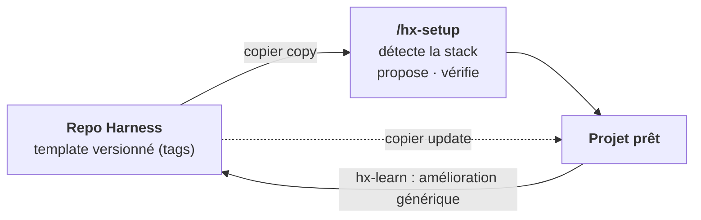
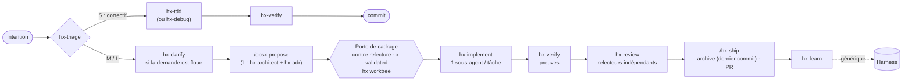
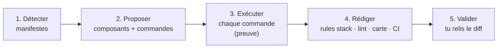
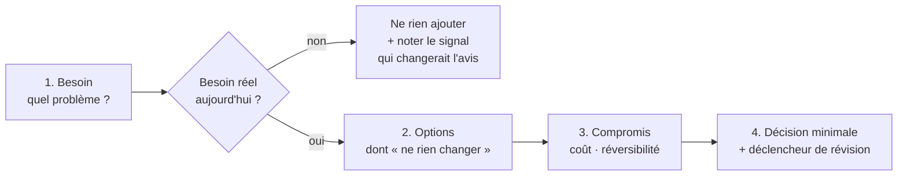

# Harness — Plan directeur

Le **pourquoi** et le **comment** du template. Pour l'installer et s'en servir, voir le [`README`](../README.md).

> **Statut** : phases 0 à 6 livrées, éprouvées sur un vrai projet (§7). Version courante : le dernier tag ; historique : [`CHANGELOG.md`](../CHANGELOG.md).
> **Cadre** : Claude Code · projets solo · GitHub Actions · agnostique de la stack · OpenSpec 1.14.x
> **Sources** : [état de l'art d'octobre 2026](research/etat-de-l-art-2026-10.md)

---

## 0. En bref

| | |
|---|---|
| **Quoi** | Un template personnel qui installe dans un projet une couche de *harness* autour d'OpenSpec : skills, agents, rules, hooks, contrôles CI. |
| **Agnostique** | Le générique ignore la stack. Le spécifique tient dans quelques fichiers isolés, remplis par `/hx-setup`. |
| **Moteur** | [Copier](https://copier.readthedocs.io) : installation **et mise à jour** par fusion à 3 voies. |
| **Règle d'or** | Tout contrôle existe en CI ; les hooks locaux ne font qu'accélérer le retour. |
| **Anti-lourdeur** | Pistes S / M / L : un petit correctif n'a pas besoin de spec. |



---

## 1. Principes

| # | Principe | Conséquence concrète | Source |
|---|---|---|---|
| P1 | **Générique et spécifique séparés** | Skills, agents et hooks n'écrivent jamais `npm` ou `dotnet` : ils passent par `hx run <commande>`. | Böckeler |
| P2 | **OpenSpec = registre de l'intention** | On l'étend sans le forker : `config.yaml`, skills voisins, clés `x-*`, CI. | OpenSpec |
| P3 | **Contrôles déterministes > prose** | Une règle importante devient un lint, un test ou un check. | Böckeler, OpenAI |
| P4 | **Le contexte est un budget** | `CLAUDE.md` est une carte (≤ 100 lignes) ; rules ciblées par chemin. | Anthropic, ETH |
| P5 | **Qui produit n'évalue pas** | Relecteurs indépendants, pour le code comme pour le cadrage. | Anthropic, superpowers |
| P6 | **Pas de « terminé » sans preuve** | `hx-verify` exige une sortie de commande fraîche. | superpowers |
| P7 | **Processus proportionné** | Pistes S/M/L. | Böckeler, Marmelab |
| P8 | **Boucle de pilotage** | Une erreur récurrente devient une rule, un contrôle ou un skill, remonté dans Harness. | Hashimoto |
| P9 | **Élaguer** | Un composant sans gain mesurable est retiré ([`elagage.md`](elagage.md)). | Anthropic |
| P10 | **Architecture proportionnée** | Feature-first ; une couche seulement pour un besoin nommé (§5). | Clean Arch., YAGNI |
| P11 | **Standard quand c'est gratuit** | Skills au format `SKILL.md`, portables sans effort. | Agent Skills |

**Non-objectifs** : forker OpenSpec ou modifier ses skills `openspec-*` · supporter un autre outil que Claude Code ([ADR-002](adr/002-claude-code-seul-standards-gratuits.md)) · des « packs » de stack précâblés · une spec pour un correctif d'une ligne.

---

## 2. Workflow



| Piste | Quand | Artefacts OpenSpec | Contrôles en plus |
|---|---|---|---|
| **S** | Diff descriptible en une phrase, aucun comportement spécifié ne change | aucun | `hx check` |
| **M** | Fonctionnalité ou changement de comportement | proposal + delta specs + tasks | `validate --strict`, traçabilité |
| **L** | Archi, contrat d'API, migration | + `design.md` + ADR | design et ADR validés **avant** le run |

**En M et L, trois temps :**

1. **Cadrage** (avec l'utilisateur) — jusqu'à la porte, **seul arrêt prévu**. L'utilisateur y vérifie que la spec dit ce qu'il a demandé (`x-validated`). En M avec `design.md` et en L, un `hx-architect` neuf conteste d'abord le cadrage.
2. **Run** (sans lui) — `hx-implement` → `hx-verify` → `hx-review`, dans le worktree du change. Arrêt seulement sur un blocage listé. Finit par un rapport : hypothèses à confirmer, revue, mineurs.
3. **Livraison** (l'utilisateur) — décision sur les mineurs, puis `/hx-ship`. L'archive reste le dernier commit.

> **Pourquoi un worktree par run ?** `trace` et `pistes` portent sur tous les changes d'un dossier : deux changes au même endroit se gêneraient. Le dossier principal reste libre pour cadrer le suivant.

Les critères de piste vivent dans `hx-triage` seul. Sur un projet existant sans specs, `hx-discover` dérive d'abord des specs depuis le code.

---

## 3. Architecture du harness

### 3.1 Générique ou spécifique

| | **Générique** | **Spécifique** |
|---|---|---|
| Source | le template, mis à jour par `copier update` | `/hx-setup`, une fois par projet |
| Fichiers | `CLAUDE.md`, `.claude/` (skills, agents, rules, settings), `.harness/hx.mjs`, `hooks.mjs`, `config.schema.json`, `versions.json`, `openspec/config.yaml`, `hx-check.yml` | `.harness/config.json`, `project.md`, `ci/setup/action.yml`, `.claude/rules/stack-*.md`, `dependabot.yml`, `CODEOWNERS`, config `arch` et lint des commentaires |
| Conflits à la mise à jour | fusion à 3 voies | **aucun** : absents du template ou `_skip_if_exists` |

### 3.2 Le contrat de commandes

`.harness/config.json` est **la seule interface entre le harness et la stack**. Il gère le multi-stack par composants ; chaque commande s'exécute dans le dossier de son composant.

```jsonc
{
  "version": 1,
  "components": {
    "api": { "path": "src/Api", "stack": "dotnet",
             "commands": { "test": "dotnet test", "lint": "dotnet format --verify-no-changes", "arch": "dotnet test ../../tests/Architecture" } },
    "web": { "path": "web", "stack": "node",
             "commands": { "test": "npm run test", "test-file": "npx vitest run {file}", "lint": "npm run lint", "typecheck": "npm run typecheck" } }
  },
  "architecture": { "style": "feature-first", "level": 1, "features": { "facturation": 2 } },
  "tracks": { "S": { "spec": false }, "M": { "spec": true, "design": "optional" }, "L": { "spec": true, "design": "required", "adr": "required" } }
}
```

JSON plutôt que YAML : `hx` n'a aucune dépendance et Node le lit nativement.

| Commande `hx` | Rôle |
|---|---|
| `check [--fast]` | Tous les contrôles (§4.3). **Jamais vert sans test exécuté.** |
| `run <cmd> [--file]` | Une commande du contrat, sur tous les composants ou celui du fichier |
| `doctor` | Installation saine, commandes qui passent, retard sur le dernier tag |
| `detect [--write]` | Propose composants et commandes depuis les manifestes |
| `worktree <change>` | Branche + worktree pour le run d'un change validé |
| `status` · `stats` | État des runs · mesures d'élagage des changes archivés |
| `trace` · `migrate` · `openspec` | Scénarios ↔ tests · clés nouvelles du contrat · OpenSpec épinglé |

Détail complet : `node .harness/hx.mjs help`.

### 3.3 `/hx-setup`



Projet existant : les rules de stack viennent des conventions observées dans le code. Projet neuf : conventions par défaut. Relançable à tout moment (nouveau composant…).

### 3.4 Copier et OpenSpec

**Copier** installe dans un projet nouveau ou existant, met à jour par fusion à 3 voies, et marche en session cloud car tout est commité ([ADR-001](adr/001-copier-moteur-de-template.md)). Pas de plugin utilisateur en complément ([ADR-003](adr/003-plugin-utilisateur-non-retenu.md)). `copier.yml` reste minimal : la source fait foi.

**OpenSpec** est une dépendance centrale assumée, épinglée, au contrat testé ([ADR-004](adr/004-openspec-dependance-centrale.md)). Points d'accroche, sans fork :

| Point | Usage |
|---|---|
| `config.yaml` | Contexte (renvoi vers `CLAUDE.md`), règles d'écriture par artefact, `apply` renvoyé vers `hx-implement` |
| `.openspec.yaml › x-*` | `x-track`, `x-validated`, mesures `x-gate-*` et `x-review-*` (lues par `hx stats`) |
| Markdown des specs et changes | Lu directement par `hx trace`, les pistes et les hooks : rapide, hors ligne |
| CLI `--json` | Utilisée par les skills ; chaque hypothèse est vérifiée par le test de contrat |
| Schéma custom | **Non** : pas d'héritage de schéma, un fork serait à maintenir |

---

## 4. Composants

### 4.1 Skills et agents

| Skill | Rôle |
|---|---|
| `hx-setup` | Personnalisation assistée à la stack (§3.3) |
| `hx-triage` | Classer en S/M/L ; porte de cadrage |
| `hx-clarify` | ≤ 5 questions avant la proposition |
| `hx-tdd` · `hx-debug` | Rouge → vert → refactor · reproduire → isoler → corriger |
| `hx-implement` | Une tâche = un sous-agent ; exige `x-validated` ; enchaîne le run |
| `hx-verify` | Aucune fin déclarée sans preuve fraîche |
| `hx-review` | Relecteurs en parallèle, filtre des faux positifs, rapport `run-report.md` |
| `hx-ship` | Base reprise, archive en dernier commit, PR, suivi CI |
| `hx-adr` · `hx-learn` · `hx-discover` | ADR « besoin d'abord » · capitaliser une leçon · specs depuis le code existant |
| `hx-security-audit` · `hx-explain` · `hx-dream` | **À la demande** : CVE et injections SQL · pédagogie pour non-développeur · consolider la mémoire du projet |

| Agent | Rôle | Écrit ? |
|---|---|---|
| `hx-explorer` | Cartographier le code et l'impact (modèle `haiku`) | non |
| `hx-implementer` | Réaliser **une** tâche en TDD | oui |
| `hx-spec-reviewer` | Le code respecte-t-il les scénarios ? | non |
| `hx-code-reviewer` | Qualité, simplicité, sur-ingénierie, règle de dépendance | non |
| `hx-security-reviewer` | Secrets, injection, dépendances | non |
| `hx-verifier` | Exécuter et prouver | non |
| `hx-architect` | Décisions besoin d'abord (§5) | non |

Seul `hx-explorer` fixe son modèle ; les autres héritent de la session. « Non » = lecture + shell, sans Edit ni Write.

### 4.2 Rules et hooks

| Rule | S'applique à | Contenu |
|---|---|---|
| `CLAUDE.md` | toujours | Carte : principes, workflow, contrat. Importe `.harness/project.md`. ≤ 100 lignes. |
| `openspec` | `openspec/**` | SHALL/MUST, scénarios WHEN/THEN testables |
| `testing` | fichiers de test | Tag `@scenario`, un comportement par test |
| `architecture` | fichiers source | Feature-first, règle de dépendance, « pas de besoin, pas de couche » |
| `comments` | fichiers source | Aucun commentaire par défaut ; un commentaire qui contredit le code est bloquant |
| `stack-*` | globs de la stack | Idiomes et conventions, rédigés par `/hx-setup` |

| Hook | Action |
|---|---|
| `SessionStart` | Affiche les changes en cours (tous worktrees) ; installe la CLI OpenSpec si absente |
| `PreToolUse` | Rappel à Claude quand il édite une spec principale ou un fichier qui décide de ce qui s'exécute ; refuse `openspec-apply-change` au profit de `hx-implement`. **Ne demande jamais confirmation.** |
| `PostToolUse` | Lint du fichier édité ; contrat cassé → retour à Claude |
| `Stop` | D'après git : lint + typecheck des composants modifiés ; signale les chemins protégés modifiés, quel que soit l'outil |

**Pas de confirmation imposée** : personne ne relit une confirmation répétée, et elle interromprait le mode Auto. Les actions risquées reviennent au mode de permission. `permissions.deny` interdit d'éditer `hx.mjs`, `hooks.mjs` et `versions.json`.

### 4.3 Contrôles (`hx check`, identiques en local et en CI)

| Étape | Vérifie |
|---|---|
| `openspec` · `archives` | Specs et changes valides (`--strict`) ; tâches des changes archivés toutes faites |
| `pistes` | `x-track` présent et valide sur chaque change ; artefacts exigés par la piste ; ADR cités existants |
| `trace` | Chaque scénario a un test tagué `@scenario` (échec une fois les tâches cochées) ; couverture des specs ≥ seuil ; pas de scénarios homonymes ni de tag orphelin |
| `lint` · `typecheck` · `arch` · `test` | Commandes du contrat, par composant |

---

## 5. Architecture des projets

> **Feature-first** (code rangé par fonctionnalité) + **règle de dépendance** de la Clean Architecture (le métier ne dépend ni du framework ni des I/O). Au niveau que le besoin justifie, **pas plus**.

### 5.1 Le besoin d'abord



- **Pas de besoin, pas de couche** : toute abstraction cite le besoin qu'elle sert.
- Toujours présenter « ne rien changer » et l'option la plus simple.
- Proposer le niveau minimal, et le **signal** qui ferait passer au suivant.
- Réserver les ADR aux **portes à sens unique** : schéma de données, API publique, découpage en services.
- Aucun pattern par réflexe (CQRS, event sourcing, microservices, repository générique…).

### 5.2 Échelle de niveaux

| Niveau | Forme | Quand | Coût |
|---|---|---|---|
| **0 · Simple** | Un module | Script, POC | nul |
| **1 · Feature-first** *(défaut)* | Un dossier par feature, tranche verticale complète, sans abstraction | La plupart des projets solo | faible |
| **2 · + domaine isolé** | Domaine pur, ports et adaptateurs aux seules frontières qui en ont besoin | Métier non trivial, I/O à isoler, plusieurs points d'entrée | moyen |
| **3 · Monolithe modulaire** | Modules à contrats publics, ports et adaptateurs systématiques | Plusieurs sous-domaines, longue durée de vie | élevé |
| *4 · Distribué* | Services séparés | Besoin **prouvé** : quasi jamais en solo | très élevé |

Le niveau se décide **par feature**, sur un signal observé, jamais par anticipation.

### 5.3 Forme du code

```
src/
├── features/
│   ├── facturation/            # niveau 2 : le métier le justifie
│   │   ├── creer-facture/      # tranche : entrée + logique + tests
│   │   ├── domain/             # règles pures, sans dépendance externe
│   │   └── adapters/           # BDD, API externes
│   └── clients/                # niveau 1
│       └── lister-clients/
├── shared/                     # noyau minimal et nommé, pas de « utils »
└── app/                        # composition : injection, routes, config
```

| Règle de dépendance (vérifiée par `hx run arch`) |
|---|
| Une feature n'importe que le contrat public d'une autre |
| `domain/` ne dépend ni du framework, ni des I/O, ni de `adapters/` |
| Aucune feature ne dépend de `app/` ; `shared/` ne dépend d'aucune feature |

Outils de `hx run arch`, choisis par `/hx-setup` : dependency-cruiser (TS), import-linter (Python), NetArchTest (.NET), go-arch-lint (Go), ArchUnit (Java). `hx-code-reviewer` signale aussi la **sur-ingénierie**.

**Gabarit ADR** (`hx-adr`) : Besoin → Contexte → Options (dont « ne rien changer ») → Décision minimale → Conséquences → Révision (réversible ou sens unique, signal de réouverture).

---

## 6. Qualité du template

| Test | Vérifie | Où |
|---|---|---|
| Unitaires | `hx`, hooks, correcteurs des evals | `npm test` (Linux, macOS, Windows) |
| Lint du template | Format `SKILL.md`, agents en lecture seule, budgets, références `hx-*`, Unicode invisible | `npm test` |
| Contrat OpenSpec | Chaque hypothèse sur la version épinglée | `npm run test:contract` |
| E2E | 5 stacks · cycle OpenSpec complet · `copier update` · lanceur `npx` | `npm run e2e`, CI |
| Evals | Agents headless notés de façon déterministe ; A/B `--without <skill>` pour l'élagage | `npm run evals`, en local |

<details>
<summary><b>Arborescences</b> : repo Harness et projet installé</summary>

<table><tr><td>

```
Harness/
├── bin/harness.mjs       # lanceur npx
├── INSTALL.md            # installation par un agent
├── copier.yml
├── template/             # ce qui atterrit dans le projet
│   ├── CLAUDE.md
│   ├── .claude/          # 15 skills, 7 agents, 4 rules, settings
│   ├── .harness/         # hx.mjs, hooks.mjs, config…
│   ├── openspec/config.yaml
│   └── .github/          # si ci
├── tests/                # unit, contrat, e2e (5 stacks)
├── evals/
└── docs/                 # PLAN, ADR, élagage, research
```

</td><td>

```
mon-projet/
├── .copier-answers.yml   # version du template
├── CLAUDE.md             # importe project.md
├── .claude/              # hx-* + openspec-*, stack-*.md
├── .harness/
│   ├── config.json       # ← personnalisé
│   ├── project.md        # ← personnalisé
│   ├── ci/setup/         # ← personnalisé
│   └── hx.mjs  hooks.mjs …
├── openspec/             # config, specs, changes
├── .github/
└── docs/                 # adr, learnings
```

</td></tr></table>

Les scripts `hx` sont en `.mjs` sans dépendance (OpenSpec impose déjà Node ≥ 20.19), et jamais dans un dossier `bin/` côté projet : les `.gitignore` .NET l'ignorent.

</details>

---

## 7. Roadmap

| Phase | Apport | Version |
|---|---|---|
| **P0 Socle** ✅ | Copier, contrat de commandes, `/hx-setup`, CI du template | — |
| **P1 Boucle de base** ✅ | Triage, TDD, implement, verify, review, ship ; agents, rules, hooks | — |
| **P2 Qualité** ✅ | `hx trace`, relecteurs sécurité et vérif, evals, contrat OpenSpec | — |
| **P3 Extensions** ✅ | `hx-discover`, revue d'élagage, ADR 001 à 003 (ADR-004 en v0.2.0) | — |
| **P4 Fiabilité** ✅ | Plus de faux verts, hook `Stop` fondé sur git, chemins protégés | v0.3.0 |
| **P5 Démarrage** ✅ | Lanceur `npx`, `INSTALL.md` | v0.4.0 |
| **P6 Runs sans interruption** ✅ | Porte de cadrage, `hx worktree`, rapport de fin de run | v0.5.0 |

**Leçons de la réalisation**, désormais encodées :

- **Ne pas bloquer `openspec/specs/`** : l'archive y écrit légitimement. Rappel à Claude, signalement en fin de tour.
- **Pas de confirmation imposée** : personne ne la relit, et elle casse le mode Auto.
- **`Purpose` ≥ 50 caractères** pour une nouvelle capability, sinon `validate --strict` la refuse après l'archive.
- **`state` décide, pas `missingPrerequisites`** : bug révélé par l'eval `implement-m`, couvert par le contrat.
- **Jamais de dossier `bin/`** pour les scripts du harness ; `hx doctor` vérifie qu'aucun n'est ignoré par git.

---

## 8. Risques

| Risque | Mitigation |
|---|---|
| OpenSpec évolue vite | Version épinglée, tests de contrat, critères de sortie ([ADR-004](adr/004-openspec-dependance-centrale.md)) |
| Le run s'écarte de l'intention | Spec validée à la porte avant tout code ; choix non tranchés remontés en hypothèses dans le rapport |
| `/hx-setup` se trompe de commande | Il exécute chaque commande avant de l'écrire ; `hx doctor` revérifie |
| L'architecte sur-conçoit | Besoin d'abord, option la plus simple obligatoire ; `hx-code-reviewer` signale l'abstraction sans besoin |
| Conflits ou projets en retard | Spécifique hors template ; `hx doctor` détecte conflits et retard ; `hx migrate` complète le contrat |
| Stack exotique, monorepo | Toute commande shell acceptée ; composants multi-stack |
| Besoin d'un autre outil IA | Skills au standard `SKILL.md` ; outil de synchronisation (rulesync, APM) |
| Lourdeur | Pistes S/M/L ; élagage mesuré |

---

## 9. Décisions

| Question | Décision |
|---|---|
| Outil IA | **Claude Code** seul ([ADR-002](adr/002-claude-code-seul-standards-gratuits.md)) |
| Moteur de template | **Copier** ([ADR-001](adr/001-copier-moteur-de-template.md)) |
| Usage | **Projets solo**, fichiers commités dans le projet |
| Plugin utilisateur | **Non** : les skills dépendent des fichiers du projet ([ADR-003](adr/003-plugin-utilisateur-non-retenu.md)) |
| CI | **GitHub Actions** |
| Stack | **Agnostique** : contrat de commandes + `/hx-setup` |
| OpenSpec | **Dépendance centrale**, épinglée, contrat testé ([ADR-004](adr/004-openspec-dependance-centrale.md)) |
| Archive OpenSpec | **Dernier commit de la PR** : `main` a toujours code et specs cohérents |
| Architecture | **Feature-first + règle de dépendance**, niveau proportionné au besoin (§5) |
| Hook sur `openspec/specs/` | **Rappel**, ni blocage ni confirmation |
| Modèle des agents | **Hérité de la session**, sauf `hx-explorer` (`haiku`) |
| Place de l'humain en M/L | **Une porte, au cadrage**, puis run sans interruption et livraison par l'utilisateur. Le but n'est pas un agent sans humain : l'utilisateur cadre le change suivant pendant le run. |
