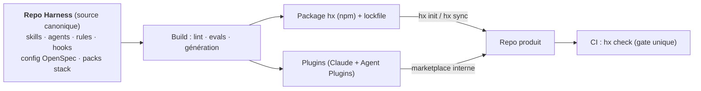
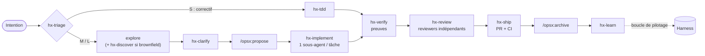
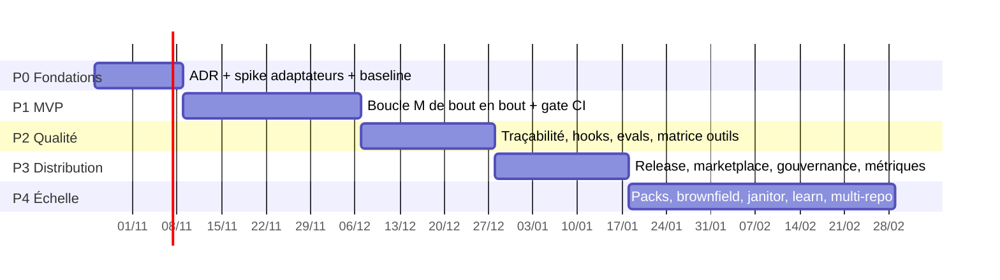

# Harness — Plan directeur

> **Statut** : proposition v0.1 · 2026-10-17
> **Base** : OpenSpec 1.14.x (workflow OPSX) · état de l'art → [`research/etat-de-l-art-2026-10.md`](research/etat-de-l-art-2026-10.md)

---

## 0. En bref

| | |
|---|---|
| **Quoi** | Une couche de *harness* (guides + capteurs) autour d'OpenSpec : **skills, agents, rules, hooks, gates CI** pour produire du logiciel avec des agents IA. |
| **Agnostique de** | l'outil IA (Claude Code, Copilot, Cursor, Codex…), la stack, la CI, le modèle. |
| **Comment** | On écrit **une seule source canonique** au plus près des standards ouverts (AGENTS.md, Agent Skills, Agent Plugins). Les formats propres à chaque outil sont **générés**. |
| **Règle d'or** | Tout gate existe **en CI** ; les hooks locaux ne font qu'accélérer le retour. |
| **Anti-waterfall** | Le processus est **proportionné** : pistes S / M / L, avec un chemin rapide sans spec pour les petits changements. |



---

## 1. Vision & périmètre

### Les 4 axes d'agnosticité

| Axe | Comment on reste agnostique |
|---|---|
| **Outil IA** | Source au format standard. Des adaptateurs génèrent les fichiers `.claude/`, `.github/`, `.cursor/`, `.codex/`… |
| **Stack** | Un **contrat de commandes** (`harness.yaml` : `test`, `lint`, `build`…) que les skills appellent sans connaître la stack. Les spécificités vont dans des **packs**. |
| **CI / forge** | Un point d'entrée unique, `hx check --ci`, plus des gabarits fins (GitHub Actions, Azure Pipelines, GitLab). |
| **Modèle** | Les agents déclarent un **niveau** (`fast` / `standard` / `deep`) ; chaque outil le traduit en modèle concret. |

### Non-objectifs (v1)

- ❌ Forker OpenSpec ou modifier ses skills `openspec-*` (ils sont réécrits à chaque `openspec update`).
- ❌ Construire notre propre runtime d'agent ou un serveur MCP.
- ❌ Un catalogue de 70 agents : **peu de composants, mesurés**.
- ❌ Imposer une spec pour un correctif d'une ligne.

---

## 2. Principes directeurs

| # | Principe | Tiré de | Conséquence concrète |
|---|---|---|---|
| P1 | **Standards d'abord**, adaptateurs ensuite | AGENTS.md (AAIF), Agent Skills, Agent Plugins 1.0 | Format canonique = standard ; seul ce qui n'est pas standardisé (agents, hooks, rules ciblées) passe par un adaptateur. |
| P2 | **OpenSpec = registre de l'intention** | OpenSpec `config.yaml`, contrat JSON | On l'étend via `config.yaml`, des skills voisins, des clés `x-*` et la CI, sans jamais le forker. |
| P3 | **Capteurs déterministes > prose** | Böckeler, OpenAI | Une règle importante = un lint / test / check. La prose ne fait que guider. |
| P4 | **Le contexte est un budget** | Anthropic, étude ETH | AGENTS.md = une carte (≤ 100 lignes). Rules ciblées par chemin. Skills à divulgation progressive. |
| P5 | **Qui produit n'évalue pas** | Anthropic (évaluateur séparé), superpowers | Les reviewers sont des sous-agents indépendants, avec un filtre de faux positifs. |
| P6 | **Pas de « terminé » sans preuve** | superpowers, Anthropic | `hx-verify` exige une sortie de commande fraîche (tests, validate, trace). |
| P7 | **Processus proportionné** | Böckeler, Marmelab (critiques du SDD) | Pistes S / M / L choisies par `hx-triage`. |
| P8 | **Boucle de pilotage** | Hashimoto, Compound Engineering | Toute erreur récurrente devient une rule, un capteur ou un skill (`hx-learn`). |
| P9 | **Élaguer** | Anthropic (mars 2026) | Chaque composant encode une hypothèse sur une faiblesse du modèle. On le mesure par evals et on le retire quand il devient inutile. |

---

## 3. Architecture

### 3.1 Format canonique et cibles générées

| Artefact | Format canonique | Standard ? | Généré vers |
|---|---|---|---|
| Instructions racine | `AGENTS.md` (bloc géré `hx`) | ✅ AAIF | `CLAUDE.md` → `@AGENTS.md`, `GEMINI.md` si besoin |
| Skills | `SKILL.md` + `scripts/` `references/` `evals/` | ✅ agentskills.io | `.agents/skills/` (Codex, Cursor, Copilot, OpenCode, Gemini…) **+ copie** `.claude/skills/` (Claude Code ne lit pas `.agents/`) |
| Rules ciblées | `.md` + frontmatter `paths:` | ❌ | `.claude/rules/`, `.github/instructions/*.instructions.md` (`applyTo`), `.cursor/rules/*.mdc` (`globs`), `.kiro/steering/` (`fileMatch`) |
| Agents | `.md` + frontmatter neutre (`name`, `description`, `capabilities`, `tier`) | ❌ (le format Claude sert de standard de fait) | `.claude/agents/` (lu aussi par VS Code et Cursor), `.github/agents/*.agent.md`, `.codex/agents/*.toml`, `.opencode/agents/` |
| Hooks | `hooks.yaml` neutre → scripts `hx` | ❌ (convergence vers les noms Claude) | `.claude/settings.json`, `.github/hooks/`, `.cursor/hooks.json`, `.codex/hooks.json` |
| Plugin | manifeste double | ✅ Agent Plugins + format Claude de fait | `plugin.json` + `.claude-plugin/plugin.json` |
| OpenSpec | fragments `config.yaml` (context + rules par artefact) | — | `openspec/config.yaml` (fusion) |

> **Copie, pas lien symbolique** : les liens symboliques posent problème sous Windows. `hx sync --check` détecte toute dérive des fichiers générés.

### 3.2 Contrat de commandes (`harness.yaml`, dans le repo produit)

```yaml
version: 1
targets: [claude-code, copilot, cursor, codex]   # outils à générer
packs: [dotnet, angular]                          # surcouches stack
commands:                                         # appelés via `hx run <nom>`
  test:      dotnet test
  test-file: dotnet test --filter {file}
  lint:      dotnet format --verify-no-changes
  typecheck: dotnet build -warnaserror
  e2e:       npx playwright test
tiers: { fast: <modèle>, standard: <modèle>, deep: <modèle> }   # par outil
tracks:
  S: { max_files: 3, spec: false }
  M: { spec: true, design: optional }
  L: { spec: true, design: required, adr: required }
```

Les skills n'appellent **jamais** `npm test` ou `dotnet test` directement, toujours `hx run test`. C'est ce qui rend un skill indépendant de la stack.

### 3.3 Points d'accroche OpenSpec utilisés

| Point d'extension | Usage Harness |
|---|---|
| `config.yaml › context` | Lien vers AGENTS.md, golden principles, contrat de commandes |
| `config.yaml › rules.<artefact>` | Règles d'écriture par artefact : proposal (piste, non-objectifs), specs (scénarios testables), design (alternatives et ADR), tasks (2–5 min, test d'abord, vérification) |
| `operations.apply.guidance` | Renvoie vers la discipline `hx-implement` / `hx-tdd` |
| `.openspec.yaml › x-*` | `x-track: M`, `x-ticket: ADO-1234`, `x-owner` |
| Contrat `--json` (`status`, `instructions`, `validate`, `show`) | Seule interface programmatique utilisée par `hx` ; couverte par des tests de contrat |
| Schéma custom | **Pas en v1** : pas d'héritage de schéma (#778), un fork coûterait cher à maintenir. On le réévaluera en phase 4. |

---

## 4. Workflow de production



### Pistes

| Piste | Quand | Artefacts OpenSpec | Gates |
|---|---|---|---|
| **S** — chemin rapide | Diff descriptible en une phrase, aucun changement de comportement spécifié | Aucun | Tests + lint + review |
| **M** — standard | Fonctionnalité ou changement de comportement | proposal + delta specs + tasks | + `validate --strict` + traçabilité |
| **L** — structurant | Archi, contrat d'API, migration, transverse | + design.md + ADR obligatoires | + review archi + revue humaine du design **avant** apply |

### Phases, composants et gates

| Phase | Skill | Agent(s) | Capteur / gate |
|---|---|---|---|
| Triage | `hx-triage` | — | Piste écrite dans `x-track` |
| Explorer | `/opsx:explore`, `hx-discover` | `hx-explorer` | — |
| Clarifier | `hx-clarify` (≤ 5 questions) | — | Questions ouvertes = 0 |
| Proposer | `/opsx:propose` + rules config | `hx-architect` (L) | `openspec validate --strict` |
| Implémenter | `hx-implement`, `hx-tdd` | `hx-implementer` (contexte frais) | Test rouge → vert, `hx run test` |
| Vérifier | `hx-verify`, `/opsx:verify` | `hx-verifier` | `hx check` + `hx trace` |
| Relire | `hx-review` | `hx-spec-reviewer`, `hx-code-reviewer`, `hx-security-reviewer` + filtre faux positifs | 0 constat bloquant |
| Livrer | `hx-ship` | — | CI verte, `tasks.md` 100 % |
| Archiver | `/opsx:archive` | — | `validate --archived` |
| Apprendre | `hx-learn` | — | Leçon enregistrée ou issue Harness |

> **Dégradation gracieuse** : un outil sans sous-agents exécute les mêmes skills en séquentiel, avec un point de contrôle entre l'implémentation et la review.

---

## 5. Catalogue

Priorité : **MVP** = phase 1 · **v1** = phases 2–3 · **v2** = phase 4.

### 5.1 Skills (`hx-*`)

| Skill | Rôle | Prio |
|---|---|---|
| `hx-triage` | Classer la demande en S/M/L et router | MVP |
| `hx-tdd` | Discipline rouge → vert → refactor, avec preuve | MVP |
| `hx-implement` | Boucle sur `tasks.md` : 1 tâche = 1 sous-agent, puis review de conformité, puis case cochée | MVP |
| `hx-verify` | Aucune déclaration de fin sans preuve fraîche | MVP |
| `hx-review` | Lance les reviewers en parallèle, filtre les faux positifs, consolide | MVP |
| `hx-ship` | PR liée au change, description générée, suivi CI | MVP |
| `hx-clarify` | Entretien ciblé avant la proposition | v1 |
| `hx-debug` | Débogage systématique : reproduire → isoler → corriger → test de non-régression | v1 |
| `hx-adr` | Rédiger un ADR (piste L) | v1 |
| `hx-learn` | Capitaliser : leçon locale, ou proposition de rule / capteur au Harness | v1 |
| `hx-discover` | Brownfield : dériver des specs de base depuis le code (OpenSpec n'en a pas, #724) | v2 |
| `hx-write-skill` | Écrire un skill **avec evals** (TDD appliqué aux skills) | v1 (interne) |
| `hx-doctor` | Diagnostiquer l'installation dans un repo | v1 |

### 5.2 Agents

| Agent | Rôle | Capacités | Niveau |
|---|---|---|---|
| `hx-explorer` | Cartographier le code et l'impact d'un change | lecture seule | fast |
| `hx-architect` | Proposer 2–3 options de design avec compromis | lecture seule | deep |
| `hx-implementer` | Réaliser **une** tâche en TDD | lecture, écriture, shell | standard |
| `hx-verifier` | Exécuter et prouver : tests, app, e2e | lecture, shell | standard |
| `hx-spec-reviewer` | Le code respecte-t-il les scénarios des delta specs ? | lecture seule | standard |
| `hx-code-reviewer` | Qualité, conventions, simplicité | lecture seule | standard |
| `hx-security-reviewer` | OWASP, secrets, injection, dépendances | lecture seule | deep |
| `hx-janitor` (v2) | Agent planifié : dérive spec ↔ code, entropie, petites PR de nettoyage | lecture, écriture, shell | standard |

### 5.3 Rules

| Rule | Portée | Contenu |
|---|---|---|
| `AGENTS.md` (bloc `hx`) | toujours | Carte du repo, contrat de commandes, workflow, golden principles. **≤ 100 lignes**. |
| `golden-principles` | toujours | Petites PR, preuve avant « fini », test d'abord, aucun secret, commits conventionnels |
| `openspec-authoring` | `openspec/**` | SHALL/MUST, scénarios WHEN/THEN testables, exigence ≤ 500 caractères, pas de détail d'implémentation |
| `testing` | `**/*test*/**`, `**/*.spec.*` | Convention de nommage, tag de traçabilité `@scenario` |
| `adr` | `docs/adr/**` | Gabarit MADR |
| Packs (`dotnet`, `angular`, `python`…) | globs par stack | Idiomes, pièges, commandes préréglées |

### 5.4 Hooks (accélérateurs)

| Événement | Action | Pourquoi |
|---|---|---|
| `SessionStart` | Résumé `openspec status --json` | Le change actif est dans le contexte dès le départ |
| `PreToolUse` (écriture) | **Bloque** les écritures dans `openspec/specs/**` et `changes/archive/**` | Les specs ne changent que par archive |
| `PreToolUse` (shell) | Bloque l'exfiltration de secrets et les commandes destructrices | Sécurité |
| `PostToolUse` (édition) | `hx run lint --file` | Retour immédiat |
| `Stop` | `hx check --fast` si un change est actif | Évite la victoire prématurée |

### 5.5 Capteurs (`hx check`, identiques en local et en CI)

| Capteur | Type | Vérifie |
|---|---|---|
| `openspec validate --all --strict` | déterministe | Structure des specs et changes |
| `hx trace` | déterministe | Chaque scénario ADDED/MODIFIED a ≥ 1 test tagué ; aucun tag orphelin (= dérive) |
| `hx run test / lint / typecheck` | déterministe | Contrat de commandes |
| `tasks-complete` | déterministe | `tasks.md` à 100 % avant archive |
| `track-policy` | déterministe | Piste L → `design.md` + ADR présents |
| `context-budget` | déterministe | Taille de AGENTS.md, SKILL.md < 500 lignes, descriptions de skills |
| `sync-drift` | déterministe | Fichiers générés = source verrouillée |
| `hx-review` en CI (optionnel) | inférentiel | Review indépendante sur la PR |

**Convention de traçabilité** (agnostique de la stack, simple grep) : un test porte `@scenario <capability>/<scenario-slug>` dans son nom ou un commentaire.

---

## 6. Structure des repos

<table><tr><td>

**Repo Harness**

```
harness/
├── AGENTS.md            # dogfooding
├── openspec/            # le Harness est
│                        # spécifié avec OpenSpec
├── core/
│   ├── skills/hx-*/     # SKILL.md, scripts/,
│   │                    # references/, evals/
│   ├── agents/*.md
│   ├── rules/*.md
│   ├── hooks/hooks.yaml
│   └── openspec/        # fragments config.yaml
├── packs/<stack>/       # rules, presets
├── cli/                 # hx (TypeScript)
├── adapters/<outil>/    # générateurs + golden files
├── evals/
│   ├── fixtures/        # repos jouets multi-stack
│   └── scenarios/
├── ci/                  # gabarits GHA / ADO / GitLab
└── docs/                # PLAN, ADR, guides
```

</td><td>

**Repo produit après `hx init`**

```
repo/
├── AGENTS.md            # bloc hx géré
├── CLAUDE.md            # @AGENTS.md
├── harness.yaml         # contrat + cibles
├── harness.lock         # version + hashes
├── openspec/
│   ├── config.yaml      # context + rules hx
│   ├── specs/
│   └── changes/
├── .agents/skills/      # openspec-* + hx-*
├── .claude/             # skills, agents,
│                        # rules, settings
├── .github/             # agents, instructions,
│                        # hooks, workflows
├── .cursor/ .codex/ …   # selon targets
└── docs/
    ├── adr/
    └── learnings/       # sortie de hx-learn
```

</td></tr></table>

**CLI `hx`** (TypeScript : OpenSpec impose déjà Node ≥ 20.19, donc aucun nouveau runtime) :
`init` · `sync [--check]` · `run <cmd>` · `check [--fast|--ci]` · `trace [--change]` · `doctor` · `upgrade`

---

## 7. Qualité du Harness lui-même

| Niveau | Quoi | Outil |
|---|---|---|
| Statique | Validation de spec des skills, frontmatter, budgets, scan Unicode caché et scripts | `skills-ref validate` + lint maison |
| Adaptateurs | Golden files : source → sortie attendue, pour chaque outil | tests unitaires CLI |
| Contrat OpenSpec | Tests sur le `--json` de `status`, `instructions`, `validate`, `show` pour la version épinglée | CI, à chaque montée de version d'OpenSpec |
| Evals de déclenchement | « Ce prompt active-t-il le bon skill ? » | jeux de prompts positifs et négatifs |
| Evals de comportement | Tâche réelle sur un repo fixture, puis notation **déterministe** (tests passent, `validate` OK, trace OK) | agents en mode headless (`claude -p`, `codex exec`, CLI Copilot) |
| Matrice outils | Mêmes scénarios × outils de niveau 1 | CI nocturne : c'est la **preuve d'agnosticité** |
| A/B | Avec ou sans un skill : uplift réel ? (principe P9) | benchmark (taux de réussite, tokens, temps) |

---

## 8. Distribution & gouvernance

| Sujet | Décision proposée |
|---|---|
| Versioning | SemVer sur le Harness. Canaux `stable` et `next` (deux refs de marketplace). OpenSpec **épinglé** dans `harness.lock`. |
| Installation | `hx init` / `hx sync` : fichiers versionnés dans le repo, revus en PR, fonctionne avec **tous** les outils. Plugins en complément, pour un usage au niveau utilisateur. |
| Mise à jour | `hx upgrade` ouvre une PR avec le diff des fichiers générés (lisible, réversible) |
| Supply chain | Marketplace **interne uniquement**, hashes dans le lockfile, scan des skills (Unicode caché, scripts), CODEOWNERS sur `core/`, releases signées. Contexte : 13 à 26 % des skills publics sont vulnérables (Snyk, arXiv). |
| Politique outils | Claude : managed settings (`strictKnownMarketplaces`, `allowManagedHooksOnly`). Copilot et Cursor : équivalents org. |
| Télémétrie tierce | `OPENSPEC_TELEMETRY=0` / `DO_NOT_TRACK=1` par défaut (OpenSpec l'active par défaut) |
| Contribution | Retours via issues Harness (`hx-learn`). Tout nouveau skill arrive **avec ses evals**. |

---

## 9. Mesure

| Métrique | Source | Signal |
|---|---|---|
| Lead time d'un change (création → archive) | OpenSpec + git | Débit |
| CI verte au 1er passage | CI | Qualité amont |
| Taille médiane des PR | git | Maîtrise du flux de review |
| Rework post-review | PR | Efficacité des reviewers IA |
| Couverture de traçabilité scénario → test | `hx trace` | Ancrage spec ↔ code |
| Orphelins / dérive | `hx trace`, janitor | Entropie |
| Activation des skills, coût en tokens par change | OTel (Claude Code), logs selon l'outil | Usage, coût |
| Ressenti des devs (trimestriel) | Sondage (cadre DX) | Adoption |

> ⚠️ Pas de « taux d'acceptation » ni de lignes de code : ce sont des métriques trompeuses (cadre DX). La **baseline** est mesurée en phase 0, avant le Harness.

---

## 10. Roadmap


*Durées indicatives, sur l'hypothèse d'une équipe de 1 à 2 personnes.*

| Phase | Livrables | Critère de sortie |
|---|---|---|
| **P0 Fondations** | ADR 001–006 (§12) · squelette du repo · OpenSpec initialisé sur le Harness · spike : 1 skill + 1 agent + 1 rule générés vers 3 outils · repo pilote choisi · baseline des métriques | Spike fonctionnel sur 3 outils, ADR acceptés |
| **P1 MVP** | `hx init/sync/run/check` · bloc AGENTS.md · fragments `config.yaml` · skills MVP (6) · agents `explorer`, `implementer`, `spec-reviewer`, `code-reviewer` · gabarit CI | L'équipe pilote livre **5 changes M** de bout en bout, CI verte, sans intervention sur le Harness |
| **P2 Qualité** | `hx trace` · hooks · `security-reviewer`, `verifier` · evals par skill · matrice outils nocturne · `hx-debug`, `hx-clarify` | Evals ≥ seuil sur les outils de niveau 1 · trace ≥ 80 % sur le pilote |
| **P3 Distribution** | Pipeline de release, canaux, lockfile, scan · plugins (double manifeste) · `hx upgrade` · tableau de bord des métriques · guide d'onboarding | 2ᵉ équipe onboardée en < 1 jour |
| **P4 Échelle** | Packs de stack · `hx-discover` · `hx-janitor` planifié · `hx-learn` · évaluation des *stores* OpenSpec (multi-repo) · revue d'élagage (P9) | Métriques ≥ baseline sur 3 équipes |

---

## 11. Risques

| Risque | Proba | Impact | Mitigation |
|---|---|---|---|
| OpenSpec évolue vite (1 release / semaine, commandes → skills seuls #2022, merge d'archive fragile #2033) | Haute | Moyen | Version épinglée, tests de contrat `--json`, aucune dépendance aux commandes `/opsx:*` dans nos skills (uniquement la CLI) |
| Les formats des outils changent (Windsurf → Devin, Gemini → Antigravity) | Haute | Faible | Adaptateurs isolés + golden files ; le standard d'abord limite la surface |
| L'outil de génération choisi (APM, rulesync) est pré-1.0 ou très instable | Moyenne | Moyen | Format canonique au plus près des standards = outil remplaçable (ADR-002) |
| Lourdeur / effet waterfall / fatigue de review | Haute | Haut | Pistes S/M/L, rules de concision des specs, suivi du lead time |
| Specs ignorées ou dérive spec ↔ code | Moyenne | Haut | `hx trace` en CI, `hx-spec-reviewer`, janitor |
| Changes parallèles qui se chevauchent (invisibles jusqu'à l'archive) | Moyenne | Moyen | Un responsable par change ; `hx check` détecte les capabilities touchées par plusieurs changes ouverts |
| Injection de prompt ou supply chain via les skills | Faible (interne) | Haut | Marketplace interne, scan, revue des scripts, `allowed-tools` minimal |
| Faible adoption | Moyenne | Haut | Pilote volontaire, onboarding < 1 jour, chemin S sans friction |

---

## 12. Décisions à prendre (ADR)

| ADR | Question | Recommandation |
|---|---|---|
| 001 | Outils de **niveau 1** (testés en CI) ? | Claude Code + GitHub Copilot, plus Cursor **ou** Codex selon l'usage réel. Le reste en best-effort. |
| 002 | Génération : **APM** vs **rulesync** vs générateur maison ? | Spike en P0. Hypothèse : générateur maison **fin** (la surface non standard est petite : agents, rules ciblées, hooks), avec APM évalué pour la distribution et le lockfile. |
| 003 | CI cible ? | `hx check --ci` agnostique + gabarit GitHub Actions et Azure Pipelines dès le MVP |
| 004 | Archive OpenSpec : dans la PR ou après le merge ? | **Dernier commit de la PR**, après approbation : `main` a toujours des specs et du code cohérents |
| 005 | Premiers packs de stack ? | Ceux du repo pilote |
| 006 | Mono-repo ou multi-repo ? | Mono-repo d'abord ; les *stores* OpenSpec (bêta) seront évalués en P4 |
