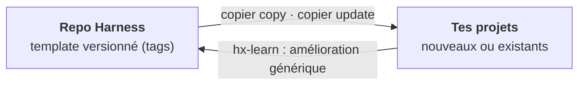

# Harness — Plan directeur

> **Statut** : proposition v0.2 · 2026-10-17
> **Nature** : un **template personnel**. On y garde sa configuration d'agents IA, puis on l'applique à chaque projet (nouveau ou existant) et on la met à jour depuis ce repo.
> **Base** : OpenSpec 1.14.x (workflow OPSX) · état de l'art → [`research/etat-de-l-art-2026-10.md`](research/etat-de-l-art-2026-10.md)

---

## 0. En bref

| | |
|---|---|
| **Quoi** | Un template qui installe dans un projet une couche de *harness* autour d'OpenSpec : skills, agents, rules, hooks et contrôles CI. |
| **Agnostique de** | l'outil IA (Claude Code, Copilot, Cursor, Codex…), la stack, la CI. Ce sont des **questions posées à l'installation**. |
| **Moteur** | [Copier](https://copier.readthedocs.io) : génération **et mise à jour** des projets par fusion à 3 voies (`copier update`). |
| **Règle d'or** | Les fichiers sont versionnés **dans le projet**. Tout contrôle existe en CI ; les hooks locaux ne font qu'accélérer le retour. |
| **Anti-lourdeur** | Pistes S / M / L : un petit correctif n'a pas besoin de spec. |



La boucle est simple. On améliore un skill dans un projet, on le remonte dans Harness, on crée un tag, puis `copier update` le propage dans tous les projets.

---

## 1. Usage cible

| Situation | Commande |
|---|---|
| Nouveau projet | `uvx copier copy --trust gh:PatayEnCroute/Harness mon-projet` |
| Projet existant | `uvx copier copy --trust gh:PatayEnCroute/Harness .` (Copier signale les conflits) |
| Mettre à jour | `uvx copier update --trust` (fusion à 3 voies, tes modifications locales sont conservées) |
| Ajouter un outil IA ou changer de CI | `uvx copier update --trust` en changeant la réponse concernée |
| Vérifier un projet | `node .harness/bin/hx.mjs check` |

> `--trust` est nécessaire parce que le template exécute des tâches après génération (`openspec init`, synchronisation). Python n'est requis **qu'à l'installation et à la mise à jour** : le projet, lui, n'en dépend pas.

### Non-objectifs

- ❌ Forker OpenSpec ou modifier ses skills `openspec-*` (ils sont réécrits par `openspec update`).
- ❌ Marketplace, gouvernance multi-équipes, pipeline de release : c'est une config personnelle.
- ❌ Un catalogue pléthorique : **peu de composants, mesurés, élagués**.
- ❌ Une spec pour un correctif d'une ligne.

---

## 2. Principes directeurs

| # | Principe | Tiré de | Conséquence concrète |
|---|---|---|---|
| P1 | **Standards d'abord** | AGENTS.md (AAIF), Agent Skills | Les fichiers canoniques sont aux emplacements standard ; le reste est généré. |
| P2 | **OpenSpec = registre de l'intention** | OpenSpec `config.yaml`, contrat JSON | On l'étend sans le forker : `config.yaml`, skills voisins, clés `x-*`, CI. |
| P3 | **Contrôles déterministes > prose** | Böckeler, OpenAI | Une règle importante devient un lint, un test ou un check. |
| P4 | **Le contexte est un budget** | Anthropic, étude ETH | AGENTS.md = une carte (≤ 100 lignes). Rules ciblées par chemin. |
| P5 | **Qui produit n'évalue pas** | Anthropic, superpowers | Les reviewers sont des sous-agents indépendants. |
| P6 | **Pas de « terminé » sans preuve** | superpowers | `hx-verify` exige une sortie de commande fraîche. |
| P7 | **Processus proportionné** | critiques du SDD (Böckeler, Marmelab) | Pistes S/M/L. |
| P8 | **Boucle de pilotage** | Hashimoto, Compound Engineering | Une erreur récurrente devient une rule, un contrôle ou un skill, remonté dans Harness. |
| P9 | **Élaguer** | Anthropic (mars 2026) | Un composant sans gain mesurable est retiré. |

---

## 3. Architecture

### 3.1 Pourquoi Copier

| Option | Nouveau projet | Projet existant | Mises à jour | Choix par outil / CI | Dépendance |
|---|---|---|---|---|---|
| Template GitHub (« Use this template ») | ✅ | ❌ | ❌ | ❌ | aucune |
| **Copier** | ✅ | ✅ | ✅ fusion 3 voies | ✅ questions + Jinja | Python (uvx), à l'install seulement |
| Script Node maison | ✅ | ✅ | ⚠️ écrasement | ✅ | Node |
| `npx skills` / plugins | skills seulement | skills seulement | ✅ | partiel | Node |

Le vrai problème d'un template personnel, c'est **la mise à jour** des projets déjà générés. Copier le résout nativement. Les versions sont des tags git du repo Harness.

### 3.2 Format canonique dans le projet

Les fichiers canoniques sont aux **emplacements standard** ou au **format Claude**, lu de fait par plusieurs outils. Le script `.harness/bin/sync.mjs` ne génère que ce qui manque pour les outils choisis.

| Type | Fichier canonique | Déjà lu nativement par | Généré seulement si l'outil est choisi |
|---|---|---|---|
| Instructions | `AGENTS.md` | Copilot, Cursor, Codex, Gemini, OpenCode | `CLAUDE.md` → `@AGENTS.md` |
| Skills | `.agents/skills/hx-*` | Codex, Cursor, Copilot, OpenCode, Gemini | `.claude/skills/` (copie : Claude Code ne lit pas `.agents/`) |
| Agents | `.claude/agents/hx-*.md` | Claude Code, VS Code / Copilot, Cursor | `.github/agents/*.agent.md`, `.codex/agents/*.toml`, `.opencode/agents/` |
| Rules ciblées | `.claude/rules/*.md` (`paths:`) | Claude Code, VS Code | `.cursor/rules/*.mdc`, `.github/instructions/*.instructions.md` |
| Hooks | `.claude/settings.json` → scripts `.harness/hooks/*.mjs` | Claude Code (et partiellement Copilot CLI, Cursor, Codex) | `.cursor/hooks.json`, `.github/hooks/*.json` |
| OpenSpec | `openspec/config.yaml` | OpenSpec | skills `openspec-*` via `openspec init` |

> **Copie, pas lien symbolique** (Windows). Tous les fichiers générés sont **commités** : les collègues, la CI et les agents cloud les voient. `hx check` détecte une dérive entre source et copie.

### 3.3 Questions du template (`copier.yml`)

```yaml
_subdirectory: template
_min_copier_version: "9.10"
tools:          # multiselect
  choices: [claude-code, copilot, cursor, codex, opencode, gemini]
  default: [claude-code, copilot]
stack:          # préréglages du contrat de commandes + pack de rules
  choices: [dotnet, node-ts, python, java, autre]
ci:
  choices: [github, azure, gitlab, aucune]
openspec_version: "1.14.3"   # épinglée
_tasks:         # après copy ET update
  - node .harness/bin/sync.mjs      # lance openspec init/update + génère les cibles
```

### 3.4 Contrat de commandes (`.harness/config.yaml`)

Pré-rempli selon `stack`, puis ajusté à la main. Les skills n'appellent **jamais** `dotnet test` ou `npm test` : ils passent par `hx run test`. C'est ce qui les rend indépendants de la stack.

```yaml
commands:
  test:      dotnet test
  test-file: dotnet test --filter {file}
  lint:      dotnet format --verify-no-changes
  typecheck: dotnet build -warnaserror
tracks:
  S: { spec: false }
  M: { spec: true, design: optional }
  L: { spec: true, design: required, adr: required }
```

### 3.5 Points d'accroche OpenSpec

| Point d'extension | Usage |
|---|---|
| `config.yaml › context` | Renvoi vers AGENTS.md et le contrat de commandes |
| `config.yaml › rules.<artefact>` | Règles d'écriture : proposal (piste, non-objectifs), specs (scénarios testables), tasks (2–5 min, test d'abord) |
| `operations.apply.guidance` | Renvoie vers `hx-implement` / `hx-tdd` |
| `.openspec.yaml › x-*` | `x-track: M`, `x-ticket: …` |
| CLI `--json` (`status`, `instructions`, `validate`) | Seule interface utilisée par les scripts `hx` |
| Schéma custom | **Pas en v1** : pas d'héritage de schéma (#778), un fork serait à maintenir |

---

## 4. Workflow


| Piste | Quand | Artefacts OpenSpec | Contrôles |
|---|---|---|---|
| **S** | Diff descriptible en une phrase, aucun comportement spécifié ne change | aucun | tests + lint + review |
| **M** | Fonctionnalité ou changement de comportement | proposal + delta specs + tasks | + `validate --strict` + traçabilité |
| **L** | Archi, contrat d'API, migration | + `design.md` + ADR | + relecture humaine du design **avant** l'implémentation |

> **Dégradation gracieuse** : un outil sans sous-agents exécute les mêmes skills en séquentiel.

---

## 5. Catalogue

**MVP** = phase 1 · **v1** = phase 2 · **v2** = phase 3.

### Skills (`.agents/skills/hx-*`)

| Skill | Rôle | Prio |
|---|---|---|
| `hx-triage` | Classer la demande en S/M/L et l'orienter | MVP |
| `hx-tdd` | Rouge → vert → refactor, avec preuve | MVP |
| `hx-implement` | Boucle sur `tasks.md` : une tâche = un sous-agent, puis review de conformité | MVP |
| `hx-verify` | Aucune déclaration de fin sans preuve fraîche | MVP |
| `hx-review` | Reviewers en parallèle, filtre des faux positifs | MVP |
| `hx-ship` | PR liée au change, suivi de la CI | MVP |
| `hx-clarify` | Entretien ciblé (≤ 5 questions) avant la proposition | v1 |
| `hx-debug` | Reproduire → isoler → corriger → test de non-régression | v1 |
| `hx-adr` | Rédiger un ADR (piste L) | v1 |
| `hx-learn` | Capitaliser : leçon locale (`docs/learnings/`) ou amélioration à remonter dans Harness | v1 |
| `hx-discover` | Brownfield : dériver des specs de base depuis le code | v2 |

### Agents (`.claude/agents/hx-*.md`)

| Agent | Rôle | Capacités | Niveau de modèle |
|---|---|---|---|
| `hx-explorer` | Cartographier le code et l'impact | lecture seule | rapide |
| `hx-implementer` | Réaliser **une** tâche en TDD | lecture, écriture, shell | standard |
| `hx-spec-reviewer` | Le code respecte-t-il les scénarios des specs ? | lecture seule | standard |
| `hx-code-reviewer` | Qualité, conventions, simplicité | lecture seule | standard |
| `hx-verifier` (v1) | Exécuter et prouver : tests, app | lecture, shell | standard |
| `hx-security-reviewer` (v1) | Secrets, injection, dépendances | lecture seule | puissant |
| `hx-architect` (v2) | 2–3 options de design avec compromis | lecture seule | puissant |

### Rules

| Rule | Portée | Contenu |
|---|---|---|
| `AGENTS.md` | toujours | Carte du repo, contrat de commandes, workflow, principes. ≤ 100 lignes, avec une section projet libre. |
| `openspec-authoring` | `openspec/**` | SHALL/MUST, scénarios WHEN/THEN testables, concision |
| `testing` | fichiers de test | Nommage, tag de traçabilité `@scenario` |
| Pack stack | globs de la stack | Idiomes et pièges (`dotnet`, `node-ts`…) |

### Hooks

| Événement | Action |
|---|---|
| `SessionStart` | Résumé `openspec status --json` (le change actif est dans le contexte) |
| `PreToolUse` (écriture) | **Bloque** les écritures dans `openspec/specs/**` : les specs ne changent que par archive |
| `PostToolUse` (édition) | Lint du fichier modifié |
| `Stop` | `hx check --fast` si un change est actif |

### Contrôles (`hx check`, identiques en local et en CI)

| Contrôle | Vérifie |
|---|---|
| `openspec validate --all --strict` | Structure des specs et des changes |
| `hx run test / lint / typecheck` | Contrat de commandes |
| `hx trace` (v1) | Chaque scénario ADDED/MODIFIED a ≥ 1 test tagué `@scenario` ; aucun tag orphelin |
| `tasks-complete` | `tasks.md` complet avant l'archive |
| `track-policy` | Piste L → `design.md` et ADR présents |
| `sync-drift` | Fichiers générés = source |

---

## 6. Structure

<table><tr><td>

**Repo Harness**

```
Harness/
├── copier.yml
├── template/            # ce qui atterrit
│   │                    # dans le projet
│   ├── AGENTS.md.jinja
│   ├── .agents/skills/hx-*/
│   ├── .claude/
│   │   ├── agents/  rules/
│   │   └── settings.json.jinja
│   ├── .harness/
│   │   ├── config.yaml.jinja
│   │   ├── bin/     # hx.mjs, sync.mjs
│   │   └── hooks/
│   ├── openspec/config.yaml.jinja
│   └── {{ci}}/…     # gabarit CI
├── packs/<stack>/       # rules + presets
├── tests/               # copy + update sur
│                        # projets fixtures
└── docs/                # PLAN, ADR, research
```

</td><td>

**Projet après `copier copy`**

```
mon-projet/
├── .copier-answers.yml  # version + réponses
├── AGENTS.md
├── CLAUDE.md            # @AGENTS.md
├── .agents/skills/      # hx-* + openspec-*
├── .claude/             # agents, rules,
│                        # skills (copie), hooks
├── .github/ .cursor/ …  # selon `tools`
├── .harness/
│   ├── config.yaml      # contrat de commandes
│   ├── bin/
│   └── hooks/
├── openspec/
│   ├── config.yaml
│   ├── specs/
│   └── changes/
└── docs/
    ├── adr/
    └── learnings/
```

</td></tr></table>

Les scripts `hx` sont en JavaScript (`.mjs`), sans dépendance : OpenSpec impose déjà Node ≥ 20.19.

---

## 7. Qualité du template

| Test (CI du repo Harness) | Vérifie |
|---|---|
| `copier copy` sur un dossier vide **et** sur un projet fixture existant, pour chaque combinaison principale d'outils | Génération correcte, `hx check` vert |
| `copier update` du tag précédent vers le tag courant, sur une fixture modifiée localement | Les mises à jour ne cassent rien et conservent les modifications locales |
| Golden files de `sync.mjs` | Chaque format d'outil est conforme |
| `skills-ref validate` + budgets (SKILL.md < 500 lignes, AGENTS.md ≤ 100) | Respect du standard et du budget de contexte |
| Contrat `--json` d'OpenSpec sur la version épinglée | Pas de casse silencieuse lors d'une montée de version |
| Evals des skills clés (v1) : tâche sur une fixture, puis vérification déterministe | Le skill apporte un gain réel (principe P9) |

---

## 8. Roadmap

| Phase | Durée indicative | Livrables | Terminé quand |
|---|---|---|---|
| **P0 Socle** | ~1 sem. | `copier.yml`, squelette `template/`, AGENTS.md, `openspec/config.yaml`, `.harness/config.yaml`, `sync.mjs` pour les outils prioritaires, CI du template | `copier copy` (projet vide et existant) puis `copier update` fonctionnent |
| **P1 Boucle de base** | ~2 sem. | 6 skills MVP, 4 agents, hooks, `hx check` / `hx run`, gabarit CI | 3 changes M menés de bout en bout sur un vrai projet |
| **P2 Qualité** | ~2 sem. | `hx trace`, `hx-verifier`, `hx-security-reviewer`, `hx-debug` / `hx-clarify` / `hx-adr` / `hx-learn`, evals | Traçabilité ≥ 80 % sur le projet pilote, evals vertes |
| **P3 Extensions** | au fil de l'eau | Packs de stack, `hx-discover`, outils supplémentaires, revue d'élagage | Selon les besoins |

---

## 9. Risques

| Risque | Mitigation |
|---|---|
| OpenSpec évolue vite (une release par semaine, commandes remplacées par des skills, #2022) | Version épinglée dans le template, tests de contrat `--json`, nos skills appellent la CLI et pas les commandes `/opsx:*` |
| Les formats des outils changent (Windsurf → Devin, Gemini → Antigravity) | Génération isolée dans `sync.mjs`, golden files ; la priorité aux standards limite la surface |
| Conflits lors de `copier update` | Contenu propre au projet dans des sections ou fichiers dédiés (`_skip_if_exists`) ; fichiers gérés aussi petits que possible |
| Projets qui ne se mettent plus à jour | La version est visible dans `.copier-answers.yml` ; `hx doctor` signale un template en retard |
| Lourdeur | Pistes S/M/L ; élaguer ce qui ne sert pas |

---

## 10. Décisions à prendre

| # | Question | Recommandation |
|---|---|---|
| 1 | Quels outils IA utilises-tu au quotidien ? Ils seront prioritaires au MVP. | Claude Code + Copilot, les autres en option |
| 2 | Copier (Python via `uvx`, seulement à l'install et à la mise à jour) te convient-il ? | Oui : c'est le seul choix qui gère les mises à jour proprement |
| 3 | Tes projets sont-ils solo ou partagés ? | Fichiers commités dans le projet dans les deux cas. En solo, on pourra ajouter une installation au niveau utilisateur (`~/.claude`, `~/.agents`) en P3. |
| 4 | Quelle CI pour tes projets ? | Les gabarits GitHub Actions et Azure Pipelines sont sélectionnables |
| 5 | Quelles stacks principales ? | Elles déterminent les premiers packs et les préréglages de commandes |
| 6 | Archive OpenSpec : dans la PR ou après le merge ? | Dernier commit de la PR : `main` a toujours un code et des specs cohérents |
