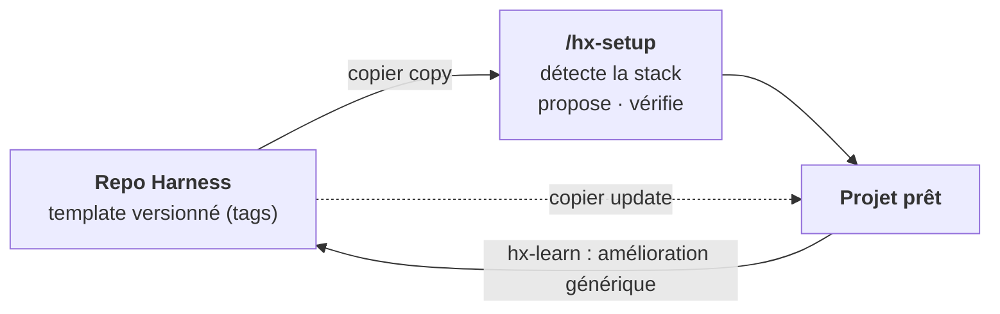
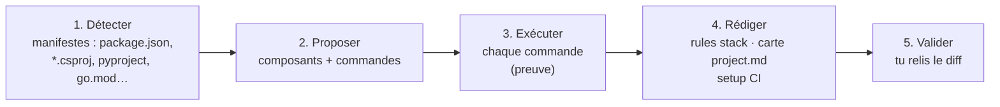
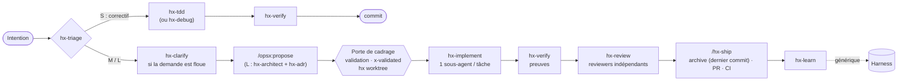
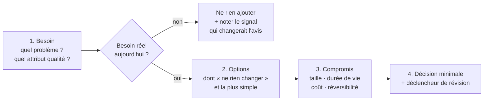

# Harness — Plan directeur

> **Statut** : **phases 0 à 6 livrées, éprouvées sur un vrai projet** (§9). Version courante : dernier tag du dépôt ; historique : [`CHANGELOG.md`](../CHANGELOG.md).
> **Nature** : un **template personnel**. On y garde sa configuration Claude Code, on l'applique à chaque projet (nouveau ou existant), puis on la met à jour depuis ce repo.
> **Cadre** : Claude Code · projets solo · GitHub Actions · **agnostique de la stack** · OpenSpec 1.14.x (OPSX)
> **État de l'art** → [`research/etat-de-l-art-2026-10.md`](research/etat-de-l-art-2026-10.md)

---

## 0. En bref

| | |
|---|---|
| **Quoi** | Un template qui installe dans un projet une couche de *harness* autour d'OpenSpec : skills, agents, rules, hooks, contrôles CI. |
| **Agnostique de la stack** | Tout ce qui est générique ne connaît pas la stack. Le spécifique tient dans **quelques fichiers isolés**, remplis à l'intégration par le skill `/hx-setup`. |
| **Moteur** | [Copier](https://copier.readthedocs.io) : installation **et mise à jour** des projets par fusion à 3 voies. |
| **Règle d'or** | Tout contrôle existe en CI ; les hooks locaux ne font qu'accélérer le retour. |
| **Anti-lourdeur** | Pistes S / M / L : un petit correctif n'a pas besoin de spec. |



---

## 1. Usage cible

| Étape | Commande | Durée visée |
|---|---|---|
| 1. Installer | `npx github:PatayEnCroute/Harness` (projet nouveau ou existant) : vérifie git, installe uv au besoin, lance Copier, ouvre Claude Code. Ou par un agent, qui suit [`INSTALL.md`](../INSTALL.md) | 1 min |
| 2. Personnaliser pour la stack | `/hx-setup`, ouvert par le lanceur : il détecte, propose, **exécute chaque commande pour la vérifier**, établit le profil d'architecture, tu valides, et il finit par `hx doctor` | 10–20 min |
| Mettre à jour plus tard | `uvx copier@9.19.1 update --trust` (tes personnalisations sont conservées) | 1 min |

> `--trust` autorise les tâches post-génération : `openspec init` à l'installation, `openspec update` et `hx migrate` à chaque mise à jour. Python (via `uv`) n'est requis **qu'à l'installation et à la mise à jour**.

### Non-objectifs

- ❌ Forker OpenSpec ou modifier ses skills `openspec-*` (ils sont réécrits par `openspec update`).
- ❌ Supporter d'autres outils IA que Claude Code ([ADR-002](adr/002-claude-code-seul-standards-gratuits.md) ; risque et porte de sortie : §10).
- ❌ Des « packs » de stack préfabriqués : la personnalisation est **assistée**, pas précâblée.
- ❌ Une spec pour un correctif d'une ligne.

---

## 2. Principes directeurs

| # | Principe | Tiré de | Conséquence concrète |
|---|---|---|---|
| P1 | **Générique / spécifique séparés** | Böckeler (*harness templates*) | Les skills, agents et hooks n'écrivent jamais `npm` ou `dotnet` : ils passent par `hx run <commande>`. |
| P2 | **OpenSpec = registre de l'intention** | OpenSpec `config.yaml`, contrat JSON | On l'étend sans le forker : `config.yaml`, skills voisins, clés `x-*`, CI. |
| P3 | **Contrôles déterministes > prose** | Böckeler, OpenAI | Une règle importante devient un lint, un test ou un check. |
| P4 | **Le contexte est un budget** | Anthropic, étude ETH | `CLAUDE.md` = une carte (≤ 100 lignes). Rules ciblées par chemin. |
| P5 | **Qui produit n'évalue pas** | Anthropic, superpowers | Les reviewers sont des sous-agents indépendants. |
| P6 | **Pas de « terminé » sans preuve** | superpowers | `hx-verify` exige une sortie de commande fraîche. |
| P7 | **Processus proportionné** | critiques du SDD (Böckeler, Marmelab) | Pistes S/M/L. |
| P8 | **Boucle de pilotage** | Hashimoto, Compound Engineering | Une erreur récurrente devient une rule, un contrôle ou un skill, remonté dans Harness. |
| P9 | **Élaguer** | Anthropic (mars 2026) | Un composant sans gain mesurable est retiré. |
| P10 | **Architecture proportionnée au besoin** | Clean Architecture, Vertical Slices, YAGNI | Feature-first par défaut ; on ajoute une couche seulement pour un besoin nommé (§5). |
| P11 | **Standard quand c'est gratuit** | Agent Skills | Les skills respectent la spec `SKILL.md` : ils restent portables vers un autre outil sans effort. |

---

## 3. Architecture du harness

### 3.1 Générique vs spécifique à la stack

C'est le cœur de l'agnosticité.

| | **Générique** (vient du template, mis à jour par `copier update`) | **Spécifique** (personnalisé à l'intégration par `/hx-setup`) |
|---|---|---|
| Fichiers | `CLAUDE.md`, `.claude/skills/hx-*`, `.claude/agents/hx-*`, `.claude/rules/{openspec,testing,architecture}.md`, `.claude/settings.json`, `.harness/hx.mjs`, `.harness/hooks.mjs`, `.harness/config.schema.json`, `.harness/versions.json`, `openspec/config.yaml`, `.github/workflows/hx-check.yml` | `.harness/config.json` (commandes, profil d'architecture, trace), `.harness/project.md` (carte, importée par `CLAUDE.md`), `.claude/rules/stack-*.md`, `.harness/ci/setup/action.yml` (outillage CI), `.github/dependabot.yml`, `.github/CODEOWNERS`, configuration `arch` |
| Change… | quand le Harness s'améliore | une seule fois par projet, puis rarement |
| Conflits `copier update` | gérés par la fusion à 3 voies | **aucun** : fichiers créés par `/hx-setup`, absents du template ou marqués `_skip_if_exists` |

### 3.2 Contrat de commandes (`.harness/config.json`)

C'est la seule interface entre le harness et la stack. Il gère aussi les projets **multi-stack** par composants. Chaque commande s'exécute **dans le dossier du composant**. Un schéma JSON (`config.schema.json`) fournit l'autocomplétion dans l'éditeur.

```jsonc
{
  "version": 1,
  "components": {                       // un seul composant pour un projet mono-stack
    "api": {
      "path": "src/Api", "stack": "dotnet",
      "commands": {
        "setup": "dotnet restore",
        "test": "dotnet test",
        "lint": "dotnet format --verify-no-changes",
        "arch": "dotnet test ../../tests/Architecture"   // règles de dépendance (v1)
      }
    },
    "web": {
      "path": "web", "stack": "node",
      "commands": {
        "setup": "npm ci",
        "test": "npm run test",
        "test-file": "npx vitest run {file}",          // {file} : relatif au composant
        "lint": "npm run lint",
        "typecheck": "npm run typecheck"
      }
    }
  },
  "architecture": {                     // voir §5
    "style": "feature-first",
    "level": 1,                         // niveau par défaut du projet
    "features": { "facturation": 2 },   // écarts justifiés par le besoin
    "profile": { "size": "small", "lifespan": "long", "domain_complexity": "medium" }
  },
  "tracks": { "S": { "spec": false }, "M": { "spec": true, "design": "optional" }, "L": { "spec": true, "design": "required", "adr": "required" } }
}
```

> Format JSON plutôt que YAML : `hx` n'a aucune dépendance, et Node lit le JSON nativement.

| Appel | Effet |
|---|---|
| `hx detect [--write]` | Propose les composants et commandes à partir des manifestes (point de départ déterministe de `/hx-setup`) |
| `hx run test` | Lance `test` sur tous les composants |
| `hx run lint --file web/src/app.ts` | Choisit le composant d'après le chemin du fichier (code 3 si aucun composant ne définit la commande) |
| `hx check [--fast]` | Contrat validé, puis validate OpenSpec + archives + pistes + trace + lint + typecheck + arch + test (`--fast` : validate OpenSpec + lint + typecheck). **Jamais vert sans test exécuté** |
| `hx trace [--json]` | Scénarios OpenSpec ↔ tests tagués `@scenario` |
| `hx doctor` | Installation saine (fichiers, versions, `settings.json` lisible et hooks câblés, aucun reste de conflit de fusion dans les fichiers du harness, fichiers principaux non ignorés par git, retard sur le dernier tag) et les commandes `lint`, `typecheck`, `build`, `arch`, `test` **passent** |
| `hx migrate` | Ajoute à `config.json` les clés nouvelles du template, sans rien remplacer (lancé par `copier update`) |
| `hx worktree <change>` | Branche et worktree frère pour le run d'un change validé ; y déplace et commite le change (et ses ADR) s'il n'est pas encore suivi ; affiche la commande qui lance le run |
| `hx openspec <args>` | Appelle la version épinglée d'OpenSpec, télémétrie coupée |

### 3.3 `/hx-setup` : la personnalisation assistée



- **Projet existant** : les rules de stack sont déduites des conventions observées dans le code (nommage, structure, frameworks de test).
- **Projet neuf** : on part de conventions par défaut, dont tu choisis la stack.
- On peut le relancer à tout moment, par exemple pour ajouter un composant à la stack.

### 3.4 Pourquoi Copier

Copier installe dans un projet nouveau ou existant, met à jour par fusion à 3 voies et fonctionne en session cloud, car les fichiers sont commités dans le projet ([ADR-001](adr/001-copier-moteur-de-template.md)). Un plugin utilisateur en complément n'est pas retenu ([ADR-003](adr/003-plugin-utilisateur-non-retenu.md)).

`copier.yml` reste minimal (extrait ; la source fait foi) :

```yaml
_subdirectory: template
_exclude: [".github/workflows", ".github/CODEOWNERS", …]
_skip_if_exists: [.harness/config.json, .harness/project.md, .harness/ci/setup/action.yml, .github/dependabot.yml, .github/CODEOWNERS]
_tasks:                                   # OpenSpec épinglé, télémétrie coupée
  - command: node .harness/hx.mjs openspec init --tools claude .
    when: "{{ _copier_operation == 'copy' }}"
  - command: node .harness/hx.mjs openspec update .
    when: "{{ _copier_operation == 'update' }}"
  - command: node .harness/hx.mjs migrate # clés nouvelles ajoutées à config.json
    when: "{{ _copier_operation == 'update' }}"
project_name: { type: str, default: "{{ _folder_name }}" }
ci: { type: bool, default: true }         # workflow GitHub Actions hx-check
default_branch: { type: str, default: main, when: "{{ ci }}" }
codeowners: { type: str, default: "" }    # relecteurs obligatoires du harness et des specs
openspec_version: { type: str, default: "1.14.3", when: false }   # calculée : copier update la propage (ADR-004)
```

### 3.5 Points d'accroche OpenSpec

| Point d'extension | Usage |
|---|---|
| `config.yaml › context` | Renvoi vers `CLAUDE.md` et le contrat de commandes |
| `config.yaml › rules.<artefact>` | Règles d'écriture : proposal (piste, non-objectifs), specs (scénarios testables), design (besoin d'abord, niveau visé, options : §5), tasks (2–5 min, test d'abord) |
| `operations.apply.guidance` | Renvoie vers `hx-implement` / `hx-tdd` |
| `.openspec.yaml › x-*` | `x-track: M` (piste), `x-validated: AAAA-MM-JJ` (porte de cadrage passée) |
| Markdown d'OpenSpec (specs, deltas, `tasks.md`, `.openspec.yaml`) | Lu directement par `hx trace`, le contrôle des pistes et les hooks : rapide, hors ligne |
| CLI `--json` (`list`, `instructions apply`, `validate`) | Utilisée par les skills ; chaque hypothèse est vérifiée par `tests/openspec-contract.test.mjs` |
| Schéma custom | **Pas en v1** : pas d'héritage de schéma (#778), un fork serait à maintenir |

---

## 4. Workflow



> **Cadrage, run, livraison.** En M et L, l'utilisateur cadre jusqu'à la porte, le seul arrêt prévu. C'est là qu'il vérifie que la spec dit ce qu'il a demandé (`x-validated` dans `.openspec.yaml`). Le run (`hx-implement` → `hx-verify` → `hx-review`) se fait ensuite sans lui, dans le worktree du change : il ne s'arrête que sur un blocage listé par `hx-implement` et finit par un rapport de fin de run (hypothèses à confirmer, revue, mineurs). La décision de l'utilisateur sur les mineurs précède l'archive, pour qu'elle reste le dernier commit. Pendant ce temps, le dossier principal reste libre pour cadrer le change suivant : `trace` et `pistes` portent sur tous les changes d'un dossier, donc deux changes dans le même dossier se gêneraient.
>
> Les critères de piste ne vivent que dans le skill `hx-triage`. Il lance `hx-explorer` quand l'impact n'est pas évident. Sur un projet existant sans specs, `hx-discover` dérive d'abord des specs de base depuis le code.

| Piste | Quand | Artefacts OpenSpec | Contrôles |
|---|---|---|---|
| **S** | Diff descriptible en une phrase, aucun comportement spécifié ne change | aucun | `hx check` (tests, lint…) |
| **M** | Fonctionnalité ou changement de comportement | proposal + delta specs + tasks | + `validate --strict` + traçabilité |
| **L** | Archi, contrat d'API, migration | + `design.md` + ADR | + design et ADR validés à la porte de cadrage, **avant** le run |

---

## 5. Architecture des projets

> **Orientation** : **feature-first** (le code est rangé par fonctionnalité, pas par couche technique) avec la **règle de dépendance de la Clean Architecture** (le métier ne dépend ni du framework ni des I/O). Les deux s'appliquent **au niveau que le besoin justifie, pas plus**.

### 5.1 Le besoin d'abord

Toute proposition de `hx-architect` suit cet ordre. Elle s'arrête dès qu'il n'y a pas de besoin réel.



| Règle de l'architecte | Exemple |
|---|---|
| **Pas de besoin, pas de couche** : toute abstraction cite le besoin qu'elle sert | « Port `PaymentGateway` : tester sans appeler le prestataire, et un 2ᵉ prestataire est prévu » |
| Toujours présenter « ne rien changer » et l'option la plus simple | Avant d'introduire un bus de messages : un simple appel de fonction suffit-il ? |
| Proposer le **niveau minimal** qui couvre le besoin, et le **signal** qui ferait passer au niveau suivant | « Niveau 1. On passera au niveau 2 pour *facturation* si les règles de remise se multiplient. » |
| Distinguer les décisions **réversibles** des **portes à sens unique** | Sens unique : schéma de données, contrat d'API publique, découpage en services. Ce sont elles qui méritent un ADR. |
| Aucun pattern par réflexe | CQRS, event sourcing, microservices, repository générique, mapper partout : seulement avec un besoin nommé |

### 5.2 Échelle de niveaux

| Niveau | Forme | Signaux qui le justifient | Coût |
|---|---|---|---|
| **0 · Simple** | Un module, sans découpage | Script, POC, outil jetable | nul |
| **1 · Feature-first** *(défaut)* | Un dossier par feature contenant la tranche verticale complète (entrée, logique, accès aux données, tests). Pas d'abstraction. | La plupart des projets solo | faible |
| **2 · Feature + domaine isolé** | Dans les features concernées : un domaine pur, plus des ports et adaptateurs **seulement aux frontières qui en ont besoin** | Règles métier non triviales ; I/O externe à isoler pour tester ; plusieurs points d'entrée (API, CLI, jobs) qui partagent la logique | moyen |
| **3 · Monolithe modulaire clean** | Modules (sous-domaines) avec contrats publics explicites ; règle de dépendance testée ; ports et adaptateurs systématiques | Plusieurs sous-domaines, longue durée de vie, changements fréquents et indépendants | élevé |
| *4 · Distribué* | Services séparés | Besoin **prouvé** de déploiement ou de scalabilité indépendants : quasi jamais en solo | très élevé |

> **Le niveau se décide par feature.** Un projet en niveau 1 peut avoir une seule feature en niveau 2 si son métier le justifie. On monte de niveau sur un signal observé, jamais par anticipation.

### 5.3 Forme du code (agnostique de la stack)

```
src/
├── features/
│   ├── facturation/            # niveau 2 : le métier le justifie
│   │   ├── creer-facture/      # tranche : entrée + logique + tests
│   │   ├── domain/             # règles pures, aucune dépendance externe
│   │   └── adapters/           # BDD, API externes (implémentent des ports)
│   └── clients/                # niveau 1 : tranches simples
│       └── lister-clients/
├── shared/                     # noyau minimal et nommé (pas de « utils » fourre-tout)
└── app/                        # composition : injection, routes, config
```

| Règle de dépendance | Vérifiée par |
|---|---|
| Une feature n'importe jamais les **internes** d'une autre, seulement son contrat public | `hx run arch` + `hx-code-reviewer` |
| `domain/` ne dépend ni du framework, ni des I/O, ni de `adapters/` | `hx run arch` |
| `app/` compose ; aucune feature ne dépend de `app/` | `hx run arch` |
| `shared/` ne dépend d'aucune feature | `hx run arch` |

### 5.4 Où ça vit dans le harness

| Élément | Rôle |
|---|---|
| `.harness/config.json › architecture` | Niveau du projet, niveaux par feature, profil (taille, durée de vie, complexité métier). Rempli par `/hx-setup`, revu par `hx-architect`. |
| `.claude/rules/architecture.md` | Forme du code, règle de dépendance, « pas de besoin, pas de couche » ; chargée sur les fichiers source |
| `hx-architect` (agent) | Analyse besoin → options → décision. Appelé en piste L, par `/hx-setup` sur un projet neuf dont le besoin dépasse le niveau 1, et quand un signal de changement de niveau apparaît. |
| `hx-adr` (skill) | Gabarit ADR « besoin d'abord » (ci-dessous) |
| `openspec/config.yaml › rules.design` | `design.md` commence par le besoin, indique le niveau visé et liste les options |
| `hx-code-reviewer` | Signale la **sur-ingénierie** (abstraction sans besoin cité) autant que les **violations** de la règle de dépendance |
| `hx run arch` (v1) | Règles de dépendance testées, configurées par `/hx-setup` selon la stack : dependency-cruiser (TS), import-linter (Python), NetArchTest / ArchUnitNET (.NET), go-arch-lint (Go), ArchUnit (Java)… |

**Gabarit ADR** (`docs/adr/NNN-titre.md`) :

```markdown
# ADR-NNN : <décision>
## Besoin          ← en premier : quel problème, pour qui, quel attribut qualité
## Contexte        ← taille du projet, niveau actuel, contraintes
## Options         ← dont « ne rien changer » et la plus simple
## Décision        ← le minimum qui couvre le besoin
## Conséquences    ← ce qui devient plus facile / plus difficile, coût
## Révision        ← réversible ou sens unique ; signal qui rouvrira la décision
```

---

## 6. Catalogue

**MVP** = phases 0–1 · **v1** = phase 2 · **v2** = phase 3. **Tout le catalogue est livré** ; la phase 4 a fiabilisé l'existant sans ajouter de composant.

### Skills (`.claude/skills/hx-*`)

| Skill | Rôle | Prio |
|---|---|---|
| `hx-setup` | Personnalisation assistée à la stack (§3.3) | **MVP (P0)** |
| `hx-triage` | Classer la demande en S/M/L et l'orienter ; porte de cadrage (M/L) | MVP |
| `hx-tdd` | Rouge → vert → refactor, avec preuve | MVP |
| `hx-implement` | Boucle sur `tasks.md` : une tâche = un sous-agent, puis review de conformité ; exige `x-validated`, enchaîne le run sans rendre la main | MVP |
| `hx-verify` | Aucune déclaration de fin sans preuve fraîche | MVP |
| `hx-review` | Reviewers en parallèle, filtre des faux positifs, rapport de fin de run | MVP |
| `hx-ship` | PR liée au change, suivi de la CI | MVP |
| `hx-clarify` | Entretien ciblé (≤ 5 questions) avant la proposition | v1 |
| `hx-debug` | Reproduire → isoler → corriger → test de non-régression | v1 |
| `hx-adr` | ADR « besoin d'abord » (§5.4), piste L et portes à sens unique | MVP |
| `hx-learn` | Capitaliser : leçon locale (`docs/learnings/`) ou amélioration à remonter dans Harness | v1 |
| `hx-discover` | Brownfield : dériver des specs de base depuis le code | v2 |

### Agents (`.claude/agents/hx-*.md`)

| Agent | Rôle | Outils | Modèle |
|---|---|---|---|
| `hx-explorer` | Cartographier le code et l'impact | lecture + shell | `haiku` |
| `hx-implementer` | Réaliser **une** tâche en TDD | lecture, écriture, shell | session |
| `hx-spec-reviewer` | Le code respecte-t-il les scénarios des specs ? | lecture + shell | session |
| `hx-code-reviewer` | Qualité, conventions, simplicité ; sur-ingénierie et règle de dépendance | lecture + shell | session |
| `hx-verifier` (v1) | Exécuter et prouver : tests, app | lecture + shell | session |
| `hx-security-reviewer` (v1) | Secrets, injection, dépendances | lecture + shell | session |
| `hx-architect` | Décisions besoin d'abord, feature-first, proportionnées à la taille du projet (§5) | lecture + shell | session |

### Rules

| Rule | Portée | Source | Contenu |
|---|---|---|---|
| `CLAUDE.md` | toujours | template | Principes, workflow, contrat de commandes. Importe `.harness/project.md` (carte du repo, remplie par `/hx-setup`). ≤ 100 lignes. |
| `.claude/rules/openspec.md` | `openspec/**` | template | SHALL/MUST, scénarios WHEN/THEN testables, concision |
| `.claude/rules/testing.md` | fichiers de test | template | Tag de traçabilité `@scenario`, un comportement par test |
| `.claude/rules/architecture.md` | fichiers source (extensions des langages courants) | template | Forme feature-first, règle de dépendance, « pas de besoin, pas de couche » |
| `.claude/rules/stack-*.md` | globs de la stack | **`/hx-setup`** | Idiomes, pièges, conventions observées |

### Hooks (`.claude/settings.json` → `.harness/hooks.mjs`)

| Événement | Action |
|---|---|
| `SessionStart` | Changes en cours (piste, état du cadrage, tâches), projet à personnaliser ; en session cloud, installe la CLI openspec épinglée |
| `PreToolUse` (écriture, Bash) | **Demande confirmation** pour `openspec/specs/**` (seuls `/opsx:sync` et `/opsx:archive` y écrivent légitimement : bloquer les casserait) et pour les fichiers qui décident de ce qui s'exécute sans confirmation : `.harness/config.json`, `hx.mjs`, `hooks.mjs`, `versions.json`, `.claude/settings*.json` (en plus, `permissions.deny` refuse Edit sur `hx.mjs`, `hooks.mjs` et `versions.json`). Couvre Edit/Write et les commandes Bash qui écrivent ces chemins : cible d'une redirection, ou segment d'une commande qui écrit (`cp`, `mv`, `sed -i`, `tee`…) ; un chemin seulement lu ou cité dans un message de commit ne compte pas. Confirmation aussi avant le skill `openspec-apply-change`, avec renvoi vers `hx-implement` |
| `PostToolUse` (édition) | `lint-file` si défini, pour rester rapide (arrêté au-delà de 100 s). Contrat cassé → retour à Claude, jamais un silence |
| `Stop` | D'après **git** (donc aussi les écritures faites par Bash, et les fichiers commités pendant la session) : lint + typecheck des seuls composants dont le code a changé depuis le dernier vert de la session (ce qui était modifié au démarrage est ignoré) ; budget de 570 s ; une seule relance (`stop_hook_active`). Signale aussi à l'utilisateur les chemins protégés modifiés, quel que soit l'outil |

> Seul `hx-explorer` fixe son modèle (`haiku` : exploration rapide et peu coûteuse) ; les autres agents héritent du modèle de la session. Le champ `model` se règle par projet.
> « lecture + shell » : pas d'Edit ni de Write ; le shell sert à lancer `hx`, `git diff` et les outils de lecture.

### Contrôles (`hx check`, identiques en local et en GitHub Actions)

| Étape | Vérifie |
|---|---|
| `openspec` | `openspec validate --all --strict` : structure des specs et des changes |
| `archives` | `openspec validate --archived` : toutes les tâches d'un change archivé sont faites |
| `pistes` | `x-track` déclaré sur chaque change en cours (absent → échec) et valide, parmi les pistes de `tracks` ; règles de `tracks` (`spec` → delta spec, `design` → `design.md`, `adr` → ADR cité) ; tout ADR cité existe |
| `trace` | Chaque scénario ADDED/MODIFIED d'un change en cours a un test tagué `@scenario` (seuls les fichiers de test comptent : `trace.test_pattern`) ; couverture des specs principales ≥ `trace.min_coverage` (100 % par défaut) ; aucun tag orphelin |
| `lint` · `typecheck` · `arch` · `test` | Contrat de commandes, par composant |

---

## 7. Structure

<table><tr><td>

**Repo Harness**

```
Harness/
├── bin/harness.mjs     # lanceur npx
├── INSTALL.md          # installation
│                       # par un agent
├── copier.yml
├── template/             # ce qui atterrit
│   │                     # dans le projet
│   ├── CLAUDE.md
│   ├── .claude/
│   │   ├── skills/hx-*/  # 12 skills
│   │   ├── agents/hx-*.md # 7 agents
│   │   ├── rules/        # 3 rules
│   │   └── settings.json # hooks, permissions
│   ├── .harness/
│   │   ├── hx.mjs  hooks.mjs
│   │   ├── config.json   # squelette
│   │   ├── config.schema.json
│   │   ├── versions.json.jinja
│   │   ├── project.md.jinja
│   │   └── ci/setup/     # si ci
│   ├── openspec/config.yaml
│   └── .github/          # si ci
│       ├── workflows/hx-check.yml
│       ├── dependabot.yml
│       └── CODEOWNERS    # si codeowners
├── tests/                # unit, contrat,
│   └── fixtures/         # e2e (5 stacks)
├── evals/                # evals headless
└── docs/                 # PLAN, ADR,
                          # élagage, research
```

</td><td>

**Projet après `copier copy` + `/hx-setup`**

```
mon-projet/
├── .copier-answers.yml   # version du template
├── CLAUDE.md             # générique, importe project.md
├── .claude/
│   ├── skills/           # hx-* + openspec-*
│   ├── agents/
│   ├── rules/            # + stack-*.md
│   └── settings.json     # hooks, permissions
├── .harness/
│   ├── config.json       # ← personnalisé
│   ├── project.md        # ← personnalisé
│   ├── ci/setup/         # ← personnalisé
│   ├── hx.mjs  hooks.mjs
│   └── versions.json  config.schema.json
├── openspec/
│   ├── config.yaml
│   ├── specs/
│   └── changes/
├── .github/              # hx-check.yml, dependabot.yml, CODEOWNERS
└── docs/
    ├── adr/
    └── learnings/
```

</td></tr></table>

Les scripts `hx` sont en JavaScript (`.mjs`), sans dépendance : OpenSpec impose déjà Node ≥ 20.19.

---

## 8. Qualité du template

| Test | Vérifie | Où |
|---|---|---|
| Unitaires `hx` et hooks | Détection, résolution des commandes, trace, pistes, codes de sortie, hooks (confirmation, lint, `Stop`, session) | `npm test`, CI |
| Lint du template | Standard `SKILL.md`, agents en lecture seule sans Edit/Write, rules ciblées, budgets (`CLAUDE.md` ≤ 100 lignes, skills < 500), références `hx-*` existantes, aucun Unicode invisible | `npm test`, CI |
| Contrat OpenSpec | Chaque hypothèse sur la version épinglée : `init`, `.openspec.yaml`, `list` et `instructions apply --json`, archive, `Purpose`, chaque `/opsx:*` cité existe | `npm run test:contract` (réseau), CI |
| E2E multi-stack | `copier copy` → `hx detect` → `doctor` → `check` sur Node, Python, .NET, Go, mixte ; YAML CI valide | CI |
| E2E cycle OpenSpec | Scénario sans test → rouge ; test tagué → vert ; hooks ; archive ; change validé parti dans son worktree, dossier principal vert ; dérive → rouge | CI |
| E2E `copier update` | L'amélioration générique arrive, les personnalisations restent | CI |
| E2E lanceur | `npx` dans un dossier vide (réponses en `--data`, comme un agent), refus d'un arbre sale, d'une réinstallation et d'un terminal absent sans `--defaults`, projet existant avec `--overwrite` | CI |
| Evals comportementales | Un agent headless sur un projet de démo, notation déterministe ; A/B `--without <skill>` pour l'élagage | `evals/run.sh`, en local avec la session Claude Code de l'utilisateur (`claude -p`, sans clé d'API) |

## 9. Roadmap

| Phase | Livrables | Validé par |
|---|---|---|
| **P0 Socle** ✅ | `copier.yml`, `template/`, `hx run / check / doctor / detect / openspec`, `/hx-setup`, fixtures, CI du template | E2E sur 5 stacks ; `copier update` conserve les personnalisations |
| **P1 Boucle de base** ✅ | Skills `hx-triage`, `hx-tdd`, `hx-implement`, `hx-verify`, `hx-review`, `hx-ship`, `hx-adr` ; agents `hx-explorer`, `hx-implementer`, `hx-spec-reviewer`, `hx-code-reviewer`, `hx-architect` ; rules `openspec`, `testing`, `architecture` ; hooks ; workflow `hx-check.yml` + outillage CI ; contrôles pistes et archives | Unitaires (hooks, pistes) ; E2E cycle OpenSpec ; evals `tdd-s`, `implement-m`, `architect`, `setup` |
| **P2 Qualité** ✅ | `hx trace` ; agents `hx-verifier`, `hx-security-reviewer` ; skills `hx-clarify`, `hx-debug`, `hx-learn` ; evals headless + A/B ; lint du template ; contrat OpenSpec | Unitaires ; contrat OpenSpec ; 4/4 evals (une exécution chacune) |
| **P3 Extensions** ✅ | Skill `hx-discover` (brownfield) ; revue d'élagage ([`elagage.md`](elagage.md)) ; ADR 001 à 003 (Copier ; plugin utilisateur et multi-outils non retenus) ; ADR-004 (OpenSpec) en v0.2.0 | Lint du template |
| **P4 Fiabilité** ✅ (v0.3.0) | Correcteurs d'evals sans faux succès et testés ; plus de faux verts (`run --file`, trace vide, délais) ; hook `Stop` fondé sur git ; chemins protégés signalés quel que soit l'outil, `permissions.deny`, `CODEOWNERS` ; prompts sans contradiction ; leçons relues | Unitaires ; contrat OpenSpec ; e2e |
| **P5 Démarrage** ✅ (v0.4.0) | Lanceur `npx github:PatayEnCroute/Harness` (git, uv, Copier, Claude Code sur `/hx-setup`) ; CLI OpenSpec installée au démarrage de session si absente ; `INSTALL.md` pour une installation par un agent | Unitaires ; e2e lanceur |
| **P6 Runs sans interruption** ✅ (v0.5.0) | Porte de cadrage (`x-validated`) ; `hx worktree` ; run enchaîné jusqu'au rapport de fin de run (hypothèses à confirmer) ; git local sans confirmation | Unitaires ; contrat OpenSpec ; e2e cycle OpenSpec |

**Constats faits pendant la réalisation**, désormais encodés dans le harness :

- **Pas de blocage de `openspec/specs/`** : `/opsx:sync` et `/opsx:archive` y écrivent par l'agent. Le hook demande donc une confirmation au lieu de bloquer.
- **`Purpose` d'au moins 50 caractères** pour une nouvelle capability, sinon `validate --strict` refuse la spec après l'archive (rule `openspec` + `config.yaml`).
- **`state` décide, pas `missingPrerequisites`** : `instructions apply` liste `design` comme prérequis même quand il est facultatif. L'eval `implement-m` a révélé ce bug du skill `hx-implement`, corrigé et couvert par le contrat.
- **Jamais de dossier `bin/`** pour les scripts du harness : les `.gitignore` .NET l'ignorent. `hx doctor` vérifie qu'aucun fichier du harness n'est ignoré.

---

## 10. Risques

| Risque | Mitigation |
|---|---|
| OpenSpec évolue vite (une release par semaine, commandes remplacées par des skills, #2022) | Version épinglée et propagée par `copier update`, tests de contrat, critères de sortie ([ADR-004](adr/004-openspec-dependance-centrale.md)) |
| `/hx-setup` se trompe de commande | Il **exécute** chaque commande avant de l'écrire, puis tu relis le diff ; `hx doctor` revérifie |
| Stack exotique ou monorepo complexe | Le contrat accepte n'importe quelle commande shell ; les composants couvrent le multi-stack |
| Conflits lors de `copier update` | Le spécifique vit dans des fichiers hors template (§3.1) ; `hx doctor` détecte marqueurs de conflit et `settings.json` illisible |
| Projets qui ne se mettent plus à jour | `hx doctor` compare `_commit` (`.copier-answers.yml`) au dernier tag du template ; `hx migrate` complète le contrat à chaque update |
| Besoin futur d'un autre outil IA | Skills au standard `SKILL.md` ; ajouter une cible = générer des copies avec un outil de synchronisation (rulesync, APM : voir l'état de l'art) |
| L'architecte sur-conçoit | Besoin d'abord, option la plus simple obligatoire, niveau par feature ; `hx-code-reviewer` signale toute abstraction sans besoin cité |
| Lourdeur | Pistes S/M/L ; élaguer ce qui ne sert pas |
| Le run, sans humain, s'écarte de l'intention | Porte de cadrage : la spec est validée avant tout code ; le run suit la spec ; les choix qu'elle ne tranchait pas remontent en hypothèses dans le rapport de fin de run |

---

## 11. Décisions

| # | Question | Décision |
|---|---|---|
| 1 | Outil IA | ✅ **Claude Code** |
| 2 | Moteur de template | ✅ **Copier** |
| 3 | Usage | ✅ **Projets solo** : fichiers commités dans le projet |
| 4 | CI | ✅ **GitHub Actions** |
| 5 | Stack | ✅ **Agnostique** : contrat de commandes + `/hx-setup` |
| 6 | Archive OpenSpec | ✅ **Dernier commit de la PR** : `main` a toujours un code et des specs cohérents |
| 7 | Orientation d'architecture | ✅ **Feature-first + règle de dépendance clean**, niveau proportionné à la taille et au besoin (§5) |
| 8 | Plugin utilisateur en complément ? | ✅ **Non retenu** : les skills dépendent des fichiers du projet ([ADR-003](adr/003-plugin-utilisateur-non-retenu.md)) |
| 9 | Hook sur `openspec/specs/` | ✅ **Confirmation** (`ask`) plutôt que blocage : l'archive y écrit légitimement |
| 10 | Modèle des agents | ✅ **Hérité de la session**, sauf `hx-explorer` (`haiku`) ; réglable par projet via le champ `model` |
| 11 | OpenSpec | ✅ **Dépendance centrale assumée**, épinglée, contrat testé, critères de sortie écrits ([ADR-004](adr/004-openspec-dependance-centrale.md)) |
| 12 | Place de l'humain en M/L | ✅ **Une porte, au cadrage** (`x-validated`), puis un run sans interruption dans le worktree du change, et la livraison (`/hx-ship`) par l'utilisateur. Le but n'est pas un agent sans humain : l'utilisateur cadre le change suivant pendant le run |
