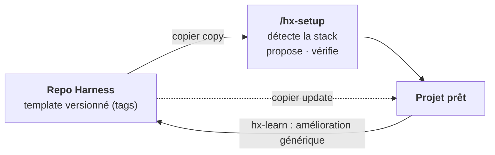
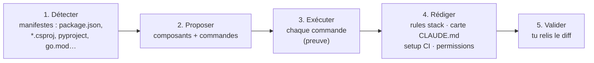
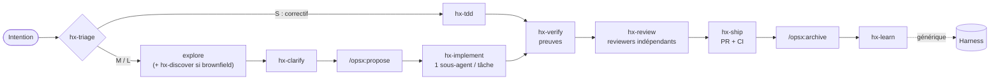
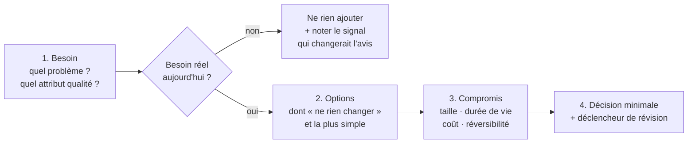

# Harness — Plan directeur

> **Statut** : v0.5 · 2026-10-17 · **phase 0 livrée** (template, `hx`, `/hx-setup` v0, CI)
> **Nature** : un **template personnel**. On y garde sa configuration Claude Code, on l'applique à chaque projet (nouveau ou existant), puis on la met à jour depuis ce repo.
> **Cadre** : Claude Code · projets solo · GitHub Actions · **agnostique de la stack** · OpenSpec 1.14.x (OPSX)
> **État de l'art** → [`research/etat-de-l-art-2026-10.md`](research/etat-de-l-art-2026-10.md)

---

## 0. En bref

| | |
|---|---|
| **Quoi** | Un template qui installe dans un projet une couche de *harness* autour d'OpenSpec : skills, agents, rules, hooks, contrôles CI. |
| **Agnostique de la stack** | Tout ce qui est générique ne connaît pas la stack. Le spécifique tient dans **quelques fichiers isolés**, remplis à l'intégration par le skill `/hx-setup`. |
| **Moteur** | [Copier](https://copier.readthedocs.io) : installation **et mise à jour** des projets par fusion à 3 voies. |
| **Règle d'or** | Tout contrôle existe en CI ; les hooks locaux ne font qu'accélérer le retour. |
| **Anti-lourdeur** | Pistes S / M / L : un petit correctif n'a pas besoin de spec. |



---

## 1. Usage cible

| Étape | Commande | Durée visée |
|---|---|---|
| 1. Installer | `uvx copier copy --trust gh:PatayEnCroute/Harness .` (projet nouveau ou existant) | 1 min |
| 2. Personnaliser pour la stack | `/hx-setup` dans Claude Code : il détecte, propose, **exécute chaque commande pour la vérifier**, établit le profil d'architecture, et tu valides | 10–20 min |
| 3. Vérifier | `node .harness/hx.mjs doctor` | 1 min |
| Mettre à jour plus tard | `uvx copier update --trust` (tes personnalisations sont conservées) | 1 min |

> `--trust` autorise les tâches post-génération (`openspec init`). Python (via `uv`) n'est requis **qu'à l'installation et à la mise à jour**.

### Non-objectifs

- ❌ Forker OpenSpec ou modifier ses skills `openspec-*` (ils sont réécrits par `openspec update`).
- ❌ Supporter d'autres outils IA que Claude Code (le choix reste ouvert : voir §10).
- ❌ Des « packs » de stack préfabriqués : la personnalisation est **assistée**, pas précâblée.
- ❌ Une spec pour un correctif d'une ligne.

---

## 2. Principes directeurs

| # | Principe | Tiré de | Conséquence concrète |
|---|---|---|---|
| P1 | **Générique / spécifique séparés** | Böckeler (*harness templates*) | Les skills, agents et hooks n'écrivent jamais `npm` ou `dotnet` : ils passent par `hx run <commande>`. |
| P2 | **OpenSpec = registre de l'intention** | OpenSpec `config.yaml`, contrat JSON | On l'étend sans le forker : `config.yaml`, skills voisins, clés `x-*`, CI. |
| P3 | **Contrôles déterministes > prose** | Böckeler, OpenAI | Une règle importante devient un lint, un test ou un check. |
| P4 | **Le contexte est un budget** | Anthropic, étude ETH | `CLAUDE.md` = une carte (≤ 100 lignes). Rules ciblées par chemin. |
| P5 | **Qui produit n'évalue pas** | Anthropic, superpowers | Les reviewers sont des sous-agents indépendants. |
| P6 | **Pas de « terminé » sans preuve** | superpowers | `hx-verify` exige une sortie de commande fraîche. |
| P7 | **Processus proportionné** | critiques du SDD (Böckeler, Marmelab) | Pistes S/M/L. |
| P8 | **Boucle de pilotage** | Hashimoto, Compound Engineering | Une erreur récurrente devient une rule, un contrôle ou un skill, remonté dans Harness. |
| P9 | **Élaguer** | Anthropic (mars 2026) | Un composant sans gain mesurable est retiré. |
| P10 | **Architecture proportionnée au besoin** | Clean Architecture, Vertical Slices, YAGNI | Feature-first par défaut ; on ajoute une couche seulement pour un besoin nommé (§5). |
| P11 | **Standard quand c'est gratuit** | Agent Skills | Les skills respectent la spec `SKILL.md` : ils restent portables vers un autre outil sans effort. |

---

## 3. Architecture du harness

### 3.1 Générique vs spécifique à la stack

C'est le cœur de l'agnosticité.

| | **Générique** (vient du template, mis à jour par `copier update`) | **Spécifique** (personnalisé à l'intégration par `/hx-setup`) |
|---|---|---|
| Fichiers | `.claude/skills/hx-*`, `.claude/agents/hx-*`, `.harness/`, `.harness/hooks/`, `openspec/config.yaml`, `.claude/rules/openspec.md`, `testing.md` et `architecture.md` | `.harness/config.json` (commandes, profil d'architecture), `.claude/rules/stack-*.md`, section « Carte » de `CLAUDE.md`, étape *setup* du workflow CI, permissions shell |
| Change… | quand le Harness s'améliore | une seule fois par projet, puis rarement |
| Conflits `copier update` | gérés par la fusion à 3 voies | **aucun** : fichiers créés par `/hx-setup`, absents du template ou marqués `_skip_if_exists` |

### 3.2 Contrat de commandes (`.harness/config.json`)

C'est la seule interface entre le harness et la stack. Il gère aussi les projets **multi-stack** par composants. Chaque commande s'exécute **dans le dossier du composant**. Un schéma JSON (`config.schema.json`) fournit l'autocomplétion dans l'éditeur.

```jsonc
{
  "version": 1,
  "components": {                       // un seul composant pour un projet mono-stack
    "api": {
      "path": "src/Api", "stack": "dotnet",
      "commands": {
        "setup": "dotnet restore",
        "test": "dotnet test",
        "lint": "dotnet format --verify-no-changes",
        "arch": "dotnet test ../../tests/Architecture"   // règles de dépendance (v1)
      }
    },
    "web": {
      "path": "web", "stack": "node",
      "commands": {
        "setup": "npm ci",
        "test": "npm run test",
        "test-file": "npx vitest run {file}",          // {file} : relatif au composant
        "lint": "npm run lint",
        "typecheck": "npm run typecheck"
      }
    }
  },
  "architecture": {                     // voir §5
    "style": "feature-first",
    "level": 1,                         // niveau par défaut du projet
    "features": { "facturation": 2 },   // écarts justifiés par le besoin
    "profile": { "size": "small", "lifespan": "long", "domain_complexity": "medium" }
  },
  "tracks": { "S": { "spec": false }, "M": { "spec": true, "design": "optional" }, "L": { "spec": true, "design": "required", "adr": "required" } }
}
```

> Format JSON plutôt que YAML : `hx` n'a aucune dépendance, et Node lit le JSON nativement.

| Appel | Effet |
|---|---|
| `hx detect [--write]` | Propose les composants et commandes à partir des manifestes (point de départ déterministe de `/hx-setup`) |
| `hx run test` | Lance `test` sur tous les composants |
| `hx run lint --file web/src/app.ts` | Choisit le composant d'après le chemin du fichier |
| `hx check [--fast]` | validate OpenSpec + lint + typecheck + arch + test (`--fast` : lint + typecheck) |
| `hx doctor` | Installation saine (fichiers, versions, rien d'ignoré par git) et chaque commande **passe** |
| `hx openspec <args>` | Appelle la version épinglée d'OpenSpec, télémétrie coupée |

### 3.3 `/hx-setup` : la personnalisation assistée



- **Projet existant** : les rules de stack sont déduites des conventions observées dans le code (nommage, structure, frameworks de test).
- **Projet neuf** : on part de conventions par défaut, dont tu choisis la stack.
- On peut le relancer à tout moment, par exemple pour ajouter un composant à la stack.

### 3.4 Pourquoi Copier

| Option | Projet existant | Mises à jour | Fonctionne en session cloud | Retenu |
|---|---|---|---|---|
| Template GitHub | ❌ | ❌ | ✅ | — |
| Plugin Claude Code (niveau utilisateur) | ✅ | ✅ auto | ⚠️ installé sur ta machine, donc absent ailleurs tant que le projet ne le déclare pas | plus tard, en option |
| **Copier** (fichiers commités dans le projet) | ✅ | ✅ fusion 3 voies | ✅ | ✅ |

`copier.yml` reste minimal :

```yaml
_subdirectory: template
_min_copier_version: "9.10"
project_name: { type: str }
ci: { type: bool, default: true }          # workflow GitHub Actions
openspec_version: { default: "1.14.3" }    # épinglée
_tasks:
  - npx -y @fission-ai/openspec@{{ openspec_version }} init --tools claude   # update en mise à jour
```

### 3.5 Points d'accroche OpenSpec

| Point d'extension | Usage |
|---|---|
| `config.yaml › context` | Renvoi vers `CLAUDE.md` et le contrat de commandes |
| `config.yaml › rules.<artefact>` | Règles d'écriture : proposal (piste, non-objectifs), specs (scénarios testables), design (besoin d'abord, niveau visé, options : §5), tasks (2–5 min, test d'abord) |
| `operations.apply.guidance` | Renvoie vers `hx-implement` / `hx-tdd` |
| `.openspec.yaml › x-*` | `x-track: M` |
| CLI `--json` (`status`, `instructions`, `validate`) | Seule interface utilisée par les scripts `hx` |
| Schéma custom | **Pas en v1** : pas d'héritage de schéma (#778), un fork serait à maintenir |

---

## 4. Workflow



| Piste | Quand | Artefacts OpenSpec | Contrôles |
|---|---|---|---|
| **S** | Diff descriptible en une phrase, aucun comportement spécifié ne change | aucun | tests + lint + review |
| **M** | Fonctionnalité ou changement de comportement | proposal + delta specs + tasks | + `validate --strict` + traçabilité |
| **L** | Archi, contrat d'API, migration | + `design.md` + ADR | + ta relecture du design **avant** l'implémentation |

---

## 5. Architecture des projets

> **Orientation** : **feature-first** (le code est rangé par fonctionnalité, pas par couche technique) avec la **règle de dépendance de la Clean Architecture** (le métier ne dépend ni du framework ni des I/O). Les deux s'appliquent **au niveau que le besoin justifie, pas plus**.

### 5.1 Le besoin d'abord

Toute proposition de `hx-architect` suit cet ordre. Elle s'arrête dès qu'il n'y a pas de besoin réel.



| Règle de l'architecte | Exemple |
|---|---|
| **Pas de besoin, pas de couche** : toute abstraction cite le besoin qu'elle sert | « Port `PaymentGateway` : tester sans appeler le prestataire, et un 2ᵉ prestataire est prévu » |
| Toujours présenter « ne rien changer » et l'option la plus simple | Avant d'introduire un bus de messages : un simple appel de fonction suffit-il ? |
| Proposer le **niveau minimal** qui couvre le besoin, et le **signal** qui ferait passer au niveau suivant | « Niveau 1. On passera au niveau 2 pour *facturation* si les règles de remise se multiplient. » |
| Distinguer les décisions **réversibles** des **portes à sens unique** | Sens unique : schéma de données, contrat d'API publique, découpage en services. Ce sont elles qui méritent un ADR. |
| Aucun pattern par réflexe | CQRS, event sourcing, microservices, repository générique, mapper partout : seulement avec un besoin nommé |

### 5.2 Échelle de niveaux

| Niveau | Forme | Signaux qui le justifient | Coût |
|---|---|---|---|
| **0 · Simple** | Un module, sans découpage | Script, POC, outil jetable | nul |
| **1 · Feature-first** *(défaut)* | Un dossier par feature contenant la tranche verticale complète (entrée, logique, accès aux données, tests). Pas d'abstraction. | La plupart des projets solo | faible |
| **2 · Feature + domaine isolé** | Dans les features concernées : un domaine pur, plus des ports et adaptateurs **seulement aux frontières qui en ont besoin** | Règles métier non triviales ; I/O externe à isoler pour tester ; plusieurs points d'entrée (API, CLI, jobs) qui partagent la logique | moyen |
| **3 · Monolithe modulaire clean** | Modules (sous-domaines) avec contrats publics explicites ; règle de dépendance testée ; ports et adaptateurs systématiques | Plusieurs sous-domaines, longue durée de vie, changements fréquents et indépendants | élevé |
| *4 · Distribué* | Services séparés | Besoin **prouvé** de déploiement ou de scalabilité indépendants : quasi jamais en solo | très élevé |

> **Le niveau se décide par feature.** Un projet en niveau 1 peut avoir une seule feature en niveau 2 si son métier le justifie. On monte de niveau sur un signal observé, jamais par anticipation.

### 5.3 Forme du code (agnostique de la stack)

```
src/
├── features/
│   ├── facturation/            # niveau 2 : le métier le justifie
│   │   ├── creer-facture/      # tranche : entrée + logique + tests
│   │   ├── domain/             # règles pures, aucune dépendance externe
│   │   └── adapters/           # BDD, API externes (implémentent des ports)
│   └── clients/                # niveau 1 : tranches simples
│       └── lister-clients/
├── shared/                     # noyau minimal et nommé (pas de « utils » fourre-tout)
└── app/                        # composition : injection, routes, config
```

| Règle de dépendance | Vérifiée par |
|---|---|
| Une feature n'importe jamais les **internes** d'une autre, seulement son contrat public | `hx run arch` + `hx-code-reviewer` |
| `domain/` ne dépend ni du framework, ni des I/O, ni de `adapters/` | `hx run arch` |
| `app/` compose ; aucune feature ne dépend de `app/` | `hx run arch` |
| `shared/` ne dépend d'aucune feature | `hx run arch` |

### 5.4 Où ça vit dans le harness

| Élément | Rôle |
|---|---|
| `.harness/config.json › architecture` | Niveau du projet, niveaux par feature, profil (taille, durée de vie, complexité métier). Rempli par `/hx-setup`, revu par `hx-architect`. |
| `.claude/rules/architecture.md` | Forme du code, règle de dépendance, « pas de besoin, pas de couche » ; chargée sur les fichiers source |
| `hx-architect` (agent) | Analyse besoin → options → décision. Appelé en piste L, par `/hx-setup` sur un projet neuf, et quand un signal de changement de niveau apparaît. |
| `hx-adr` (skill) | Gabarit ADR « besoin d'abord » (ci-dessous) |
| `openspec/config.yaml › rules.design` | `design.md` commence par le besoin, indique le niveau visé et liste les options |
| `hx-code-reviewer` | Signale la **sur-ingénierie** (abstraction sans besoin cité) autant que les **violations** de la règle de dépendance |
| `hx run arch` (v1) | Règles de dépendance testées, configurées par `/hx-setup` selon la stack : dependency-cruiser (TS), import-linter (Python), NetArchTest / ArchUnitNET (.NET), ArchUnit (Java)… |

**Gabarit ADR** (`docs/adr/NNN-titre.md`) :

```markdown
# ADR-NNN : <décision>
## Besoin          ← en premier : quel problème, pour qui, quel attribut qualité
## Contexte        ← taille du projet, niveau actuel, contraintes
## Options         ← dont « ne rien changer » et la plus simple
## Décision        ← le minimum qui couvre le besoin
## Conséquences    ← ce qui devient plus facile / plus difficile, coût
## Révision        ← réversible ou sens unique ; signal qui rouvrira la décision
```

---

## 6. Catalogue

**MVP** = phases 0–1 · **v1** = phase 2 · **v2** = phase 3.

### Skills (`.claude/skills/hx-*`)

| Skill | Rôle | Prio |
|---|---|---|
| `hx-setup` | Personnalisation assistée à la stack (§3.3) | **MVP (P0)** |
| `hx-triage` | Classer la demande en S/M/L et l'orienter | MVP |
| `hx-tdd` | Rouge → vert → refactor, avec preuve | MVP |
| `hx-implement` | Boucle sur `tasks.md` : une tâche = un sous-agent, puis review de conformité | MVP |
| `hx-verify` | Aucune déclaration de fin sans preuve fraîche | MVP |
| `hx-review` | Reviewers en parallèle, filtre des faux positifs | MVP |
| `hx-ship` | PR liée au change, suivi de la CI | MVP |
| `hx-clarify` | Entretien ciblé (≤ 5 questions) avant la proposition | v1 |
| `hx-debug` | Reproduire → isoler → corriger → test de non-régression | v1 |
| `hx-adr` | ADR « besoin d'abord » (§5.4), piste L et portes à sens unique | MVP |
| `hx-learn` | Capitaliser : leçon locale (`docs/learnings/`) ou amélioration à remonter dans Harness | v1 |
| `hx-discover` | Brownfield : dériver des specs de base depuis le code | v2 |

### Agents (`.claude/agents/hx-*.md`)

| Agent | Rôle | Outils | Modèle |
|---|---|---|---|
| `hx-explorer` | Cartographier le code et l'impact | lecture seule | rapide |
| `hx-implementer` | Réaliser **une** tâche en TDD | lecture, écriture, shell | standard |
| `hx-spec-reviewer` | Le code respecte-t-il les scénarios des specs ? | lecture seule | standard |
| `hx-code-reviewer` | Qualité, conventions, simplicité ; sur-ingénierie et règle de dépendance | lecture seule | standard |
| `hx-verifier` (v1) | Exécuter et prouver : tests, app | lecture, shell | standard |
| `hx-security-reviewer` (v1) | Secrets, injection, dépendances | lecture seule | puissant |
| `hx-architect` | Décisions besoin d'abord, feature-first, proportionnées à la taille du projet (§5) | lecture seule | puissant |

### Rules

| Rule | Portée | Source | Contenu |
|---|---|---|---|
| `CLAUDE.md` | toujours | template + `/hx-setup` | Principes, workflow, contrat de commandes (générique) + carte du repo (spécifique). ≤ 100 lignes. |
| `.claude/rules/openspec.md` | `openspec/**` | template | SHALL/MUST, scénarios WHEN/THEN testables, concision |
| `.claude/rules/testing.md` | fichiers de test | template | Tag de traçabilité `@scenario`, un comportement par test |
| `.claude/rules/architecture.md` | fichiers source | template (globs par `/hx-setup`) | Forme feature-first, règle de dépendance, « pas de besoin, pas de couche » |
| `.claude/rules/stack-*.md` | globs de la stack | **`/hx-setup`** | Idiomes, pièges, conventions observées |

### Hooks (`.claude/settings.json` → `.harness/hooks/*.mjs`)

| Événement | Action |
|---|---|
| `SessionStart` | Résumé `openspec status --json` (le change actif est dans le contexte) |
| `PreToolUse` (écriture) | **Bloque** les écritures dans `openspec/specs/**` : les specs ne changent que par archive |
| `PostToolUse` (édition) | `hx run lint --file <fichier>` : agnostique grâce au contrat |
| `Stop` | `hx check --fast` si un change est actif |

### Contrôles (`hx check`, identiques en local et en GitHub Actions)

| Contrôle | Vérifie |
|---|---|
| `openspec validate --all --strict` | Structure des specs et des changes |
| `hx run test / lint / typecheck` | Contrat de commandes |
| `hx trace` (v1) | Chaque scénario ADDED/MODIFIED a ≥ 1 test tagué `@scenario` ; aucun tag orphelin |
| `hx run arch` (v1) | Règles de dépendance (§5.3) |
| `tasks-complete` | `tasks.md` complet avant l'archive |
| `track-policy` | Piste L → `design.md` et ADR présents |

---

## 7. Structure

<table><tr><td>

**Repo Harness**

```
Harness/
├── copier.yml
├── template/             # ce qui atterrit
│   │                     # dans le projet
│   ├── CLAUDE.md
│   ├── .claude/
│   │   ├── skills/hx-*/
│   │   ├── agents/hx-*.md
│   │   ├── rules/
│   │   └── settings.json
│   ├── .harness/
│   │   ├── config.json   # squelette
│   │   ├── project.md.jinja
│   │   ├── hx.mjs
│   │   └── hooks/        # P1
│   ├── openspec/config.yaml
│   └── .github/workflows/
│       └── hx-check.yml.jinja
├── tests/
│   └── fixtures/         # node, python, dotnet,
│                         # go, mixte
└── docs/                 # PLAN, ADR, research
```

</td><td>

**Projet après `copier copy` + `/hx-setup`**

```
mon-projet/
├── .copier-answers.yml   # version du template
├── CLAUDE.md             # générique + carte
├── .claude/
│   ├── skills/           # hx-* + openspec-*
│   ├── agents/
│   ├── rules/            # + stack-*.md
│   └── settings.json     # hooks, permissions
├── .harness/
│   ├── config.json       # ← personnalisé
│   ├── project.md        # ← personnalisé
│   ├── hx.mjs  hooks/
├── openspec/
│   ├── config.yaml
│   ├── specs/
│   └── changes/
├── .github/workflows/hx-check.yml
└── docs/
    ├── adr/
    └── learnings/
```

</td></tr></table>

Les scripts `hx` sont en JavaScript (`.mjs`), sans dépendance : OpenSpec impose déjà Node ≥ 20.19.

---

## 8. Qualité du template

| Test (GitHub Actions du repo Harness) | Vérifie |
|---|---|
| `copier copy` puis `hx detect --write` sur des **fixtures multi-stack** (Node, Python, .NET, Go, projet mixte) → `hx doctor` et `hx check` verts | **Preuve d'agnosticité** : le générique fonctionne quelle que soit la stack |
| `copier update` du tag précédent vers le courant, sur une fixture personnalisée | Les personnalisations survivent à la mise à jour |
| Tests unitaires de `hx.mjs` (résolution de composant, exécution, codes de sortie) | Fiabilité du contrat |
| Validation `SKILL.md` + budgets (< 500 lignes, `CLAUDE.md` ≤ 100) | Standard et budget de contexte |
| Contrat `--json` d'OpenSpec sur la version épinglée | Pas de casse silencieuse lors d'une montée de version |
| Evals de `hx-setup` et des skills clés (v1) : tâche sur une fixture, puis vérification déterministe | Gain réel (principe P9) |

---

## 9. Roadmap

| Phase | Durée indicative | Livrables | Terminé quand |
|---|---|---|---|
| **P0 Socle** ✅ | livrée | `copier.yml`, `template/`, `CLAUDE.md`, `openspec/config.yaml`, `hx run / check / doctor / detect / openspec`, `/hx-setup` v0, 5 fixtures, CI du template | ✅ Sur 5 fixtures (Node, Python, .NET, Go, mixte) : `copier copy` → `hx detect` → `hx doctor` et `hx check` verts ; `copier update` conserve les personnalisations |
| **P1 Boucle de base** | ~2 sem. | 7 skills MVP (dont `hx-adr`), 5 agents (dont `hx-architect`), rule `architecture.md`, hooks, workflow `hx-check.yml`, `/hx-setup` complet (rules stack, carte, CI, permissions) | 3 changes M menés de bout en bout sur un vrai projet |
| **P2 Qualité** | ~2 sem. | `hx trace`, `hx run arch`, `hx-verifier`, `hx-security-reviewer`, `hx-debug` / `hx-clarify` / `hx-learn`, evals | Traçabilité ≥ 80 % sur le projet pilote, evals vertes |
| **P3 Extensions** | au fil de l'eau | `hx-discover`, plugin utilisateur optionnel, autres outils si besoin, revue d'élagage | Selon les besoins |

---

## 10. Risques

| Risque | Mitigation |
|---|---|
| OpenSpec évolue vite (une release par semaine, commandes remplacées par des skills, #2022) | Version épinglée, tests de contrat `--json` ; nos skills appellent la CLI et pas les commandes `/opsx:*` |
| `/hx-setup` se trompe de commande | Il **exécute** chaque commande avant de l'écrire, puis tu relis le diff ; `hx doctor` revérifie |
| Stack exotique ou monorepo complexe | Le contrat accepte n'importe quelle commande shell ; les composants couvrent le multi-stack |
| Conflits lors de `copier update` | Le spécifique vit dans des fichiers hors template (§3.1) |
| Projets qui ne se mettent plus à jour | Version visible dans `.copier-answers.yml` ; `hx doctor` signale un template en retard |
| Besoin futur d'un autre outil IA | Skills au standard `SKILL.md` ; ajouter une cible = générer des copies (réintroduire `sync`) |
| L'architecte sur-conçoit | Besoin d'abord, option la plus simple obligatoire, niveau par feature ; `hx-code-reviewer` signale toute abstraction sans besoin cité |
| Lourdeur | Pistes S/M/L ; élaguer ce qui ne sert pas |

---

## 11. Décisions

| # | Question | Décision |
|---|---|---|
| 1 | Outil IA | ✅ **Claude Code** |
| 2 | Moteur de template | ✅ **Copier** |
| 3 | Usage | ✅ **Projets solo** : fichiers commités dans le projet |
| 4 | CI | ✅ **GitHub Actions** |
| 5 | Stack | ✅ **Agnostique** : contrat de commandes + `/hx-setup` |
| 6 | Archive OpenSpec | ✅ **Dernier commit de la PR** : `main` a toujours un code et des specs cohérents |
| 7 | Orientation d'architecture | ✅ **Feature-first + règle de dépendance clean**, niveau proportionné à la taille et au besoin (§5) |
| 8 | Plugin utilisateur en complément ? | ⏳ Plus tard (P3), si le besoin de mise à jour instantanée se fait sentir |
