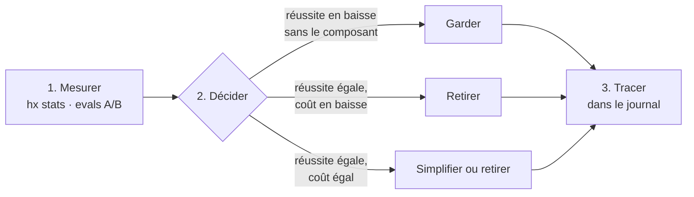

# Revue d'élagage

**Chaque composant compense une faiblesse du modèle.** Quand le modèle progresse, le composant peut devenir inutile, et il coûte alors du contexte et de l'attention pour rien. On mesure donc son apport, et on le retire quand il ne sert plus (principe P9).

---

## Méthode

| Étape | Comment |
|---|---|
| **Mesurer** | Usage réel : `node .harness/hx.mjs stats` dans un projet. Effet d'un skill : `evals/run.sh --runs 10 <scénario>`, puis la même chose avec `--without <skill>`. |
| **Quand** | À chaque nouvelle génération de modèle, au plus tard chaque trimestre. |
| **Tracer** | Chaque retrait ou simplification va dans le [journal](#journal), avec sa mesure (fichier de `evals/results/`, commité). |

> **Pourquoi 10 exécutions ?** En dessous, 90 % et 70 % de réussite ne se distinguent pas.

---

## Ce que chaque composant compense

### Workflow

| Composant | Faiblesse compensée | Mesure | On retire si… |
|---|---|---|---|
| `hx-triage` | Sur-processer les petits changements, sous-spécifier les gros | eval `tdd-s` | le modèle choisit la bonne piste sans lui |
| `hx-tdd` | Code avant le test, ou tests qui ne peuvent pas échouer | eval `tdd-s --without hx-tdd` | réussite égale sans lui |
| `hx-implement` | Contexte dégradé sur un long change, sortie de la spec | eval `implement-m` | réussite égale sans lui, sur ≥ 5 tâches |
| `hx-verify` + hook `Stop` | « Terminé » déclaré sans preuve | `hx check` vert en fin d'evals | plus aucun échec de `check` sans lui |
| Hook `PostToolUse` | Erreurs de lint accumulées jusqu'à la fin | échecs `lint` en fin de tâche | le lint final passe toujours sans lui |

### Cadrage

| Composant | Faiblesse compensée | Mesure | On retire si… |
|---|---|---|---|
| Porte de cadrage | Spécifier autre chose que la demande, puis l'implémenter fidèlement | `x-gate-corrections` ; hypothèses du rapport infirmées ; eval `gate-stops` | aucune correction à la porte sur un trimestre |
| Contre-relecture (`hx-architect`) | Cadrage sur-dimensionné, jamais contesté par son auteur | `x-gate-removed` | aucune décision retirée sur un trimestre |
| `hx-architect` + rule `architecture` | Patterns par réflexe | eval `architect` | le modèle reste proportionné sans eux |

### Revue et mémoire

| Composant | Faiblesse compensée | Mesure | On retire si… |
|---|---|---|---|
| `hx-review` + relecteurs | Mal juger son propre travail | `x-review-confirmed` / `x-review-discarded` | < 1 constat confirmé par PR sur un trimestre |
| Rule `comments` + relecteur | Commentaires qui paraphrasent le code, puis le contredisent | constats « Commentaires » confirmés | aucun sur un trimestre (le lint reste) |
| `hx-learn` | Leçons d'un incident oubliées au change suivant | même correction demandée deux fois | aucune leçon relue n'a changé une décision sur un trimestre |
| `hx-dream` | Leçons accumulées sans relecture : redites, périmées, noyées | charge avant/après ; leçons réapprises | rien à condenser sur un trimestre (une leçon réapprise = il élague trop) |

### À la demande

| Composant | Faiblesse compensée | Mesure | On retire si… |
|---|---|---|---|
| `hx-security-audit` | Rapport gonflé : CVE non vérifiées, injections sans chemin d'entrée | constats confirmés par l'utilisateur | mêmes constats, sans plus de faux positifs, sans lui |
| `hx-explain` | Jargon, justification après coup, bilan complaisant | question de compréhension après l'explication ; conseils appliqués | explications aussi claires et bilan aussi honnête sans lui |

### Toujours gardés

Contrôles déterministes, quasi gratuits et indépendants du modèle, ou outils qui ne compensent aucune faiblesse : **pas de signal de retrait.**

| Composant | Rôle |
|---|---|
| `hx check`, `hx trace`, pistes, archives | Specs et code ne divergent pas |
| `hx worktree` | Deux changes ne se gênent pas dans un même dossier |
| `hx status` | L'utilisateur ne perd pas le fil des runs en cours |
| Hook `Stop` (chemins protégés) | Une protection contournée par Bash (`cd`, script) se voit quand même |
| `hx-setup` | Gain de temps, pas une faiblesse du modèle (eval `setup`) |

---

## Candidats non construits

On n'ajoute un composant que si l'usage en montre le besoin.

| Candidat | Signal qui le justifierait |
|---|---|
| Rollback et migration de données en piste L | Une migration livrée sans plan de retour arrière |
| Revue de performance | Une régression de performance passée en revue |
| Étape docs / CHANGELOG en piste M | Une PR mergée avec une doc utilisateur périmée |

---

## Journal

| Date | Sujet | Résultat | Preuve |
|---|---|---|---|
| 2026-10-18 | Plugin utilisateur | Non construit | Besoin non observé ([ADR-003](adr/003-plugin-utilisateur-non-retenu.md)) |
| 2026-10-18 | Génération multi-outils | Non construite | Un seul outil utilisé ([ADR-002](adr/002-claude-code-seul-standards-gratuits.md)) |
| 2026-10-18 | Ligne de base, 1 exécution | 4/4 evals vertes, ~1,10 $ | **Non archivée** (antérieure à `evals/results/`) |
| 2026-10-18 | Ligne de base `--runs 10`, `claude-sonnet-5-5` | `architect` 10/10 · `implement-m` 10/10 · `setup` 10/10 · `tdd-s` 8/10. 11,74 $ au total. | `evals/results/20261018T2029*`, `…205427*`, `…205546*`, `…2108*` |
| 2026-10-19 | `implement-m` après la porte et le run enchaîné (0df52c3) | 10/10, inchangé. Coût moyen 0,53 $ au lieu de 0,39 $ (+37 %) : `hx-implement` enchaîne désormais verify et review. | [`20261018T235030Z-full.jsonl`](../evals/results/20261018T235030Z-full.jsonl) |
| 2026-10-27 | Repli des sous-agents dans une boucle unique (billet Anthropic du 22/10) | Non mené : 6 agents sur 7 vérifient ou explorent, des usages que le billet garde. Tester la boucle unique de `hx-implement` quand un change de 5 tâches ou plus paraît lent ou cher. | [`sous-agents-2026-10.md`](research/sous-agents-2026-10.md) |

<b>Réserves sur la ligne de base du 2026-10-18</b>

- Les 4 scénarios ont été mesurés **avant le durcissement des correcteurs** (cf88fda, 2d52145, 79f8dd7, 464328c) : ces chiffres ne valent pas pour v0.3.0, et les échecs n'ont pas de `reason` enregistrée.
- Les 2 échecs de `tdd-s` (bcf700c) sont attribués au correcteur `test-first`, corrigé depuis, **sans nouvelle mesure**.
- Commits mesurés : a8ef3b2 (`architect`, `implement-m`), bcf700c (`tdd-s`, plus `architect` 1/1 de contrôle), 416decb (`setup`).
- Ces campagnes ont révélé et fait corriger 2 défauts du hook `PreToolUse` (`setup` passé de 0/6 à 9/10) et 2 du correcteur `test-first`.
- Les correcteurs n'ont pas changé depuis v0.3.0, donc la mesure du 2026-10-19 est comparable.

**Prochaine étape** : A/B `--without` par composant.

