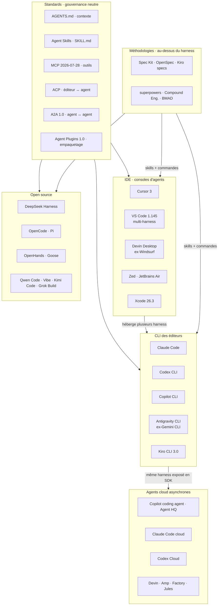

# Harness agentiques de développement : état de l'industrie

> Étude de l'état de l'art des harness de développement dans l'industrie, confrontée au template. Rédigée le 06/11/2026.
> **Périmètre** : harness CLI des éditeurs, IDE agentiques, agents cloud asynchrones, open source, standards, méthodologies, évaluation, sécurité, marché.
> **Méthode** : 17 axes de recherche, chacun contre-vérifié sur ses sources primaires le 06/11/2026. Sur plusieurs axes, le quota de recherche web était épuisé : les dernières vérifications ont été faites par lecture directe des pages. Les éléments marqués ⚠️ viennent de sources secondaires ou n'ont pas pu être vérifiés.
> **Prolonge** : [`etat-de-l-art-2026-10.md`](etat-de-l-art-2026-10.md), [`ingenierie-de-contexte-2026-11.md`](ingenierie-de-contexte-2026-11.md), [`sous-agents-2026-10.md`](sous-agents-2026-10.md), [`scion-2026-10.md`](scion-2026-10.md).

## Verdict

**Les harness ont convergé sur les briques ; ils divergent sur qui décide.** Boucle, sous-agents déclaratifs, hooks, `SKILL.md`, AGENTS.md, worktrees : tout le monde a la même boîte à outils. La compétition porte désormais sur l'approbation confiée à un modèle, l'orchestration écrite en code et l'environnement d'exécution. Le harness est aligné sur la doctrine ; ses écarts sont dans la mesure et la reprise après interruption.

| # | Constat | Preuve clé | Pour le harness |
|---|---|---|---|
| 1 | **Les primitives ont convergé** : sous-agents en fichiers, hooks `PreToolUse` à code de sortie 2, `SKILL.md`, plugins, AGENTS.md lu partout | 5 CLI d'éditeurs, Cursor, VS Code ; `SKILL.md` dans 9 harness sur 11 | ✅ P11 tient : rien à porter |
| 2 | **L'approbation passe de l'humain à un juge automatique** | auto mode (Claude Code, défaut depuis v2.1.283), Guardian V3 (Codex), assisted permissions (Copilot, GA 26/10/2026) | ✅ « pas de confirmation imposée » ; mais l'angle mort des éditions de fichiers impose de garder les hooks déterministes |
| 3 | **L'orchestration s'écrit en code et devient reprenable** | dynamic workflows Claude Code (02/06/2026), Copilot (preview 01/10/2026), Workflows Kiro 3.0 (03/11/2026) | ⚠️ le run du harness est piloté par la prose des skills et survit mal à une interruption |
| 4 | **L'effet du harness est réel mais contesté** | +22,5 points selon le harness sur TB 2.1 ; effet nul sur suite privée et pour les modèles forts | ⚠️ les evals du harness ne publient pas leur configuration |
| 5 | **Le goulot est la revue et la stabilité, pas l'écriture** | Faros : +441,5 % de temps médian en revue, +242,7 % d'incidents par PR | ✅ une porte au cadrage, revue IA filtrée, PR en brouillon |
| 6 | **La surface d'attaque est le dépôt lui-même** | 4 CVE Claude Code contournent le dialogue de confiance au 1er semestre ; git comme vecteur chez 3 éditeurs | ⚠️ `hx doctor` ne vérifie pas la version de Claude Code |
| 7 | **Le harness est jetable** : chaque composant encode une limite du modèle | Anthropic retire resets et sprints à chaque génération ; Claude Code réécrit toutes les 3-4 semaines | ✅ P9 ; ligne de base déjà mesurée sur Sonnet 5.5, mais les A/B `--without` restent à faire |

---

## 1. Carte de l'industrie

| Harness | Boucle / approbation | Sous-agents | Hooks | Skills / extension | Mémoire | Sandbox | Intégration PR |
|---|---|---|---|---|---|---|---|
| **Claude Code** 2.1.318 | auto mode (classifieur) par défaut interactif ; `/goal` | Markdown, `isolation: worktree` ; agent teams (expé) ; dynamic workflows JS | 33 événements, 5 types de handlers | `SKILL.md`, plugins, mods in-process | CLAUDE.md + auto memory (200 lignes / 25 Ko) ; compaction ~967K | Seatbelt / bubblewrap, **off par défaut** | Code Review GA (15/10/2026) ; auto-fix PR en cloud |
| **Codex CLI** 0.167 | Guardian V3 / `auto_review` ; `/goal` derrière flag | TOML, 3 intégrés | 14 événements, variables `CLAUDE_PLUGIN_*` | `SKILL.md`, marketplace de plugins | Memories opt-in (stockage v2) | Seatbelt / bubblewrap / Windows MXC, réseau coupé | revue de PR auto ⚠️ |
| **Copilot CLI** | Autopilot ; assisted permissions GA | Explore, Task, Code Review, Plan ; `.agent.md` ; dynamic workflows (preview) | `preToolUse` / `postToolUse` | skills, plugins, MCP | dépôt + inter-sessions ; compaction ~95 % | sandbox local GA (10/2026) | `&` délègue au coding agent ; code review agentique |
| **Antigravity CLI** (ex-Gemini CLI) | Plan mode par défaut (Gemini 0.34) | oui (15/04/2026) ; agents d'arrière-plan | noms propres (`BeforeTool`…) | Agent Skills, plugins | 4 niveaux, Auto Memory | Seatbelt deny-default ; trust fail-closed | n.d. |
| **Kiro CLI** 3.0 | « Approve for me » (mécanisme non documenté) ; `/autonomous` | Workflows plan/implement/review à contexte frais | oui, après workspace trust | Agent Plugins | `/memories` | `/sandbox` OS ; sessions cloud | n.d. |
| **Cursor** 3 | Agents Window, `/best-of-n` | MD + YAML ; lit `.claude/agents` et `.codex/agents` | 18 événements, deny > ask > allow | skills, Origin Marketplace | Memories retirées → rules `.mdc`, AGENTS.md | sandbox (évasions corrigées en 3.0) | Bugbot + Autofix |
| **VS Code** 1.145 | harness au choix : Copilot, Claude, Codex | `*.agent.md` | oui | skills, prompt files, plugins | CLAUDE.md / AGENTS.md lus | imposable par paramètres gérés | via Copilot |
| **Devin Desktop** | Devin Local ; plan mode en fichier Markdown | Fusion : lead frontier + sidekick | migrés depuis Windsurf | rules + skills | memories retirées | Devin Cloud | Devin Review |
| **OpenCode** | agents `build` / `plan` | `@general` | n.d. | n.d. | n.d. | n.d. | n.d. |
| **Pi** | noyau minimal (4 outils ⚠️) | **aucun dans le noyau** | extensions | skills, packages | n.d. | aucune permission native | n.d. |

**Lecture** : les lignes se ressemblent. Ce qui les sépare n'est plus dans ces colonnes, mais dans qui approuve, où ça tourne et comment c'est facturé (§13).

---

## 2. Harness CLI des éditeurs

Cinq CLI partagent les mêmes briques et se différencient sur l'approbation par modèle et l'orchestration programmable. Les cadences sont quasi quotidiennes : chaque affirmation se date à la version près.

| Constat | Source |
|---|---|
| Claude Code : 13 versions du 19/10 au 04/11/2026 (2.1.304 → 2.1.318). `claude_code.safety_event` ajouté en 2.1.307, plus émis depuis 2.1.310 | [changelog](https://code.claude.com/docs/en/changelog) |
| 6 modes de permission. Auto : classifieur (Sonnet 5 par défaut), pause après 3 blocages consécutifs ou 20 au total, non configurable. Mode de départ interactif depuis v2.1.283 ; exceptions : `claude -p`, Agent SDK, HIPAA | [permission-modes](https://code.claude.com/docs/en/permission-modes) |
| Hooks Claude Code : 33 événements (dont `PermissionDenied`, `PostToolBatch`, `TaskCompleted`, `Pre/PostCompact`, `InstructionsLoaded`) ; handlers `command`, `http`, `mcp_tool`, `prompt`, `agent` (expé) | [hooks](https://code.claude.com/docs/en/hooks) |
| Mods : plugins JS/TS **in-process, non sandboxés**, actifs par défaut depuis v2.1.287 ; AGENTS.md, `/diff`, télémétrie livrés comme mods | [mods](https://code.claude.com/docs/en/plugins/mods/overview) |
| `/goal` (Claude Code) : condition ≤ 4 000 caractères, Stop hook `prompt` à petit modèle, verdict *not yet met / met / impossible*, **sans outils**, compatible `-p` | [goal](https://code.claude.com/docs/en/goal) |
| `/goal` (Codex) : 0.128.0 (30/04/2026), toujours derrière `features.goals` | [release](https://github.com/openai/codex/releases/tag/rust-v0.128.0) |
| Codex 0.165 : Guardian V3, hooks scopés par environnement ; 0.167 : `PreToolUse` avant Guardian | [changelog Codex](https://learn.chatgpt.com/docs/changelog) |
| SDK : Claude Agent SDK (exécute le binaire), Codex SDK sur app-server (`codex mcp-server` supprimé), Copilot SDK GA 02/06/2026 en 6 langages | [Agent SDK](https://code.claude.com/docs/en/agent-sdk/overview), [Copilot SDK](https://github.blog/changelog/2026-06-02-copilot-sdk-is-now-generally-available/) |
| Gemini CLI → Antigravity CLI (annonce 19/05/2026, coupure grand public 18/06/2026) ; maintenu pour l'entreprise (v0.64.0, 13/10/2026). Commande `agy` ⚠️ | [Google](https://developers.googleblog.com/an-important-update-transitioning-gemini-cli-to-antigravity-cli/) |
| Kiro CLI 3.0.0 (03/11/2026) : harness V3 commun IDE/Web/CLI ; Q Developer CLI remplacé le 17/11/2025 (licence AWS IP) | [Kiro](https://kiro.dev/blog/cli-3/) |

**Tendances**
- Approbation déléguée à un juge, règles deny/ask toujours prioritaires, sandbox OS combinable.
- La condition d'arrêt vérifiable devient une primitive (`/goal`).
- Un même harness sur toutes les surfaces, exposé comme bibliothèque.
- Second semestre 2026 = sécurité : workspace trust avant hooks et MCP (Kiro 2.33, Gemini 0.59), contrôles admin des modes.

---

## 3. IDE agentiques

L'IDE devient une console d'orchestration d'agents parallèles en worktrees, et se découple du harness qu'il héberge.

| Constat | Source |
|---|---|
| Cursor 3.0 (02/04/2026) : Agents Window, `/worktree`, `/best-of-n` multi-modèles, outil Await | [Cursor 3.0](https://cursor.com/changelog/3-0) |
| Hooks Cursor : 18 événements ; priorité Enterprise MDM > Team > projet > utilisateur ; fail-open par défaut ; agents cloud sans hooks utilisateur | [hooks](https://cursor.com/docs/hooks) |
| Bugbot : `.cursor/config/bugbot.yaml` **lu depuis la branche de base** (une PR ne modifie pas sa propre revue) ; autofix 3 tentatives max | [bugbot](https://cursor.com/docs/bugbot) |
| VS Code 1.145 (04/11/2026) : sessions imbriquées multi-harness (preview), Agent Host, sandboxing imposable, automatisations cron | [updates](https://code.visualstudio.com/updates) |
| Checkpoints VS Code : n'annulent ni terminal, ni réseau, ni déploiement | [checkpoints](https://code.visualstudio.com/docs/copilot/chat/chat-checkpoints) |
| JetBrains Air : plugin livré **sans agent** ; Copilot via ACP le 03/11/2026 | [GitHub](https://github.blog/changelog/2026-11-03-github-copilot-is-now-available-in-jetbrains-air) |
| Cline 4.0.0 (26/06) puis rollback 4.0.1 (28/06) ; 4.1.4 : sortie du plan réservée à l'utilisateur, écritures shell bloquées en Plan | [releases](https://github.com/cline/cline/releases) |
| Consolidation : Cursor chez SpaceX (~60 Md$, annoncé le 16/06/2026, clôture vers mi-08/2026 ⚠️) ; Windsurf → Devin Desktop (02/06), Cascade retiré (08/09) ; Roo Code fermé (15/05) ; actifs Augment chez Harness (08/10) | [Cursor](https://cursor.com/blog), [Devin](https://docs.devin.ai/desktop/changelog), [Roo](https://roocode.com/blog/sunsetting-roo-code-extension-cloud-and-router) |
| 29/10/2026 : extension Claude Code piégée (2.1.312/2.1.313) sur la marketplace Cursor ~11 h, ≤ 5 000 utilisateurs, clé SSH ajoutée | [Cursor](https://cursor.com/blog) |

**Tendances**
- Le plan devient un artefact Markdown approuvé ; la sortie du plan revient à l'humain.
- Formats croisés : Cursor charge `.claude/agents`, VS Code lit CLAUDE.md.
- Gouvernance entreprise dans le harness : MDM, hooks de dépôt bloqués hors workspace approuvé, « Agents no longer merge pull requests » (Augment Cosmos).
- Les marketplaces deviennent une surface de chaîne d'approvisionnement.

---

## 4. Agents cloud asynchrones

Tous les grands éditeurs ont un agent asynchrone. La compétition s'est déplacée vers l'environnement d'exécution et les déclencheurs.

| Constat | Source |
|---|---|
| Copilot coding agent : 3 environnements (cloud sandbox multi-dépôts, Actions 59 min max, Remote) ; automations sur planning ou événement | [docs](https://docs.github.com/en/copilot/concepts/agents/coding-agent/about-coding-agent) |
| Agent HQ : Claude et Codex en preview depuis le 04/02/2026 ; facturation passée d'1 premium request par session à minutes Actions + AI credits | [GitHub](https://github.blog/changelog/2026-02-04-claude-and-codex-are-now-available-in-public-preview-on-github/), [docs](https://docs.github.com/en/copilot/concepts/agents/about-third-party-agents) |
| Claude Code cloud : VM 4 vCPU / 16 Go ; réseau None/Trusted/Full/Custom ; **secrets hors VM** injectés par proxy ; pas de coût VM séparé | [cloud-environments](https://code.claude.com/docs/en/cloud-environments.md) |
| Teleport à sens unique depuis le CLI ; auto-fix de PR sur échecs CI et commentaires, pas sur conflits ; Projects coordonnent des sessions cloud parallèles | [web](https://code.claude.com/docs/en/claude-code-on-the-web) |
| Codex Cloud : environnements réutilisables, une VM par tâche (DevDay 29/09/2026 ⚠️) ; rachat d'Ona annoncé le 11/06/2026 ⚠️ | [Codex cloud](https://learn.chatgpt.com/docs/cloud), [The Decoder](https://the-decoder.com/openai-buys-ona-to-push-codex-toward-long-running-autonomous-coding-tasks/) |
| Devin Fusion : lead frontier + sidekick bon marché, échange de briefs ; −31 à −46 % de coût (chiffres vendeur) | [Cognition](https://cognition.com/blog/local-fusion) |
| Amp : orbs self-hosted (22/10/2026) ; Factory : Droid Computers (100 $/mois) | [Amp](https://ampcode.com/news), [Factory](https://factory.com/pricing) |

**Tendances**
- Environnement self-hosted ou chez le client ; secrets hors du sandbox.
- Déclencheurs au-delà du chat : issue, @mention, Jira, Linear, Slack, cron, événements CI.
- Forfaits 20 / 100-200 $ à limites glissantes ; les unités opaques (ACU) disparaissent.
- Sessions de plusieurs heures, VM mises en veille puis réveillées.

---

## 5. Open source

L'écosystème ouvert a la taille des outils propriétaires. Deux pôles : noyau minimal et plateforme extensible. Les études de 2026 donnent en partie raison au minimalisme.

| Constat | Source |
|---|---|
| Étoiles (k) : DeepSeek Harness ~275, Hermes ~261 (agent généraliste), OpenCode ~225, Pi ~120, OpenHands ~93, Goose ~56, Aider ~50 (sans commit depuis le 22/05/2026) | dépôts GitHub |
| arXiv 2609.00006 : 11 harness, ~4 M de lignes ; aucun framework agentique, aucun retrieval par embeddings ; `SKILL.md` 9/11, MCP 8/11, ACP 6/11 ; « convergence qui devient imitation » | [arXiv](https://arxiv.org/abs/2609.00006) |
| mini-swe-agent : ~100 lignes, bash seul, >74 % SWE-bench Verified (modèle non nommé) | [dépôt](https://github.com/SWE-agent/mini-swe-agent) |
| Pi : « skips features like sub-agents and plan mode », pas de permissions natives | [dépôt](https://github.com/earendil-works/pi) |
| OpenHands : SDK + Agent Server + Automation Server ; papier SDK accepté à MLSys 2026 | [dépôt](https://github.com/OpenHands/OpenHands) |
| Labos de modèles : DeepSeek Harness (13/08/2026, preview), Qwen Code, Mistral Vibe, Kimi Code (TUI sur pi-tui), Grok Build (Apache-2.0, 07/2026) | [dsh](https://github.com/deepseek-ai/deepseek-harness), [Qwen](https://github.com/QwenLM/qwen-code), [Vibe](https://github.com/mistralai/mistral-vibe), [Kimi](https://github.com/MoonshotAI/kimi-code), [Grok](https://github.com/xai-org/grok-build) |
| deepagents (LangGraph) : contre-exemple au « pas de framework » | [dépôt](https://github.com/langchain-ai/deepagents) |

**Tendances**
- Briques réutilisées d'un projet à l'autre (pi-tui, fork de Gemini CLI, dsh qui appelle Claude Code et Codex).
- Politique de comportement : de la prose du prompt vers la configuration.
- Dépôts qui changent d'organisation (sst → anomalyco, block → aaif-goose) ou s'archivent (Kimi CLI).

---

## 6. Standards et interopérabilité

Une pile en couches se dessine, sous gouvernance neutre. Hooks et sous-agents restent sans norme : ils convergent par compatibilité croisée.

| Couche | État au 06/11/2026 | Source |
|---|---|---|
| **AGENTS.md** | AAIF (Linux Foundation, 09/12/2025). Claude Code le lit nativement **depuis v2.1.277**, si aucun CLAUDE.md ; réglage pour lire les deux. « 60k+ projets » revendiqués | [agents.md](https://agents.md), [memory](https://code.claude.com/docs/en/memory) |
| **Agent Skills** | « originally developed by Anthropic » ; `name` ≤ 64, `description` ≤ 1 024 ; chargement en 3 étapes (~100 tokens, < 5 000, ressources) | [spec](https://agentskills.io/specification) |
| **MCP 2026-07-28** | sans état (plus d'`initialize` ni de `Mcp-Session-Id`) ; Tasks, Apps, EMA en extensions ; Roots/Sampling/Logging dépréciés ≥ 12 mois ; prochaine révision fin 03/2027 | [blog MCP](https://blog.modelcontextprotocol.io/posts/2026-07-28/) |
| **MCP Registry** | preview depuis le 08/09/2025 ; GA non vérifiée ⚠️ | [blog](https://blog.modelcontextprotocol.io/posts/2025-09-08-mcp-registry-preview/) |
| **ACP** | lancé par Zed (08/2025), JetBrains co-développeur (10/2025) ; registre le 28/01/2026 | [Zed](https://zed.dev/blog/acp-registry) |
| **A2A 1.0** | 09/04/2026, projet LF distinct ; 150+ organisations | [LF](https://www.linuxfoundation.org/press/a2a-protocol-surpasses-150-organizations-lands-in-major-cloud-platforms-and-sees-enterprise-production-use-in-first-year) |
| **Agent Plugins 1.0** | Vercel, 06/08/2026 ; TSC AWS, Cursor, Microsoft, OpenAI, Vercel ; **Anthropic absent**. Claude Code garde `.claude-plugin/plugin.json` et `.mcp.json` | [Vercel](https://vercel.com/blog/introducing-agent-plugins), [plugins-reference](https://code.claude.com/docs/en/plugins-reference) |
| **Sous-agents** | MD + YAML (Claude, Cursor), TOML (Codex), `.agent.md` (Copilot) | [Cursor](https://cursor.com/docs/context/subagents), [Codex](https://learn.chatgpt.com/docs/agent-configuration/subagents) |
| **Hooks** | Codex reprend la sémantique Claude (et `CLAUDE_PLUGIN_ROOT`) ; Gemini garde ses noms | [Codex hooks](https://learn.chatgpt.com/docs/hooks), [Gemini hooks](https://geminicli.com/docs/hooks/) |
| **Synchronisation** | APM (lockfile, hashes, SBOM) ; rulesync (~67 outils) ; `npx skills` + skills.sh | [APM](https://github.com/microsoft/apm), [rulesync](https://github.com/dyoshikawa/rulesync) |

**Tendances**
- MCP se calque sur HTTP ; ses fonctions avancées sortent du cœur.
- La configuration d'agent se gère comme des dépendances : la chaîne d'approvisionnement des skills devient un sujet de sécurité.
- L'empaquetage reste bipolaire : Agent Plugins d'un côté, `.claude-plugin/` de l'autre.

---

## 7. Doctrine du harness engineering

Le terme s'impose en février-avril 2026 : le harness, c'est tout sauf le modèle. Breunig l'inscrit dans la suite prompt (2023) → contexte (2025) → harness (2026).

| Idée | Source |
|---|---|
| « Engineer the Harness » : chaque erreur de l'agent devient une ligne AGENTS.md ou un outil (05/02/2026) | [Hashimoto](https://mitchellh.com/writing/my-ai-adoption-journey) |
| OpenAI : ~5 mois, >1 M de lignes, zéro ligne à la main ; revue surtout après merge ; « bearish » sur MCP ; ~6 skills | [OpenAI](https://openai.com/index/harness-engineering/) (403), [Latent Space](https://latent.space/p/harness-eng) ⚠️ |
| Guides (feedforward) / capteurs (feedback), computationnels / inférentiels ; harnais de comportement = « the elephant in the room » | [Böckeler](https://martinfowler.com/articles/harness-engineering.html) |
| « every component in a harness encodes an assumption about what the model can't do » ; resets retirés avec Opus 4.5, sprints avec Opus 4.6 | [Anthropic, 24/03/2026](https://www.anthropic.com/engineering/harness-design-long-running-apps) |
| Une boucle unique avec skills bat souvent les sous-agents ; sélection d'outils dégradée au-delà de 30-50 | [Anthropic, 22/10/2026](https://claude.com/blog/building-agents-when-to-fold-subagents-into-your-main-agent-loop) |
| Écritures sur un seul fil ; relecteur à contexte vierge sur le diff : 2 bugs/PR, ~58 % sévères | [Cognition, 22/04/2026](https://cognition.com/blog/multi-agents-working) |
| Big Harness : changer le seul format d'édition fait passer Grok Code Fast 1 de 6,7 % à 68,3 % | [Bölük](https://blog.can.ac/2026/02/12/the-harness-problem/) |
| Big Model : « thinnest possible wrapper », réécrit toutes les 3-4 semaines ; SWE-Atlas : écart ~2,5 points, dans le bruit | [Latent Space](https://www.latent.space/p/ainews-is-harness-engineering-real) ⚠️ |
| Couplage : les labos entraînent leurs modèles sur leur propre harness ; harnesses = « SaaS platforms of old » | [Breunig, 10/05](https://www.dbreunig.com/2026/05/10/overfitting-the-harness.html), [14/08](https://www.dbreunig.com/2026/08/14/harnesses-are-situated-agents.html) |
| Context inertia : harnesses « conçus pour oublier » (resets, notes de passation, état hors contexte) | [Breunig, 14/10/2026](https://www.dbreunig.com/2026/10/14/context-inertia.html) |
| Radar Vol. 35 : « Harness engineering at scale », discipline qui exige un responsable | [Thoughtworks](https://www.thoughtworks.com/radar) |

**Tendances**
- Du probabiliste vers le déterministe : contexte, garde-fous et vérifications passent en code.
- Générateur et évaluateur séparés.
- L'attention humaine synchrone est la ressource rare.

---

## 8. Contexte et mémoire

Le contexte « juste à temps » est la norme. La compaction se fait sur plusieurs niveaux. Sur la mémoire automatique, les éditeurs se divisent. Détail : [`ingenierie-de-contexte-2026-11.md`](ingenierie-de-contexte-2026-11.md).

| Constat | Source |
|---|---|
| Claude Code : compaction ~967K sur les modèles 1M ; idle compaction (v2.1.290, >200K, ~1 h) ; réinjection plafonnée (5 fichiers, skills 5 000 / 25 000 tokens) ; hooks `SessionStart` source `compact` | [model-config](https://code.claude.com/docs/en/model-config), [context-window](https://code.claude.com/docs/en/context-window) |
| Tool search MCP actif par défaut ; >85 % de tokens en moins (éditeur) | [tool search](https://platform.claude.com/docs/en/agents-and-tools/tool-use/tool-search-tool) |
| API : compaction à la demande (beta `compact-2026-09-04`), recommandée partout | [compaction](https://platform.claude.com/docs/en/build-with-claude/compaction) |
| Codex : compaction en fin de tour ; bug #16033 (pas d'auto-compaction) ouvert depuis le 27/03/2026, reproduit sur 0.162 | [config](https://learn.chatgpt.com/docs/config-file/config-reference), [issue](https://github.com/openai/codex/issues/16033) |
| Codex Memories : « Keep required team guidance in AGENTS.md… Treat memories as a helpful recall layer » | [memories](https://learn.chatgpt.com/docs/customization/memories) |
| Cursor retire ses Memories (2.1.x) ⚠️ ; Devin Local remplace memories et workflows par rules et skills | [forum](https://forum.cursor.com/t/are-my-memories-gone/144057), [Devin FAQ](https://docs.devin.ai/desktop/devin-desktop-faq.md) |
| AGENTS.md (v3, 29/09/2026) : générés par LLM −0,5 à −2 pts ; écrits par humain +2,4 %, **aucun effet significatif** ; coût +19 à +23 % | [arXiv 2602.11988](https://arxiv.org/abs/2602.11988) |
| Masquage des observations ≈ résumé par LLM, ~moitié du coût | [arXiv 2508.21433](https://arxiv.org/abs/2508.21433) |
| Recherche sémantique : +12,5 % offline, +0,3 % de rétention en A/B ; grep + sémantique = meilleur | [Cursor](https://cursor.com/blog/semsearch) |
| `/doctor prompt-audit` (v2.1.283) audite CLAUDE.md, AGENTS.md, rules, skills | [memory](https://code.claude.com/docs/en/memory) |

**Tendances**
- Le fichier sert d'interface au contexte (sorties longues, historique, progression).
- Mémoire automatique : couche de rappel locale chez OpenAI et Anthropic, retirée chez Cursor et Cognition.
- Les gros gains en tokens restent des mesures internes d'éditeurs.

---

## 9. Orchestration, parallélisme et revue

Le parallélisme est la norme, le git worktree sa primitive. Les orchestrateurs tiers se font absorber. La revue de PR par agents s'industrialise.

| Constat | Source |
|---|---|
| Claude Code, 5 modes : sous-agents, agent view (`claude agents`), agent teams (expé, off), Projects (beta), dynamic workflows ; `/batch` = 5 à 30 sous-agents en worktree | [agents](https://code.claude.com/docs/en/agents.md) |
| Dynamic workflows : `agent()`, `parallel()`, `pipeline()`, `phase()` ; 16 agents concurrents par défaut, 1 000 par run ; reprenables ; disponibles sur tous les plans payants | [workflows](https://code.claude.com/docs/en/workflows.md), [billet](https://claude.dev/blog/a-harness-for-every-task-dynamic-workflows-in-claude-code/) |
| Agent teams : 3 à 5 coéquipiers recommandés ; pas de worktree entre coéquipiers ; pas en `-p` | [agent-teams](https://code.claude.com/docs/en/agent-teams) |
| Worktrees : `--worktree "#1234"` depuis une PR ; `.worktreeinclude` ; aussi adopté par Codex | [worktrees](https://code.claude.com/docs/en/worktrees), [Codex](https://learn.chatgpt.com/codex/environments/git-worktrees) |
| Codex 0.167 : « agent command center » (`codex agents`) | [changelog](https://learn.chatgpt.com/codex/changelog) |
| Orchestrateurs tiers : Vibe Kanban en fin de vie (10/04/2026), Crystal déprécié ; Conductor, Claude Squad actifs | [Vibe Kanban](https://www.vibekanban.com/blog/shutdown) |
| Claude Code Review : GA 15/10/2026, 6-10 min, Quick/Standard/Deep ; 15-25 $/revue ; <1 % de constats incorrects (interne) | [GA](https://claude.com/resources/articles/code-review-is-now-generally-available) |
| Copilot code review agentique GA (05/03/2026) : 60 M de revues, 71 % actionnables | [GitHub](https://github.blog/ai-and-ml/github-copilot/60-million-copilot-code-reviews-and-counting/) |
| Bugbot : >2 M PR/mois ; Autofix GA 26/02/2026, >35 % mergés | [Cursor](https://cursor.com/blog/bugbot-autofix) |
| Plugin `code-review` : 4 agents, score de confiance, seuil 80 | [README](https://raw.githubusercontent.com/anthropics/claude-plugins-official/main/plugins/code-review/README.md) |
| Anthropic : Scion remplace git ; Antique fait relire l'intention ; la revue adversariale pousse à la sur-ingénierie | [Anthropic](https://www.anthropic.com/engineering/redesigning-source-control) |

**Tendances**
- Modes empilés ; les éditeurs recommandent le plus léger qui suffit (coût linéaire en agents).
- Revue : de passes fixes à vote majoritaire vers des agents qui vérifient leurs propres constats, puis corrigent.
- Le dépôt et la PR deviennent le plan de contrôle des agents.

---

## 10. Évaluation et preuves d'impact

Les benchmarks saturent en quelques mois. L'effet du harness est spectaculaire sur benchmarks publics, nul sur suite privée. La productivité n'a pas de preuve causale solide.

| Constat | Source |
|---|---|
| SWE-bench Verified archivé par Vals (Opus 5 à 97 %, 01/09/2026) ; abandon par OpenAI ⚠️ non vérifié | [Vals](https://www.vals.ai/benchmarks/swebench) |
| SWE-bench Pro v2 (22/09/2026) : sandbox limité à l'endpoint du modèle ; Opus 5 99,4 % public, **222/272 privé** (−17,8 pts) ; harness sans effet pour les modèles forts | [Scale](https://labs.scale.com/blog/swe-bench-pro-v2) |
| Terminal-Bench 2.1 → 3.0 → 4.0 en 4 mois ; 4.0 retire tâches saturées, à solution publique, à refus | [2.1](https://www.tbench.ai/news/terminal-bench-2-1), [4.0](https://www.tbench.ai/news/terminal-bench-4-0) |
| TB 2.1 : GPT-5.4 77,3 % sous Codex CLI, 54,8 % sous Terminus 2 ; l'ordre Claude Code / Terminus 2 s'inverse entre 2.0 et 2.1 | [tbench](https://www.tbench.ai/news/terminal-bench-2-1) |
| Même modèle, harness différent : 28 % → 49 % à fenêtre de 20k ; écart faible à fenêtre large | [arXiv 2608.26218](https://arxiv.org/abs/2608.26218) |
| 176 configurations : élision par règles avant résumé = la plus efficiente ; bash seul suffit aux modèles forts | [arXiv 2609.20804](https://arxiv.org/abs/2609.20804) |
| Suite privée, 80 tâches × harness : **aucun avantage moyen** du harness natif (±1,25 pt) | [arXiv 2609.11987](https://arxiv.org/abs/2609.11987) |
| Bruit d'infrastructure : 6 points ; se méfier des écarts < 3 points tant que la configuration n'est pas alignée | [Anthropic](https://www.anthropic.com/engineering/infrastructure-noise) |
| Papier de position : publier le harness avec chaque score | [arXiv 2605.23950](https://arxiv.org/abs/2605.23950) |
| Score dépendant de l'exécutant : Opus 5.5 sur TB 4.0 = 66,4 % (Anthropic) vs 59,6 % (Artificial Analysis) | [Anthropic](https://www.anthropic.com/news/claude-opus-5-5), [DeepMind](https://deepmind.google/models/gemini/) |
| METR : uplift −18 % / −4 % (IC larges), jugé « unreliable » (développeurs refusant de travailler sans IA) ; page time horizons figée le 08/09/2026 | [METR](https://metr.org/blog/2026-02-24-uplift-update/), [time horizons](https://metr.org/time-horizons/) |
| Faros 2026 (22 000 devs) : PR fusionnées +16,2 %, incidents/PR +242,7 %, temps médian en revue +441,5 % (corrélations, éditeur) | [Faros](https://faros.ai/blog/ai-acceleration-whiplash-takeaways) |
| GitClear : blocs dupliqués +81 %, code déplacé 21 % → 3,8 % (corrélations, éditeur) | [GitClear](https://www.gitclear.com/write_only_mode_ai_research) |

**Tendances**
- Crédibilité vers les jeux privés et les protocoles sans réseau.
- Les benchmarks se maintiennent comme du logiciel (semver, retrait de tâches, règles anti-reward-hacking).
- Recommandation qui émerge : choisir le harness sur le coût et le type de tâche, publier sa configuration.

---

## 11. Sécurité, incidents et gouvernance

La sécurité ne repose plus sur des prompts de permission au cas par cas : sandbox OS + proxy réseau, approbation par classifieur, isolation forte pour l'autonome. Les mesures de ces garde-fous divergent fortement.

| Constat | Source |
|---|---|
| Sandbox Claude Code : **désactivé par défaut** ; hors sandbox : Read, Edit, Write, WebFetch, hooks, MCP locaux, LSP ; **repli silencieux hors sandbox** sauf `failIfUnavailable` | [sandboxing](https://code.claude.com/docs/en/sandboxing) |
| Auto mode (25/03/2026) : classifieur 2 étages, « reasoning-blind » ; FN 17 % sur 52 actions réelles | [Anthropic](https://www.anthropic.com/engineering/claude-code-auto-mode) |
| Chiffres éditeur : humains approuvent 97 % des prompts, repèrent 13,6 % des commandes dangereuses ; 0/720 injections réussies | [Anthropic](https://claude.com/blog/auto-mode-default-in-claude-code) |
| Évaluation indépendante : **81 % de FN** de bout en bout ; 36,8 % des actions modifiant l'état sont des **éditions de fichiers hors périmètre du classifieur** | [arXiv 2604.04978](https://arxiv.org/abs/2604.04978) |
| Codex : workspace-write, réseau coupé par défaut ; `requirements.toml`, MDM | [sandboxing](https://learn.chatgpt.com/docs/sandboxing) |
| Pare-feu Copilot agent : **outil Bash seul**, ni MCP ni setup | [GitHub](https://docs.github.com/en/copilot/how-tos/use-copilot-agents/coding-agent/customize-the-agent-firewall) |
| Docker Sandboxes : une microVM par session, VMM maison | [Docker](https://www.docker.com/blog/why-microvms-the-architecture-behind-docker-sandboxes/) |
| Lethal trifecta : données privées + contenu non fiable + communication externe | [Willison](https://simonwillison.net/2025/Jun/16/the-lethal-trifecta/) |
| Nx s1ngularity (26/08/2025) : CLI d'IA lancés avec `--dangerously-skip-permissions`, `--yolo`, `--trust-all-tools` ; 2 349 secrets ; workflow vulnérable probablement généré par un agent | [GHSA](https://github.com/nrwl/nx/security/advisories/GHSA-cxm3-wv7p-598c) |
| Skills : 36,82 % avec au moins une faille (Snyk) ; 341 malveillants sur 2 857 (Koi ⚠️) ; 5 ont échappé aux scanners (Unit 42) | [Snyk](https://snyk.io/blog/toxicskills-malicious-ai-agent-skills-clawhub/), [Unit 42](https://unit42.paloaltonetworks.com/openclaw-ai-supply-chain-risk/) |

### Incidents et CVE 2026

| Classe | Exemples | Source |
|---|---|---|
| **Confiance contournée par la config du dépôt** | `defaultMode` lu avant le dialogue (CVE-2026-33068, < 2.1.53) ; `commondir` de worktree (CVE-2026-40068, < 2.1.84) | [GHSA-mmgp](https://github.com/anthropics/claude-code/security/advisories/GHSA-mmgp-wc2j-qcv7), [GHSA-q5hj](https://github.com/anthropics/claude-code/security/advisories/GHSA-q5hj-mxqh-vv77) |
| **Git comme vecteur** | hooks `.git` (Cursor, CVE-2026-26268) ; fsmonitor via worktree (Claude Code, CVE-2026-55607) ; dépôt bare imbriqué (Copilot, CVE-2026-45033) ; exécutable git dans le PATH (Claude Code) | [GHSA-7835](https://github.com/anthropics/claude-code/security/advisories/GHSA-7835-87q9-rgvv), [GHSA-9ccr](https://github.com/github/copilot-cli/security/advisories/GHSA-9ccr-r5hg-74gf) |
| **Évasion de sandbox** | TOCTOU outil Edit (CVE-2026-88968, < 2.1.251) ; `working_directory` (Cursor, CVE-2026-50548) | [GHSA-5xjx](https://github.com/anthropics/claude-code/security/advisories/GHSA-5xjx-9qx6-jcrv), [GHSA-3v8f](https://github.com/cursor/cursor/security/advisories/GHSA-3v8f-48vw-3mjx) |
| **Classifieur « lecture seule » contourné** | expansions bash (Copilot, CVE-2026-29783) ; `find`, `sed`, `cd` (Claude Code, 02/2026) | [GHSA-g8r9](https://github.com/github/copilot-cli/security/advisories/GHSA-g8r9-g2v8-jv6f) |
| **Faille entre harness** | Cursor exécutait les hooks de `.claude/settings.local.json` (CVE-2026-48124) | [GHSA-pc9j](https://github.com/cursor/cursor/security/advisories/GHSA-pc9j-3qc2-95wv) |
| **Plugins** | épinglage par SHA contourné par une branche nommée comme le SHA (CVE-2026-86063, < 2.1.179) | [GHSA-pq7j](https://github.com/anthropics/claude-code/security/advisories/GHSA-pq7j-f95f-qfcv) |
| Volumes GHSA | Claude Code 36 (23 en 2026), Cursor 33, Copilot CLI 2, Codex 1, Gemini CLI 0 : reflètent les canaux de divulgation, pas la sécurité réelle | pages d'avis |
| Incidents opérationnels 2026 | non vérifiés ⚠️ | — |

**Gouvernance** : réglages gérés que le dépôt ne peut pas assouplir (Claude Code, Codex, Copilot). AI Act : obligations GPAI depuis le 02/08/2025, transparence depuis 08/2026 ; l'Omnibus (en vigueur 27/07/2026) reporte le haut risque au 02/12/2027 et au 02/08/2028 ([Commission](https://digital-strategy.ec.europa.eu/en/policies/regulatory-framework-ai)).

**Tendances**
- Principe correctif récurrent : ne lire **aucune** config du dépôt avant la décision de confiance ; refuser par défaut.
- La convergence des formats propage les failles d'un harness à l'autre.
- Tokens CI trop larges : cause commune (Nx, Amazon Q 1.84.0).

---

## 12. Méthodologies (SDD et discipline de processus)

Les méthodologies sont une couche à part, distribuée en skills sur 14 à 30+ harness. Le SDD passe de spec-first à spec-anchored. OpenSpec entre en Trial au Radar.

| Constat | Source |
|---|---|
| Spec Kit ~148k étoiles, v1.3.1 (05/11/2026) : plateforme d'extensions, workflows, hooks, Quality Gates, MCP | [releases](https://github.com/github/spec-kit/releases) |
| OpenSpec ~74k : propose → apply → archive, deltas fusionnés dans des specs vivantes ; « 30+ tools » | [dépôt](https://github.com/Fission-AI/OpenSpec) |
| **Radar Vol. 35 (11/2026) : OpenSpec Assess → Trial**, surtout sur code existant ; réserve : volume de Markdown, discipline de mise à jour | [Thoughtworks](https://www.thoughtworks.com/radar/tools/openspec) |
| Radar Vol. 34 : Spec Kit en Assess ; « instruction bloat » réglé en déplaçant la constitution dans des skills | [Thoughtworks](https://www.thoughtworks.com/radar/languages-and-frameworks/github-spec-kit) |
| Kiro : specs Feature/Bugfix, Quick Spec sans validations, tâches en vagues parallèles | [Kiro](https://kiro.dev/docs/specs/) |
| BMAD 6.12 : Build choisit son niveau de processus ; core 14 → 8 skills | [releases](https://github.com/bmad-code-org/BMAD-METHOD/releases) |
| superpowers : 313,5k étoiles affichées (non recoupées ⚠️), 7 étapes, 16 harness | [dépôt](https://github.com/obra/superpowers) |
| Compound Engineering : 37 skills, 14 hôtes ; `/lfg` jusqu'à la PR, sans merge | [dépôt](https://github.com/EveryInc/compound-engineering-plugin) |
| Tessl : gestionnaire de paquets de skills avec evals (avec / sans la skill) | [Tessl](https://tessl.io/blog/skills-are-software-and-they-need-a-lifecycle-introducing-skills-on-tessl/) |
| SpecMine (arXiv 2608.25202) : 470 795 specs ; usage sélectif ; agents plus fiables mais planification et revue plus chères ; détails d'implémentation → specs sujettes à la dégradation ; vérification surtout à la fin | [arXiv](https://arxiv.org/abs/2608.25202) |
| Critiques de référence : « sledgehammer to crack a nut » ; « The Waterfall Strikes Back » | [Böckeler](https://www.martinfowler.com/articles/exploring-gen-ai/sdd-3-tools.html), [Marmelab](https://marmelab.com/blog/2025/11/12/spec-driven-development-waterfall-strikes-back.html) |

**Tendances**
- Cérémonie proportionnée à la tâche (Quick Spec, Build, profils OpenSpec).
- Des templates Markdown vers des skills versionnées et évaluées.
- Vérification au premier plan (TDD, PBT, Quality Gates, reviewers à seuil). Spec-as-source : aucun outil.

---

## 13. Marché, adoption et économie

Les agents de code sont le segment le plus monétisé. La facturation passe à l'usage. Les harness se consolident autour d'un fournisseur de modèle et de calcul. Run-rates déclaratifs, non audités.

| Constat | Source |
|---|---|
| Claude Code > 2,5 Md$ de run-rate (12/02/2026) ; Anthropic > 47 Md$ (05/2026), S-1 déposé le 26/10/2026 | [Série G](https://www.anthropic.com/news/anthropic-raises-30-billion-series-g-funding-380-billion-post-money-valuation), [Série H](https://www.anthropic.com/news/series-h) |
| Cursor > 4 Md$ (06/2026, source anonyme ⚠️) ; part des dépenses Ramp 41 % → ~26 % ; Anthropic ~la moitié ⚠️ | [dealroom](https://dealroom.co/news/134107-cursor-tops-4b-annualized-revenue/), [CNBC](https://www.cnbc.com/2026/06/16/spacex-spcx-cursor-acquisition-ipo.html) |
| Cognition > 1 Md$ (25/09/2026), Série E à 48 Md$ | [blog](https://cognition.com/blog) |
| Copilot à l'usage (AI Credits) depuis le 01/06/2026 : modèle premium « no longer sustainable » ; 50 M d'utilisateurs ⚠️ | [GitHub](https://github.blog/news-insights/github-copilot-is-moving-to-usage-based-billing/) |
| Stack Overflow 2026 : agents de code — Claude Code 66 %, Copilot 59 % ; pulse avril : 59 % utilisent des agents, 63 % rarement ou jamais en autopilote | [enquête](https://survey.stackoverflow.co/2026/ai), [pulse](https://stackoverflow.blog/2026/05/27/agents-on-a-leash-agentic-ai-remains-mostly-monitored-at-work) |
| JetBrains : 90 % utilisent un agent chaque semaine ⚠️ | [i-programmer](https://www.i-programmer.info/news/99-professional/19118-jetbrains-reveals-widespread-adoption-of-ai-coding-agents-.html) |
| Emploi : 22-25 ans exposés à −19 % de leur trajectoire (Stanford, 12/08/2026) ; BLS : +10 % développeurs 2025-2035 | [Stanford](https://digitaleconomy.stanford.edu/publications/canaries-in-the-coal-mine/), [BLS](https://www.bls.gov/ooh/computer-and-information-technology/software-developers.htm) |
| Prix : Opus 5.5 4 $/20 $ ; palier ultra-premium 10 $/50 $ (Fable 5.1, Mythos 5.1, GPT-6 Astra) ; **tokenizer Claude 4.7+ : ~30 % de tokens en plus** | [pricing](https://platform.claude.com/docs/en/about-claude/pricing) |
| Coût par tâche (Artificial Analysis) : 0,60 $ à 10,85 $ ; Opus 5.5 de 0,98 $ (low) à 10,04 $ (max) | [AA](https://artificialanalysis.ai/leaderboards/models) |
| Claude Code entreprise : ~13 $/dev/jour actif ; agent teams ~7x de tokens (coéquipiers en plan mode) | [costs](https://code.claude.com/docs/en/costs) |
| Chine : auteurs chinois ~49 % des requêtes OpenRouter (semaine du 26/10/2026) ; forfaits GLM et MiniMax ciblant Claude Code, Codex, OpenCode ; DeepSeek Harness 8e app OpenRouter | [OpenRouter](https://openrouter.ai/rankings), [Z.ai](https://docs.z.ai/devpack/overview) |
| Éditeurs « absents » : Xcode 26.3 intègre Claude Agent et Codex via MCP ; GitLab Duo Agent Platform GA (18.8), AGENTS.md lu ; Rovo Dev absorbé dans Jira ; Warp « Factory Stack » multi-harness | [Apple](https://www.apple.com/newsroom/2026/02/xcode-26-point-3-unlocks-the-power-of-agentic-coding/), [GitLab](https://docs.gitlab.com/user/duo_agent_platform/customize/agents_md/), [Warp](https://www.warp.dev/blog/the-factory-stack) |

**Tendances**
- Facturation au token ou au crédit ; quotas hebdomadaires ; promotions qui datent toute comparaison.
- Les harness des labos progressent plus vite que les IDE indépendants.
- Les plateformes intègrent des harness tiers plutôt que de construire le leur.

---

## 14. Open source et droit

Les projets se polarisent entre interdiction et responsabilité humaine. La traçabilité passe par les trailers de commit.

| Constat | Source |
|---|---|
| curl arrête son bug bounty (31/01/2026) : rapports confirmés >15 % → <5 % | [Stenberg](https://daniel.haxx.se/blog/2026/01/26/the-end-of-the-curl-bug-bounty/) |
| Linux : « AI agents MUST NOT add Signed-off-by tags » ; seul un humain certifie le DCO | [kernel](https://docs.kernel.org/process/coding-assistants.html) |
| Interdiction : QEMU, Gentoo, NetBSD (sauf approbation de core) | [QEMU](https://www.qemu.org/docs/master/devel/code-provenance.html), [Gentoo](https://wiki.gentoo.org/wiki/Project:Council/AI_policy) |
| ASF : `Generated-by:` / `Co-authored-by: <Tool> <Version>` ; futur fichier Tooling-Provenance | [ASF](https://www.apache.org/legal/generative-tooling.html) |
| CPython : labels `AI-needs-explanation` / `AI-guidelines-not-met` ; modifier un test pour passer n'est pas une correction | [devguide](https://devguide.python.org/getting-started/ai-tools/index.html) |
| Thaler v. Perlmutter : certiorari refusé (02/03/2026), auteur humain exigé | [Cour suprême](https://www.supremecourt.gov/search.aspx?filename=/docket/docketfiles/html/public/25-449.html) |
| Doe v. GitHub : statut 2026 non vérifié ⚠️ | [plaignants](https://githubcopilotlitigation.com/) |

---

## Convergences et désaccords

| Sujet | Convergence | Désaccord |
|---|---|---|
| Primitives | sous-agents en fichiers, hooks `PreToolUse` / exit 2, `SKILL.md`, AGENTS.md, worktrees | formats de sous-agents (MD, TOML, `.agent.md`) ; noms de hooks Gemini ; Agent Plugins vs `.claude-plugin/` |
| Approbation | juge automatique + règles deny prioritaires + sandbox | FN 17 % (Anthropic) vs 81 % (indépendant) ; mécanisme de Kiro non documenté |
| Multi-agents | écritures sur un fil, relecteurs neufs (Cognition, Anthropic) | Gas Town 20-30 agents ; dynamic workflows jusqu'à 1 000 agents/run ; Projects en parallèle |
| Effet du harness | il faut publier modèle + harness | +22,5 pts (TB 2.1), 6,7 → 68,3 % (Bölük) vs ±1,25 pt (suite privée) et nul pour modèles forts (Scale) |
| Big Model vs Big Harness | le harness est jetable, à re-tester par génération | « thinnest possible wrapper » (Cherny) vs gains par le seul format d'édition |
| Mémoire automatique | AGENTS.md / rules versionnées font foi | gardée en rappel local (OpenAI, Anthropic) vs retirée (Cursor, Cognition) |
| Fichiers de contexte | courts, non standard seulement | adoptés partout, sans effet significatif mesuré |
| MCP | standard de fait pour les outils | « bearish » chez OpenAI Frontier (tokens incontrôlés) |
| SDD | cérémonie proportionnée, spec-anchored | Trial au Radar vs « waterfall » ; SpecMine : coûts de revue en hausse |
| Productivité | adoption quasi universelle | METR juge ses mesures peu fiables ; Faros/GitClear : stabilité et duplication dégradées |
| Revue | agents qui vérifient leurs constats, seuil de confiance | revue adversariale qui pousse à la sur-ingénierie (Anthropic) |

---

## Ce que ça change pour le harness

| Tendance de l'industrie | Position actuelle du harness | Écart | Recommandation et priorité |
|---|---|---|---|
| Harness jetable, à re-tester par génération (§7) ; génération Opus 5.5 / Sonnet 5.5 / Haiku 5.5 sortie entre le 22/09 et le 07/10/2026 | P9 ; [`elagage.md`](../elagage.md) : ligne de base `--runs 10` sur `claude-sonnet-5-5` (18/10/2026) ; « Prochaine étape : A/B `--without` par composant » | ligne de base faite, A/B jamais menés ; Opus 5.5 non mesuré | **H1 · haute** : mener les A/B `--without` (`--runs 10`) sur `hx-triage`, `hx-tdd`, `hx-implement`, hook `PostToolUse`, puis une campagne sur Opus 5.5 |
| Effet du harness contesté ; bruit d'infra ~6 pts ; publier la config (§10) | evals headless, 10 runs, A/B ; chaque résultat enregistre déjà version de Claude Code, modèle, coût et durée, mais ni effort, ni mode de permission, ni tokens | configuration incomplète : deux campagnes peuvent différer sans qu'on le voie | **H2 · haute** : compléter chaque résultat d'eval avec effort, mode de permission et tokens (entrée, pic de contexte) ; un écart < 3 pts sur 10 runs n'autorise aucune décision d'élagage |
| Reprise : hooks `PreCompact` / `PostCompact`, workflows reprenables (§2, §9) | `SessionStart` seul, `nextAction` écrite pour l'utilisateur (E3 de l'étude contexte) | le run ne sait pas reprendre seul | **H3 · haute** : journal de run + hook `PostCompact` (ou `SessionStart` source `compact`) qui réinjecte change, tâche suivante et chemin du journal (rejoint R1 et R3 de [`ingenierie-de-contexte`](ingenierie-de-contexte-2026-11.md)) |
| Approbation par classifieur ; angle mort des éditions de fichiers (81 % FN) (§11) | « pas de confirmation imposée » ; `permissions.deny` sur `hx.mjs`, `hooks.mjs` ; `Stop` signale les chemins protégés | aligné, mais l'appui sur l'auto mode n'est pas documenté | **H4 · moyenne** : écrire dans PLAN §4.2 que l'auto mode ne couvre pas les éditions ; les gardes du harness sur fichiers restent déterministes (P3) ; ajouter `PermissionDenied` comme arrêt de `hx-implement` (cf. [`scion`](scion-2026-10.md)) |
| Sandbox off par défaut, repli silencieux hors sandbox ; CVE corrigées à des versions précises (§11) | aucun réglage sandbox ; `hx doctor` ne vérifie pas la version de Claude Code | exécution autonome sans sandbox ; versions vulnérables non détectées | **H5 · moyenne** : `hx doctor` exige une version minimale de Claude Code (≥ 2.1.251, dernier correctif de sandbox cité) ; `/hx-setup` propose en opt-in `sandbox.enabled` + `failIfUnavailable` |
| Orchestration écrite en code, reprenable, à schéma (§9) | `hx-implement` et `hx-review` orchestrent en prose : un sous-agent par tâche, relecteurs en parallèle | pas de reprise native ; sortie des relecteurs non typée | **H6 · moyenne** : prototyper `hx-review` en dynamic workflow (relecteurs `parallel()`, sortie à schéma, filtre) ; A/B contre le skill ; ne garder que si réussite égale et coût ou reprise meilleurs (P9) |
| SDD spec-anchored validé ; specs dégradées par les détails d'implémentation (§12) | OpenSpec + `hx trace` (chaque scénario ↔ un test) : vérification continue ; la rule `openspec` impose déjà « un comportement observable, sans détail d'implémentation » | aucun | garder ; suivre les écarts spec ↔ code relevés par `hx-spec-reviewer` (`hx stats`) |
| `/goal` : condition d'arrêt jugée par petit modèle sans outils (§2) | `hx verify` (preuve fraîche) et `hx confidence` (fichiers et git) | aucun | garder : un juge sans outils contredit P6. Ne pas adopter `/goal` comme fin de run |
| Agent teams, mods, A2A (§2, §6, §9) | 7 agents, 6 en lecture seule ; ADR-003 : pas de plugin utilisateur | aucun | ne pas adopter : expérimental, non sandboxé ou hors besoin solo |
| AGENTS.md lu nativement par Claude Code depuis v2.1.277 ; sans effet significatif mesuré (§6, §8) | `CLAUDE.md` seul (ADR-002) ; l'état de l'art d'octobre le marque ⚠️ | ⚠️ obsolète | basse : retirer le ⚠️ de [`etat-de-l-art-2026-10.md`](etat-de-l-art-2026-10.md) ; ne rien changer au fichier |
| Revue lue depuis la branche de base (Bugbot) ; agents interdits de merge (§3) | `hx-review --pr` ; jamais de merge | une PR peut modifier `.claude/skills/hx-review` qui la relit | basse : `hx-review --pr` signale toute PR qui touche `.claude/` ou `.harness/` |
| Provenance : `Generated-by`, DCO humain (§14) | commits du run sans trailer imposé par le harness | traçabilité IA non garantie | **H7 · basse** : `hx-ship` vérifie un trailer de provenance (`Co-Authored-By`) sur les commits du run |
| Chaîne d'approvisionnement des skills (§11) | aucun skill tiers ; lint Unicode invisible | aucun | garder |
| Coût par tâche ×10 selon l'effort ; `CLAUDE_CODE_SUBAGENT_EFFORT` (§2, §13) | modèle hérité, sauf `hx-explorer` en `haiku` | effort jamais mesuré | basse : mesurer l'effort des relecteurs en A/B après H2 |

**Les 7 recommandations principales**

| # | Recommandation | Principe | Priorité |
|---|---|---|---|
| H1 | A/B `--without` de la revue d'élagage, puis campagne Opus 5.5 | P9 | haute |
| H2 | Evals qui publient toute leur configuration (effort, mode, tokens) et respectent un seuil de bruit | P9, P3 | haute |
| H3 | Journal de run + réinjection après compactage par hook | P3, P4 | haute |
| H4 | Documenter auto mode + gardes déterministes ; `PermissionDenied` = arrêt | P3, P6 | moyenne |
| H5 | Version minimale de Claude Code dans `hx doctor` ; sandbox opt-in | P3 | moyenne |
| H6 | Prototype `hx-review` en dynamic workflow, gardé seulement si mesuré | P9, P5 | moyenne |
| H7 | Trailer de provenance vérifié sur les commits du run | P3 | basse |

---

## Questions ouvertes

| Question | Ce qui la trancherait |
|---|---|
| Le harness compte-t-il encore face aux modèles forts ? (±1,25 pt sur suite privée vs +22,5 pts sur TB 2.1) | eval privée de 5+ tâches liées, avec et sans harness, même modèle (H2) |
| L'auto mode suffit-il en run autonome sans sandbox ? | mesure du taux d'actions hors périmètre (éditions) dans les evals |
| Dynamic workflows : gain réel ou mode de plus ? Ils dépendent d'un plan payant | A/B H6 |
| Les modèles « surappris » sur Claude Code rendent-ils les skills qui imposent un autre comportement moins efficaces ? (Breunig) | evals `--without` par skill, à chaque génération |
| Agent Plugins sans Anthropic : faut-il un jour un second format d'empaquetage ? | signal de révision de l'ADR-002 (deuxième outil IA) |
| OpenSpec en Trial : la discipline de mise à jour des specs tient-elle sur la durée ? | `hx stats` : écarts spec ↔ code relevés par `hx-spec-reviewer` sur les changes archivés |
| Incidents opérationnels 2026 (bases supprimées, coûts incontrôlés) : aucun vérifié | recherche dédiée |
| La mémoire automatique (auto memory) entre-t-elle en conflit avec `hx-dream` ? | comparer ce qu'elle retient à ce que `hx-dream` consolide |

---

## Sources

**CLI des éditeurs**
- Claude Code : [changelog](https://code.claude.com/docs/en/changelog), [permission-modes](https://code.claude.com/docs/en/permission-modes), [hooks](https://code.claude.com/docs/en/hooks), [mods](https://code.claude.com/docs/en/plugins/mods/overview), [goal](https://code.claude.com/docs/en/goal), [agent-teams](https://code.claude.com/docs/en/agent-teams), [Agent SDK](https://code.claude.com/docs/en/agent-sdk/overview), [dynamic workflows](https://claude.dev/blog/a-harness-for-every-task-dynamic-workflows-in-claude-code/)
- Codex : [changelog](https://learn.chatgpt.com/docs/changelog), [sous-agents](https://learn.chatgpt.com/docs/agent-configuration/subagents), [SDK](https://learn.chatgpt.com/docs/codex-sdk), [rust-v0.128.0](https://github.com/openai/codex/releases/tag/rust-v0.128.0)
- Google : [transition vers Antigravity CLI](https://developers.googleblog.com/an-important-update-transitioning-gemini-cli-to-antigravity-cli/), [changelogs Gemini CLI](https://www.geminicli.com/docs/changelogs)
- GitHub : [Copilot CLI GA](https://github.blog/changelog/2026-02-25-github-copilot-cli-is-now-generally-available/), [assisted permissions](https://github.blog/changelog/2026-10-26-github-copilot-assisted-permissions-generally-available/), [dynamic workflows](https://github.blog/changelog/2026-10-01-dynamic-workflows-in-copilot-cli-and-the-copilot-app), [Copilot SDK](https://github.blog/changelog/2026-06-02-copilot-sdk-is-now-generally-available/)
- Kiro : [CLI 3.0](https://kiro.dev/blog/cli-3/), [changelog](https://kiro.dev/changelog/cli/)

**IDE**
- Cursor : [3.0](https://cursor.com/changelog/3-0), [hooks](https://cursor.com/docs/hooks), [sous-agents](https://cursor.com/docs/subagents), [rules](https://cursor.com/docs/rules), [Bugbot](https://cursor.com/docs/bugbot), [changelog](https://cursor.com/changelog), [blog](https://cursor.com/blog)
- [VS Code updates](https://code.visualstudio.com/updates), [checkpoints](https://code.visualstudio.com/docs/copilot/chat/chat-checkpoints) · [Devin Desktop changelog](https://docs.devin.ai/desktop/changelog) · [Copilot dans Air](https://github.blog/changelog/2026-11-03-github-copilot-is-now-available-in-jetbrains-air) · [ACP registry](https://zed.dev/blog/acp-registry) · [Cline](https://github.com/cline/cline/releases) · [Roo Code](https://roocode.com/blog/sunsetting-roo-code-extension-cloud-and-router) · [Kilo](https://blog.kilo.ai/p/new-kilo-for-vs-code-is-live) · [Harness × Augment](https://www.harness.io/press-and-news/harness-acquires-augment-code)

**Agents cloud**
- [Copilot coding agent](https://docs.github.com/en/copilot/concepts/agents/coding-agent/about-coding-agent), [agents tiers](https://docs.github.com/en/copilot/concepts/agents/about-third-party-agents), [secrets Agents](https://github.blog/changelog/2026-05-08-more-flexible-secrets-and-variables-for-copilot-cloud-agent/)
- [Claude Code cloud](https://code.claude.com/docs/en/cloud-environments.md), [on the web](https://code.claude.com/docs/en/claude-code-on-the-web) · [Codex Cloud](https://learn.chatgpt.com/docs/cloud) · [Ona](https://the-decoder.com/openai-buys-ona-to-push-codex-toward-long-running-autonomous-coding-tasks/) ⚠️ · [DevDay](https://www.gigazine.net/gsc_news/en/20260930-openai-codex-cli-cloud) ⚠️
- [Devin notes](https://docs.devin.ai/release-notes/overview), [Devin pricing](https://devin.ai/pricing), [Fusion](https://cognition.com/blog/local-fusion) · [Amp](https://ampcode.com/news) · [Factory](https://factory.com/pricing) · [Jules](https://jules.google/docs/usage-limits/)

**Open source**
- [arXiv 2609.00006](https://arxiv.org/abs/2609.00006), [2608.26218](https://arxiv.org/abs/2608.26218), [2609.20804](https://arxiv.org/abs/2609.20804)
- [mini-swe-agent](https://github.com/SWE-agent/mini-swe-agent), [OpenHands](https://github.com/OpenHands/OpenHands), [Hermes](https://github.com/NousResearch/hermes-agent), [OpenCode](https://github.com/anomalyco/opencode), [Pi](https://github.com/earendil-works/pi), [Goose](https://github.com/aaif-goose/goose), [Vibe](https://github.com/mistralai/mistral-vibe), [Qwen Code](https://github.com/QwenLM/qwen-code), [Kimi Code](https://github.com/MoonshotAI/kimi-code), [Crush](https://github.com/charmbracelet/crush), [deepagents](https://github.com/langchain-ai/deepagents), [Aider](https://github.com/Aider-AI/aider/commits/main), [DeepSeek Harness](https://github.com/deepseek-ai/deepseek-harness), [Grok Build](https://github.com/xai-org/grok-build)

**Standards**
- [AAIF](https://www.linuxfoundation.org/press/linux-foundation-announces-the-formation-of-the-agentic-ai-foundation), [agents.md](https://agents.md), [Claude Code memory](https://code.claude.com/docs/en/memory), [Agent Skills](https://agentskills.io/specification)
- MCP : [2026-07-28](https://blog.modelcontextprotocol.io/posts/2026-07-28/), [roadmap](https://blog.modelcontextprotocol.io/posts/mcp-roadmap/), [Ruby Tier 1](https://blog.modelcontextprotocol.io/posts/ruby-sdk-tier-1/), [Registry](https://blog.modelcontextprotocol.io/posts/2025-09-08-mcp-registry-preview/)
- [ACP v2](https://agentclientprotocol.com/protocol/v2/overview.md), [A2A 1.0](https://www.linuxfoundation.org/press/a2a-protocol-surpasses-150-organizations-lands-in-major-cloud-platforms-and-sees-enterprise-production-use-in-first-year), [Agent Plugins](https://vercel.com/blog/introducing-agent-plugins), [plugins Claude Code](https://code.claude.com/docs/en/plugins-reference), [hooks Codex](https://learn.chatgpt.com/docs/hooks), [hooks Gemini](https://geminicli.com/docs/hooks/), [APM](https://github.com/microsoft/apm), [rulesync](https://github.com/dyoshikawa/rulesync), [skills CLI](https://vercel.com/changelog/introducing-skills-the-open-agent-skills-ecosystem)

**Doctrine**
- [Hashimoto](https://mitchellh.com/writing/my-ai-adoption-journey) · [OpenAI](https://openai.com/index/harness-engineering/) via [Latent Space](https://latent.space/p/harness-eng) ⚠️ · [Böckeler](https://martinfowler.com/articles/harness-engineering.html)
- Anthropic : [long-running agents](https://www.anthropic.com/engineering/effective-harnesses-for-long-running-agents), [harness design](https://www.anthropic.com/engineering/harness-design-long-running-apps), [context engineering](https://www.anthropic.com/engineering/effective-context-engineering-for-ai-agents), [fold subagents](https://claude.com/blog/building-agents-when-to-fold-subagents-into-your-main-agent-loop)
- Cognition : [Don't Build Multi-Agents](https://cognition.com/blog/dont-build-multi-agents), [What's Actually Working](https://cognition.com/blog/multi-agents-working)
- Breunig : [State of Context Engineering](https://www.dbreunig.com/2026/10/24/the-state-of-context-engineering.html), [overfitting](https://www.dbreunig.com/2026/05/10/overfitting-the-harness.html), [situated agents](https://www.dbreunig.com/2026/08/14/harnesses-are-situated-agents.html), [context inertia](https://www.dbreunig.com/2026/10/14/context-inertia.html)
- [Is Harness Engineering real?](https://www.latent.space/p/ainews-is-harness-engineering-real) ⚠️ · [Bölük](https://blog.can.ac/2026/02/12/the-harness-problem/) · [Willison, patterns](https://simonwillison.net/2026/Feb/23/agentic-engineering-patterns/) · [Gas Town](https://github.com/gastownhall/gastown)

**Contexte et mémoire**
- Claude Code : [model-config](https://code.claude.com/docs/en/model-config), [context-window](https://code.claude.com/docs/en/context-window), [MCP](https://code.claude.com/docs/en/mcp) · API : [tool search](https://platform.claude.com/docs/en/agents-and-tools/tool-use/tool-search-tool), [compaction](https://platform.claude.com/docs/en/build-with-claude/compaction), [context management](https://claude.com/blog/context-management)
- Codex : [memories](https://learn.chatgpt.com/docs/customization/memories), [config](https://learn.chatgpt.com/docs/config-file/config-reference), [#16033](https://github.com/openai/codex/issues/16033)
- Cursor : [dynamic context discovery](https://cursor.com/en-US/blog/dynamic-context-discovery), [semsearch](https://cursor.com/blog/semsearch), [memories retirées](https://forum.cursor.com/t/are-my-memories-gone/144057) ⚠️ · [Devin FAQ](https://docs.devin.ai/desktop/devin-desktop-faq.md)
- [arXiv 2602.11988](https://arxiv.org/abs/2602.11988), [2508.21433](https://arxiv.org/abs/2508.21433)

**Orchestration et revue**
- Claude Code : [agents](https://code.claude.com/docs/en/agents.md), [workflows](https://code.claude.com/docs/en/workflows.md), [worktrees](https://code.claude.com/docs/en/worktrees), [Code Review GA](https://claude.com/resources/articles/code-review-is-now-generally-available), [Code Review](https://claude.com/blog/code-review)
- [Agent HQ](https://github.blog/news-insights/company-news/welcome-home-agents/), [Copilot code review](https://github.blog/ai-and-ml/github-copilot/60-million-copilot-code-reviews-and-counting/) · [Bugbot](https://cursor.com/blog/building-bugbot), [Autofix](https://cursor.com/blog/bugbot-autofix) · [CodeRabbit](https://thenextweb.com/news/coderabbit-raised-143m-to-read-the-code-ai-wrote) ⚠️ · [Greptile](https://www.greptile.com/content-library/greptile-martian-code-review-benchmark)
- [Scion](https://www.anthropic.com/engineering/redesigning-source-control) · [Faros 2025](https://www.faros.ai/blog/ai-productivity-paradox-report-2025) · [Codex worktrees](https://learn.chatgpt.com/codex/environments/git-worktrees) · [Vibe Kanban](https://www.vibekanban.com/blog/shutdown) · [plugins Anthropic](https://github.com/anthropics/claude-plugins-official)

**Évaluation**
- [SWE-bench Pro v2](https://labs.scale.com/blog/swe-bench-pro-v2), [SEAL](https://labs.scale.com/leaderboard/swe_bench_pro_public) · Terminal-Bench : [2.1](https://www.tbench.ai/news/terminal-bench-2-1), [3.0](https://www.tbench.ai/news/terminal-bench-3-0), [4.0](https://www.tbench.ai/news/terminal-bench-4-0), [news](https://www.tbench.ai/news) · [Vals](https://www.vals.ai/benchmarks/swebench)
- [infrastructure noise](https://www.anthropic.com/engineering/infrastructure-noise) · [arXiv 2605.23950](https://arxiv.org/abs/2605.23950), [2609.11987](https://arxiv.org/abs/2609.11987)
- [METR uplift](https://metr.org/blog/2026-02-24-uplift-update/), [time horizons](https://metr.org/time-horizons/) · [DORA 2025](https://cloud.google.com/blog/products/ai-machine-learning/announcing-the-2025-dora-report) · [Faros 2026](https://faros.ai/blog/ai-acceleration-whiplash-takeaways) · [GitClear](https://www.gitclear.com/write_only_mode_ai_research)

**Sécurité et gouvernance**
- [sandboxing Claude Code](https://code.claude.com/docs/en/sandboxing), [auto mode](https://www.anthropic.com/engineering/claude-code-auto-mode), [auto mode par défaut](https://claude.com/blog/auto-mode-default-in-claude-code), [arXiv 2604.04978](https://arxiv.org/abs/2604.04978)
- [sandboxing Codex](https://learn.chatgpt.com/docs/sandboxing) · [pare-feu Copilot](https://docs.github.com/en/copilot/how-tos/use-copilot-agents/coding-agent/customize-the-agent-firewall) · [Docker Sandboxes](https://www.docker.com/blog/why-microvms-the-architecture-behind-docker-sandboxes/)
- [lethal trifecta](https://simonwillison.net/2025/Jun/16/the-lethal-trifecta/) · [Invariant](https://invariantlabs.ai/blog/mcp-github-vulnerability) · [Nx](https://github.com/nrwl/nx/security/advisories/GHSA-cxm3-wv7p-598c) · [AWS-2025-015](https://aws.amazon.com/security/security-bulletins/AWS-2025-015/) · [mcp-remote](https://github.com/advisories/GHSA-6xpm-ggf7-wc3p) · [Snyk ToxicSkills](https://snyk.io/blog/toxicskills-malicious-ai-agent-skills-clawhub/) · [Unit 42](https://unit42.paloaltonetworks.com/openclaw-ai-supply-chain-risk/)
- Avis GHSA : [Claude Code](https://github.com/anthropics/claude-code/security/advisories), [Cursor](https://github.com/cursor/cursor/security/advisories/GHSA-pc9j-3qc2-95wv), [Cursor Cloud Agents](https://github.com/cursor/cursor/security/advisories/GHSA-whx2-4gvm-m3r3), [Copilot CLI](https://github.com/github/copilot-cli/security/advisories/GHSA-g8r9-g2v8-jv6f), [Codex](https://github.com/openai/codex/security/advisories/GHSA-w5fx-fh39-j5rw), [Gemini CLI](https://github.com/google-gemini/gemini-cli/security/advisories) · [Replit 2025](https://www.theregister.com/2025/07/21/replit_saastr_vibe_coding_incident/) ⚠️
- AI Act : [Commission](https://digital-strategy.ec.europa.eu/en/policies/regulatory-framework-ai), [Code GPAI](https://digital-strategy.ec.europa.eu/en/policies/contents-code-gpai), [Omnibus](https://secureprivacy.ai/blog/eu-ai-act-digital-omnibus-the-new-high-risk-ai-deadlines-after-council-approval) ⚠️

**Méthodologies**
- [Spec Kit](https://github.com/github/spec-kit/releases), [OpenSpec](https://github.com/Fission-AI/OpenSpec), [Kiro specs](https://kiro.dev/docs/specs/), [BMAD](https://github.com/bmad-code-org/BMAD-METHOD/releases), [superpowers](https://github.com/obra/superpowers), [Compound Engineering](https://github.com/EveryInc/compound-engineering-plugin), [Agent OS](https://github.com/buildermethods/agent-os), [feature-dev](https://raw.githubusercontent.com/anthropics/claude-plugins-official/main/plugins/feature-dev/README.md), [Tessl](https://tessl.io/blog/skills-are-software-and-they-need-a-lifecycle-introducing-skills-on-tessl/)
- Thoughtworks : [OpenSpec](https://www.thoughtworks.com/radar/tools/openspec), [Spec Kit](https://www.thoughtworks.com/radar/languages-and-frameworks/github-spec-kit), [Radar](https://www.thoughtworks.com/radar) · [Böckeler, SDD](https://www.martinfowler.com/articles/exploring-gen-ai/sdd-3-tools.html) · [Marmelab](https://marmelab.com/blog/2025/11/12/spec-driven-development-waterfall-strikes-back.html) · [SpecMine](https://arxiv.org/abs/2608.25202)

**Marché, modèles et coûts**
- Anthropic : [Série G](https://www.anthropic.com/news/anthropic-raises-30-billion-series-g-funding-380-billion-post-money-valuation), [Bun](https://www.anthropic.com/news/anthropic-acquires-bun-as-claude-code-reaches-usd1b-milestone), [Série H](https://www.anthropic.com/news/series-h), [limites](https://www.anthropic.com/news/higher-limits-spacex), [Opus 5.5](https://www.anthropic.com/news/claude-opus-5-5), [pricing](https://platform.claude.com/docs/en/about-claude/pricing), [dépréciations](https://platform.claude.com/docs/en/about-claude/model-deprecations), [coûts Claude Code](https://code.claude.com/docs/en/costs), [news](https://www.anthropic.com/news)
- [Cursor pricing](https://cursor.com/pricing), [SpaceX × Cursor](https://www.cnbc.com/2026/06/16/spacex-spcx-cursor-acquisition-ipo.html) ⚠️, [dealroom](https://dealroom.co/news/134107-cursor-tops-4b-annualized-revenue/) ⚠️ · [Copilot à l'usage](https://github.blog/news-insights/github-copilot-is-moving-to-usage-based-billing/) · [Microsoft T4](https://www.cnbc.com/2026/07/29/microsoft-msft-q4-earnings-report-2026.html) ⚠️ · [Codex 5 M](https://constellationr.com/insights/news/openai-touts-broadening-codex-usage-5-million-weekly-active-users) ⚠️ · [Cognition](https://cognition.com/blog)
- [OpenAI changelog](https://developers.openai.com/api/docs/changelog) · [AI Studio pricing](https://aistudio.google.com/docs/pricing) · [xAI](https://docs.x.ai/docs/models) · [Artificial Analysis](https://artificialanalysis.ai/leaderboards/models) ⚠️
- Adoption : [Stack Overflow 2026](https://survey.stackoverflow.co/2026/ai), [pulse](https://stackoverflow.blog/2026/05/27/agents-on-a-leash-agentic-ai-remains-mostly-monitored-at-work), [JetBrains](https://www.i-programmer.info/news/99-professional/19118-jetbrains-reveals-widespread-adoption-of-ai-coding-agents-.html) ⚠️, [Stanford](https://digitaleconomy.stanford.edu/publications/canaries-in-the-coal-mine/), [BLS](https://www.bls.gov/ooh/computer-and-information-technology/software-developers.htm)
- Chine : [OpenRouter](https://openrouter.ai/rankings), [restrictions Anthropic](https://www.anthropic.com/news/updating-restrictions-of-sales-to-unsupported-regions), [distillation](https://www.anthropic.com/news/detecting-and-preventing-distillation-attacks), [GLM Coding Plan](https://docs.z.ai/devpack/overview), [MiniMax](https://platform.minimax.io/docs/coding-plan/intro), [Trae Agent](https://github.com/bytedance/trae-agent), [Lingma](https://lingma.aliyun.com/)
- Autres éditeurs : [GitLab 18.8](https://docs.gitlab.com/releases/18/gitlab-18-8-released/), [Duo Agent Platform](https://about.gitlab.com/gitlab-duo/agent-platform/), [Xcode 26.3](https://www.apple.com/newsroom/2026/02/xcode-26-point-3-unlocks-the-power-of-agentic-coding/), [Rovo Dev](https://www.atlassian.com/software/rovo-dev), [Junie](https://junie.jetbrains.com/), [Warp](https://www.warp.dev/blog/the-factory-stack), [AWS Transform](https://aws.amazon.com/transform/), [Lovable](https://lovable.dev/blog/series-c), [v0 API](https://vercel.com/blog/introducing-the-new-v0-api), [Replit](https://replit.com/blog/)

**Open source et droit**
- [curl bounty](https://daniel.haxx.se/blog/2026/01/26/the-end-of-the-curl-bug-bounty/), [curl contribute](https://curl.se/dev/contribute.html), [Linux](https://docs.kernel.org/process/coding-assistants.html), [QEMU](https://www.qemu.org/docs/master/devel/code-provenance.html), [Gentoo](https://wiki.gentoo.org/wiki/Project:Council/AI_policy), [NetBSD](https://www.netbsd.org/developers/commit-guidelines.html), [CPython](https://devguide.python.org/getting-started/ai-tools/index.html), [ASF](https://www.apache.org/legal/generative-tooling.html), [GitHub interaction limits](https://docs.github.com/en/communities/moderating-comments-and-conversations/limiting-interactions-in-your-repository)
- [Thaler v. Perlmutter](https://www.supremecourt.gov/search.aspx?filename=/docket/docketfiles/html/public/25-449.html), [Copyright Office](https://www.copyright.gov/ai/), [Doe v. GitHub](https://githubcopilotlitigation.com/) ⚠️
