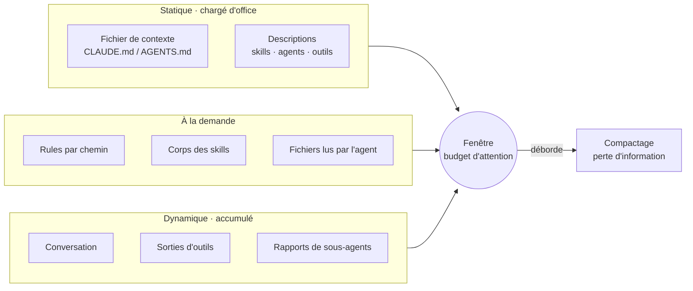
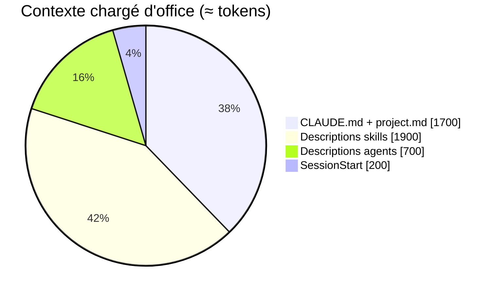

# Ingénierie de contexte : ce que ça change pour le harness

> Étude de l'état de l'art (2025-2026) sur la gestion du contexte dans les harness de production de code, confrontée au template. Rédigée le 06/11/2026. Elle fonde les prochaines guidelines du harness (§5). Les éléments marqués ⚠️ viennent de sources secondaires.

## Verdict

**Le contexte statique est sain ; le contexte dynamique ne l'est pas encore.** Le harness charge peu en permanence (≈ 4 k tokens) et à la demande (≈ 10 k sur une piste M). Ses points faibles sont ailleurs : l'état d'un run vit en partie dans la conversation, les décisions d'une tâche ne passent pas à la suivante, et rien ne guide la reprise après un compactage.

| | Constat | Priorité |
|---|---|---|
| ✅ | Carte courte, rules par chemin, skills à la demande, relecteurs sans contexte | garder |
| ⚠️ | Hypothèses des tâches gardées en mémoire de conversation jusqu'au rapport | **haute** |
| ⚠️ | Chaque `hx-implementer` ignore les choix des tâches précédentes | **haute** |
| ⚠️ | Après un compactage en plein run, le contexte réinjecté s'adresse à l'utilisateur, pas à l'agent | moyenne |
| ⚠️ | `CLAUDE.md` répète des détails déjà dans les skills (livraison automatique) | basse |
| ⚠️ | Sortie d'échec tronquée à 60 lignes, sans fichier complet à relire | basse |

---

## 1. Ce que dit l'état de l'art

| # | Idée | Preuve | Source |
|---|---|---|---|
| 1 | **Le contexte est un budget d'attention** : viser « le plus petit ensemble de tokens à fort signal » | principe | [Anthropic, sept. 2025](https://www.anthropic.com/engineering/effective-context-engineering-for-ai-agents) |
| 2 | **Context rot** : la qualité baisse avec la longueur, bien avant la limite ; un seul distracteur suffit à la dégrader | 18 modèles, tous touchés | [Chroma, 2025](https://research.trychroma.com/context-rot) ⚠️ |
| 3 | **Densité d'instructions** : la conformité baisse avec le nombre de consignes, biais vers les premières | 68 % au mieux à 500 consignes | [IFScale, NeurIPS 2025](https://arxiv.org/abs/2507.11538) |
| 4 | **Fichiers de contexte** : peu ou pas de gain, coût +19 à +23 % ; n'y mettre que ce qui n'est pas ailleurs | SWE-bench + CTXbench | [ETH, arXiv 2602.11988](https://arxiv.org/abs/2602.11988) |
| 5 | **Découverte à la demande** : sorties d'outils écrites en fichier, lues par `tail` ; descriptions chargées seulement si utiles | −46,9 % de tokens (A/B interne) ⚠️ | [Cursor, janv. 2026](https://cursor.com/blog/dynamic-context-discovery) |
| 6 | **Prise de notes structurée** : l'état d'une tâche longue vit dans des fichiers, relus après compactage | principe | [Anthropic, sept. 2025](https://www.anthropic.com/engineering/effective-context-engineering-for-ai-agents), [nov. 2025](https://www.anthropic.com/engineering/effective-harnesses-for-long-running-agents) |
| 7 | **Récitation** : réécrire le plan en fin de contexte le garde dans l'attention ; garder les erreurs visibles | retour de production | [Manus](https://manus.im/blog/Context-Engineering-for-AI-Agents-Lessons-from-Building-Manus) ⚠️ |
| 8 | **Les actions portent des décisions implicites** : un sous-agent qui n'en hérite pas produit un résultat incohérent | principe | [Cognition, 2025](https://cognition.ai/blog/dont-build-multi-agents) |
| 9 | **Relecture sans contexte partagé** : meilleure quand codeur et relecteur ne partagent rien | retour de production | [Cognition, avr. 2026](https://cognition.ai/blog/multi-agents-working) ⚠️ |
| 10 | **Inertie de contexte** : l'agent poursuit une hypothèse périmée ; remède : note écrite puis contexte vidé | harness « Memento » | [Breunig, oct. 2026](https://www.dbreunig.com/2026/10/24/the-state-of-context-engineering.html) |
| 11 | **Effondrement de contexte** : réécrire toute la mémoire d'un coup la résume en banalités ; préférer des ajouts et retraits ciblés | +10,6 % sur agents | [ACE, ICLR 2026](https://arxiv.org/abs/2510.04618) |
| 12 | **Convergence des harness** : skills à chargement différé dans 9 systèmes sur 11 ; compactage à seuil dans 7 | étude de code source | [arXiv 2609.00006](https://arxiv.org/abs/2609.00006) |

**Lecture** : 2025 a parlé de « context engineering », 2026 de « harness engineering ». Le fond ne change pas : sortir l'assemblage du contexte de la prose pour le confier à du code déterministe (Breunig). C'est déjà le principe P3 du harness.

---

## 2. Le harness mesuré

Mesure du template, en caractères (≈ 3,5 caractères par token en français).

| Couche | Contenu | Taille | ≈ tokens |
|---|---|---|---|
| **Toujours chargé** | `CLAUDE.md` + `project.md` | 6,0 Ko | 1 700 |
| | Descriptions des 16 skills | 6,6 Ko | 1 900 |
| | Descriptions des 7 agents | 2,4 Ko | 700 |
| | Sortie du hook `SessionStart` | 1 ligne par change | < 200 |
| **Par chemin** | rules `architecture` + `comments` (tout fichier source) | 4,3 Ko | 1 200 |
| | rules `testing`, `openspec` | 1,4 et 2,0 Ko | 400 et 550 |
| **Piste M** | triage, clarify, implement, verify, review, ship | 35,6 Ko | 10 000 |

**Conclusion** : le statique pèse ≈ 2 % d'une fenêtre de 200 k. Le gros du contexte d'une session est **dynamique** : conversation de cadrage, sorties d'outils, rapports d'`hx-implementer` (≤ 25 lignes chacun), revue. C'est là que se jouent context rot et compactage.

---

## 3. Le harness au crible

### Déjà aligné

| Pratique de l'état de l'art | Dans le harness |
|---|---|
| Carte courte, rien de découvrable (#4) | `CLAUDE.md` ≤ 100 lignes ; le spécifique dans `project.md` ; P4 |
| Chargement différé (#5, #12) | Skills au format `SKILL.md`, rules par `paths:`, `references/` lus à la demande |
| Contrôles déterministes plutôt que prose (#10) | `hx check`, hooks, `hx confidence` calculé sur les fichiers |
| Contexte neuf et isolé (#1) | Un `hx-implementer` par tâche ; `hx-explorer` en `haiku` |
| Relecteurs sans contexte partagé (#9) | `hx-review` : « Les relecteurs n'ont pas ton contexte : c'est voulu. » |
| Notes externes (#6) | `tasks.md` coché, `run-report.md`, mesures `x-*` dans `.openspec.yaml` |
| Sorties d'outils courtes (#5) | `hx check` n'affiche que les étapes rouges, 60 dernières lignes |
| Mémoire consolidée (#11) | `hx-dream` : sources citées, plan validé avant écriture |

### Écarts

| # | Écart | Où | Risque concret |
|---|---|---|---|
| E1 | **Hypothèses en mémoire de conversation** jusqu'au rapport | `hx-implement` étape 2 : « Note ses hypothèses pour le rapport » | Run de 5+ tâches et boucle de correction → compactage → hypothèses perdues → rapport et `x-run-assumptions` faux → `hx confidence` surévalué |
| E2 | **Décisions non transmises** entre tâches (#8) | `hx-implement` : « ne transmets que ce qui la concerne » | Tâche 2 renomme ou recode autrement ce que la tâche 1 a tranché ; la revue de conformité ne le voit pas (elle relit une tâche) |
| E3 | **Reprise après compactage** non guidée | `SessionStart` (sans matcher, donc aussi au compactage) → `nextAction` « attendre la notification de fin de run » | Phrase écrite pour l'utilisateur ; l'agent ne sait plus à quelle tâche il en était ni où sont ses notes |
| E4 | **Cadrage et run dans la même conversation** (#2, #10) | « Valider et lancer le run ici » | Les allers-retours du cadrage (options rejetées, hypothèses abandonnées) restent dans la fenêtre du run : distracteurs et inertie |
| E5 | **Doublons `CLAUDE.md` ↔ skills** (#3, #4) | Paragraphe « Livraison automatique » de `CLAUDE.md` vs `hx-review` | Consignes chargées en permanence pour un cas rare ; deux textes à garder cohérents |
| E6 | **Sortie tronquée sans original** (#5) | `tail()` de `hx.mjs` | Le début d'une trace (cause racine) disparaît ; l'agent relance la commande pour la retrouver |
| E7 | **Pas de mesure du contexte** | evals : `cost_usd`, `duration_s` seulement | Impossible de prouver qu'une guideline réduit le contexte sans dégrader la réussite (P9) |

---

## 4. Recommandations

Ordre = gain attendu / coût. Chacune a sa preuve attendue, comme toute proposition `hx-learn`.

| # | Recommandation | Corrige | Coût | Preuve attendue |
|---|---|---|---|---|
| R1 | **Journal de run** : `openspec/changes/<change>/run-log.md`, une entrée par tâche (hypothèses, décisions, écarts), écrite par l'orchestrateur après chaque rapport et commitée avec la tâche. `hx-review` construit le rapport depuis ce fichier. | E1 | faible | eval `implement-m` avec compactage forcé : hypothèses du rapport = hypothèses des rapports de tâche |
| R2 | **Transmettre le journal** : chaque `hx-implementer` reçoit les décisions des tâches précédentes (section « Décisions », ≤ 15 lignes), pas leur conversation. | E2 | faible | eval de 5+ tâches liées (déjà demandée par [`sous-agents-2026-10.md`](sous-agents-2026-10.md)) : 0 incohérence relevée par `hx-spec-reviewer` sur le diff complet |
| R3 | **Reprise explicite** : quand `SessionStart` est déclenché par un compactage (`source: "compact"`) et qu'un run est en cours, injecter pour l'agent : change, tâche suivante, chemin du journal, « reprends `hx-implement` sans rendre la main ». | E3 | faible | test unitaire du hook ; eval avec compactage forcé : le run va au rapport |
| R4 | **Le fichier est le relais** : à la porte, le run repart des artefacts (proposal, specs, design, journal), jamais du fil de la conversation. Après un cadrage long (plusieurs tours de clarification), préférer « run dans un worktree séparé » (session neuve). | E4 | faible | comparer `x-gate-corrections` et hypothèses infirmées, run « ici » vs worktree séparé |
| R5 | **`CLAUDE.md` = carte** : une ligne par étape et son skill ; le détail (livraison automatique, boucle de correction) reste dans `hx-review` et `hx-triage`. Objectif ≤ 60 lignes. | E5 | faible | A/B evals complètes, `CLAUDE.md` actuel vs allégé : réussite égale |
| R6 | **Sortie complète en fichier** : `hx check` et `hx run` écrivent la sortie entière dans `.harness/logs/<étape>.log` et en citent le chemin sous l'extrait. | E6 | faible | test de `hx.mjs` |
| R7 | **Mesurer le contexte** : les evals enregistrent tokens d'entrée et pic de contexte (sortie JSON de `claude -p`). | E7 | faible | colonne présente dans `evals/results/` |

**Non retenu**

| Idée | Pourquoi pas |
|---|---|
| Récitation d'un `todo.md` par l'agent (Manus) | `tasks.md` joue déjà ce rôle ; Manus rapporte un tiers des actions perdues en tenue de liste ⚠️ |
| RAG, index d'embeddings du code | Pour le code, la recherche structurelle (grep, glob) suffit et domine les harness étudiés (#12) |
| Ajouter `disable-model-invocation` à des skills pour retirer leur description du contexte | Le gain (≈ 200 tokens par skill) ne vaut pas le risque : le langage naturel déclenche la plupart des skills (`hx-update`, `hx-setup`). À rouvrir seulement pour `hx-dream` |
| Compactage piloté par le harness | Claude Code le fait ; le harness n'a besoin que d'y survivre (R1, R3) |

---

## 5. Guidelines proposées

À reprendre dans `PLAN.md` (§1, principe P4 étendu) et dans la grille de relecture des skills.

| # | Guideline | Vérifiable par |
|---|---|---|
| G1 | **Statique minimal** : `CLAUDE.md` ne contient que ce qui ne se découvre pas ailleurs (commandes `hx`, pistes, principes). Tout détail d'étape vit dans son skill. | lint du template : `CLAUDE.md` ≤ 60 lignes |
| G2 | **Toute information utile après la session vit dans un fichier** : hypothèses, décisions, verdicts, mesures. La conversation n'est jamais la seule copie. | revue des skills : chaque « note » a une destination fichier |
| G3 | **Le relais entre agents est un artefact, pas une conversation** : spec, journal, diff. On transmet les décisions prises, pas le raisonnement. | grille `hx-implement` |
| G4 | **Les relecteurs ne reçoivent que l'artefact jugé** (diff, scénarios). Jamais le raisonnement de l'auteur. | inchangé (P5) |
| G5 | **Une sortie d'outil est un extrait + un chemin** : l'agent lit la suite s'il en a besoin. | tests de `hx.mjs` |
| G6 | **Survivre au compactage** : un hook réinjecte où en est le travail, depuis les fichiers. | eval avec compactage forcé |
| G7 | **Description de skill = déclencheur** : « quoi » + « quand », mots-clés en tête, ≤ 400 caractères. | lint du template |
| G8 | **Mémoire : ajouts et retraits ciblés**, jamais une réécriture globale ; chaque entrée cite sa source. | inchangé (`hx-dream`) |
| G9 | **Tout ajout de contexte se mesure** : réussite et tokens, avec et sans (P9). | R7 + revue d'élagage |

---

## Sources

- Anthropic, [Effective context engineering for AI agents](https://www.anthropic.com/engineering/effective-context-engineering-for-ai-agents), sept. 2025 ; [Effective harnesses for long-running agents](https://www.anthropic.com/engineering/effective-harnesses-for-long-running-agents), nov. 2025
- Chroma, [Context Rot](https://research.trychroma.com/context-rot), 2025 (lu via [The Decoder](https://the-decoder.com/yet-another-study-finds-that-overloading-llms-with-information-leads-to-worse-results/) et [W&B](https://wandb.ai/byyoung3/ml-news/reports/Chroma-Research-Warns-of-Context-Rot-as-LLMs-Falter-with-Long-Inputs--VmlldzoxMzczMjQ4MQ)) ⚠️
- Jaroslawicz et al., [How Many Instructions Can LLMs Follow at Once?](https://arxiv.org/abs/2507.11538), NeurIPS 2025
- Gloaguen et al., [Evaluating AGENTS.md](https://arxiv.org/abs/2602.11988), ETH Zurich, févr. 2026
- Cursor, [Dynamic context discovery](https://cursor.com/blog/dynamic-context-discovery), janv. 2026 (chiffre via [InfoQ](https://www.infoq.com/news/2026/01/cursor-dynamic-context-discovery) et [TestingCatalog](https://www.testingcatalog.com/cursor-rolls-out-dynamic-context-discovery-for-coding-agents))
- Manus, [Context Engineering for AI Agents](https://manus.im/blog/Context-Engineering-for-AI-Agents-Lessons-from-Building-Manus) (lu via [tianpan.co](https://tianpan.co/blog/2026-03-02-context-engineering-lessons-from-manus) et [ZenML](https://www.zenml.io/llmops-database/context-engineering-strategies-for-production-ai-agents)) ⚠️
- Cognition, [Don't Build Multi-Agents](https://cognition.ai/blog/dont-build-multi-agents), juin 2025 ; [Multi-Agents: What's Actually Working](https://cognition.ai/blog/multi-agents-working), avr. 2026 ⚠️
- Breunig, [The State of Context Engineering](https://www.dbreunig.com/2026/10/24/the-state-of-context-engineering.html), oct. 2026
- Zhang et al., [Agentic Context Engineering (ACE)](https://arxiv.org/abs/2510.04618), ICLR 2026
- [Harness Engineering: Anatomy, Architecture, and Evolution of Coding Agents](https://arxiv.org/abs/2609.00006), sept. 2026
- Anthropic, [Context editing](https://docs.claude.com/en/docs/build-with-claude/context-editing) (effacement des résultats d'outils, outil mémoire)
