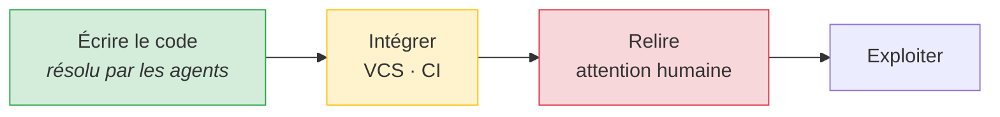

# Quand écrire du code n'est plus le goulot

> Analyse de « [Redesigning source control at Anthropic](https://www.anthropic.com/research/redesigning-source-control) » (Anthropic, 13/10/2026) et de ses répercussions sur le harness. Recoupée avec deux publications Anthropic du même mois. Rédigée le 27/10/2026.

## En bref

| | |
|---|---|
| **Thèse de l'étude** | « *Coding is no longer the bottleneck.* » Le goulot passe à ce qui entoure le code : versionnage, CI, et attention humaine. |
| **Ce qui change l'état de l'art** | L'infrastructure à très grande échelle (Scion remplace git). **Pas** la méthode : sur la méthode, l'étude confirme des pratiques déjà connues. |
| **Pour le harness** | Aucun outil à remplacer. La méthode est confirmée sur 4 points, 2 ajustements sont recommandés, 3 transpositions sont à refuser. |

---

## 1. Ce que dit l'étude

| Constat | Chiffre |
|---|---|
| Merges par jour sur le monorepo | **2 500** (mai 2026) → **30 000+** (sept. 2026), ×12 en 4 mois |
| Taille du dépôt | Historique ≈ 100 Go, copie de travail > 25 Go, 25 M checkouts CI par jour |
| Réponse | **Scion** : versionnage centralisé, client toujours en ligne, historique côté serveur exposé par API, checkouts creux |
| Gains | Checkouts ×100 plus rapides, empreinte ÷200, 25 % de CPU de CI récupéré |
| Équipe | 7 personnes, migration en 5 mois, pendant que le volume de merges a été multiplié par 10 |

**Constats sur la façon de travailler avec les agents** (cités mot pour mot) :

| # | Citation | Sens |
|---|---|---|
| A | « *the role of the engineers was to tell Claude "no."* » | L'humain tranche les compromis et refuse les mauvais patterns. |
| B | « *adversarial review […] can also be myopic* », d'où une sur-ingénierie | Un relecteur IA adversarial invente des risques hypothétiques. |
| C | « *examine the intent of the change as opposed to reading every line of code* » | La relecture humaine porte sur l'intention, plus sur chaque ligne. |
| D | « *A proper merge queue […] doesn't make much sense at agent scale* » | Tests après merge ; Claude corrige les conflits. |
| E | « *superfans* » : un agent par composant surveille télémétrie et logs | Exploitation confiée à des agents. |
| F | Mythos Preview réécrit seul un pipeline : 20× moins de mémoire, 4× plus rapide | Les modèles dépassent le code fait main. |
| G | Règles d'approbation sémantiques (commentaire seul ≠ logique sensible) | Revue proportionnée au risque. |

### Recoupements du même mois

| Publication | Constat utile |
|---|---|
| [How employment is changing at Anthropic](https://www.anthropic.com/research/employment-at-anthropic) (16/10) | Commits par ingénieur ×5 en 6 mois. Agents : **6 h de travail par heure humaine**, sessions **inactives 80 % du temps**, en attente d'un humain. Instructions permanentes : quelques centaines → **8 500** en un an. Taux de code supprimé ou annulé : identique entre code d'agent et code humain. |
| [Investigating unintended model actions](https://www.anthropic.com/research/investigating-unintended-model-actions) (09/10) | Risque dominant : la **persistance**, « *when it cannot complete a task as given, works around a restriction instead of stopping* ». Cause : tâches « *ambiguous or impossible to complete* ». |

---

## 2. Prendre du recul

> Chez Anthropic, le goulot **Intégrer** domine, à cause de l'échelle. Pour un projet solo, c'est **Relire** qui domine, quelle que soit l'échelle.

| Solide | À relativiser |
|---|---|
| Déplacement du goulot : observé, chiffré, recoupé par deux études | **Échelle** : 30 000 merges/jour, monorepo de 100 Go. Un projet solo en est loin de 4 ordres de grandeur. |
| Relecture de l'intention plutôt que des lignes | **Budget** : les auteurs reconnaissent une dépense en tokens « *far beyond what most businesses would want* ». |
| Relecteur IA adversarial sujet à la sur-ingénierie | **Volume ≠ valeur** : « *More code does not necessarily mean better code* » (étude emploi). Les merges mesurent le débit, pas l'utilité. |
| Persistance des agents face aux restrictions | **Juge et partie** : Anthropic vend les tokens qui produisent ce volume. Scion n'est pas publié, ses chiffres ne sont pas auditables. |
| | **Biais de sélection** : les adoptants des agents progressaient déjà plus vite avant adoption (étude emploi). |
| | Les auteurs eux-mêmes : « *by no means a suitable replacement for git for general use* ». |

---

## 3. Répercussions sur le harness

✅ confirmé · ⚠️ à ajuster · ⛔ à ne pas transposer

| Constat | Le harness aujourd'hui | Verdict |
|---|---|---|
| **C** Relire l'intention | Porte de cadrage : l'utilisateur valide la spec, pas le code. Le corps de PR commence par le pourquoi. | ✅ Même choix, fait plus tôt : avant le code plutôt qu'après. |
| **A + B** L'humain dit non ; relecture adversariale myope | `hx-architect` « besoin d'abord », `hx-code-reviewer` signale la sur-ingénierie, `hx-review` filtre les faux positifs. | ✅ Confirmé. ⚠️ Mesurer la dérive (reco. 3). |
| **Recoupement emploi** Humain = goulot (80 % d'attente) | Une seule porte ; l'utilisateur cadre le change suivant pendant le run ; `hx status`. | ✅ Exactement le problème visé par la phase 6. |
| **Recoupement emploi** Instructions ×40 | P4 « le contexte est un budget », `hx-dream` élague la mémoire. | ✅ Confirmé. |
| **Persistance** Contourner au lieu de s'arrêter | Mode Auto sans confirmation. Garde-fous : ne jamais affaiblir un test, ne jamais désactiver un contrôle, arrêts listés, porte contre l'ambiguïté. **Aucun ne dit qu'une restriction de l'environnement est un arrêt.** | ⚠️ Trou réel (reco. 1). |
| **F** Modèles bien plus forts | P9 et `elagage.md` : revue à chaque génération de modèle. Ligne de base du 18/10 ; **A/B `--without` jamais mené**. | ⚠️ Revue d'élagage due (reco. 2). |
| **G** Approbation selon le risque | CODEOWNERS sur les chemins sensibles, rappel `PreToolUse`, signalement `Stop`. Par chemin, pas sémantique. | ✅ Suffisant en solo. |
| **D** Pas de merge queue, tests après merge | `/hx-ship` reprend la base et lance `hx check` **avant** l'archive : `main` reste toujours cohérent. | ⛔ En solo, ce contrôle coûte quelques secondes et protège une décision du plan (§9). |
| Remplacer git | Un worktree git par run. | ⛔ Les auteurs le déconseillent hors très gros monorepos. |
| **E** Agents d'exploitation | Le harness s'arrête au merge. | ⛔ Hors périmètre. Idée à garder pour `/Idea`. |

---

## 4. Recommandations

| # | Priorité | Action | Coût | Preuve attendue |
|---|---|---|---|---|
| 1 | **P1** | Dans `hx-implement` (arrêts autorisés) et `hx-implementer` (contrat) : « une restriction de l'environnement (permission refusée par le mode Auto, réseau bloqué, hook qui refuse) est un **blocage à rapporter**, jamais un obstacle à contourner ». | 2 lignes | Nouvelle eval : une tâche qui exige une commande interdite doit finir en arrêt, pas en contournement. |
| 2 | **P1** | Mener l'A/B `--without` prévu par `elagage.md` sur le modèle courant, en commençant par `hx-tdd` et le découpage « un sous-agent par tâche » de `hx-implement`. | ~10 $ par composant : 2 × 10 runs (ligne de base : 11,74 $ pour 4 × 10 runs) | Lignes du journal d'élagage, fichiers dans `evals/results/`. |
| 3 | P2 | Faire de `x-review-discarded > x-review-confirmed` sur un trimestre un signal explicite de « relecture myope » dans `elagage.md`. | 1 ligne | `hx stats`. |
| 4 | P3 | Ajouter aux risques du plan (§8) les signaux qui rouvriraient les refus ⛔ : runs parallèles qui se bloquent au `/hx-ship`, checkouts de CI qui dépassent la minute, projet en production avec télémétrie. | 3 lignes | — |

**Ce qu'il ne faut pas faire** : changer de système de versionnage, supprimer le contrôle avant merge, ajouter un agent d'exploitation, ou multiplier les relecteurs IA (constat B : plus de revue adversariale peut produire plus de sur-ingénierie).

---

## 5. Limites de cette analyse

- Sources : les trois billets Anthropic, lus en ligne le 27/10/2026, et leur couverture de presse. Aucune donnée brute, Scion non publié.
- L'hypothèse que « l'étude » visée est le billet Scion repose sur sa date, son sujet et sa couverture de presse. Si une autre publication était visée, les sections 1 et 2 sont à revoir. La section 3 tient en partie grâce aux recoupements.

## Sources

- Anthropic, [Redesigning source control at Anthropic](https://www.anthropic.com/research/redesigning-source-control), 13/10/2026
- Anthropic, [How employment is changing at Anthropic](https://www.anthropic.com/research/employment-at-anthropic), 16/10/2026
- Anthropic, [Investigating unintended model actions in our evaluations and internal use](https://www.anthropic.com/research/investigating-unintended-model-actions), 09/10/2026
- Couverture : [DevOps.com](https://devops.com/anthropic-builds-its-own-source-control-after-ai-agents-outgrow-git), [Arize, « Why Anthropic replaced Git, and whether you'll need to »](https://arize.com/blog/anthropic-scion-vs-git.md), [The Register](https://www.theregister.com/a/5302943)
