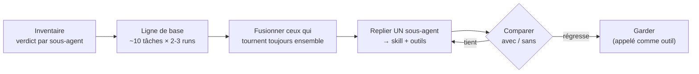
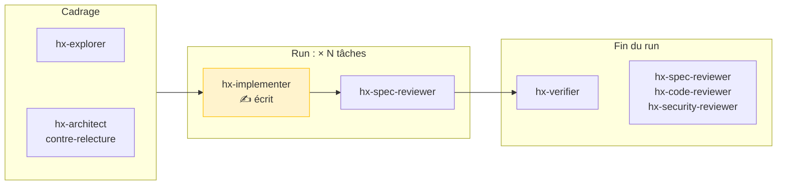

# Moins de sous-agents : ce que ça change pour le harness

> Analyse de « [Building agents: When to fold subagents into your main agent loop](https://claude.com/blog/building-agents-when-to-fold-subagents-into-your-main-agent-loop) » (Anthropic, 22/10/2026), de son [kit de migration](https://github.com/anthropics/single-agent-loop-kit) et de la discussion sur X qui a suivi. Rédigée le 27/10/2026.

## En bref

| | |
|---|---|
| **Thèse** | « *Using fewer subagents in favor of progressively disclosed context and tools can improve quality* », à coût et latence moindres. Un agent unique avec des skills bat souvent l'architecture en sous-agents. |
| **Mais** | Garder un sous-agent quand il **gagne son propre contexte** : vérification indépendante, recherche en parallèle, lecture bien plus large que ce dont l'agent principal a besoin ensuite. |
| **Méthode** | Mesurer d'abord, replier **un sous-agent à la fois**, comparer avec et sans, plusieurs exécutions par tâche. |
| **Pour le harness** | 6 agents sur 7 sont des relecteurs ou des explorateurs, le cas où le billet dit de garder. **Un seul est contesté : `hx-implementer`** (un sous-agent neuf par tâche). Il ne peut pas être tranché aujourd'hui, faute d'une eval assez longue. |

---

## 1. Ce que dit le billet

### Pourquoi une boucle unique suffit désormais

| Raison | Détail |
|---|---|
| **Contexte partagé** | Chaque passage de relais perd des détails : un « téléphone arabe », « *each handoff degrading fidelity* ». « *The model that writes the plan is also the one carrying it out.* » |
| **Divulgation progressive** | Skills et recherche d'outils chargent le détail à la demande. Anthropic a ainsi réduit de plus de 80 % le prompt système de Claude Code pour les modèles récents. |
| **Capacité des modèles** | « *Starting with Opus 4.5, models became capable of managing far more in a single loop than most teams expected.* » |

### Quand garder un sous-agent

| Garder si… | Ne pas découper… |
|---|---|
| La boucle unique se dégrade **de façon mesurable** à cause d'un contexte trop chargé | Par type de problème : chaque relais dégrade la fidélité |
| Le travail est parallèle et profite de contextes neufs et jetables | Par équipe : l'architecture copie l'organigramme (loi de Conway) |
| La vérification doit être indépendante, en boîte noire | En empilant des consignes contradictoires dans un même prompt (le « *Frankenprompt* ») |
| L'agent lit bien plus que ce dont l'agent principal a besoin ensuite | |

### Méthode du kit

Verdict par sous-agent : **replier**, **fusionner**, **appeler comme outil** ou **garder**. Mise en garde du billet : sur un agent de support, le repli a réduit la latence mais cassé un processus, et l'échec n'est apparu que dans **une exécution sur deux**.

---

## 2. Prendre du recul

| Solide | À relativiser |
|---|---|
| Une logique cohérente avec la propre règle d'élagage du harness (P9) : Anthropic retire ce que le modèle n'a plus besoin qu'on compense | **Le public visé** : des agents d'entreprise (support client, routage) sur la plateforme Claude, pas des agents de code |
| La méthode exige une mesure avant tout repli : ce n'est pas un dogme | **Les preuves** : « plusieurs déploiements », un facteur 2 de latence chez un client. Pas de chiffre de qualité publié. Le kit l'admet : deux exécutions, une personne, un modèle. |
| Recoupé par la recherche sur le code : les agents seuls font un peu mieux sur les tâches couplées ([arXiv 2511.00872](https://arxiv.org/pdf/2511.00872)) | **La lecture de X** : « Anthropic dit d'arrêter les sous-agents » est une simplification. Le billet en garde explicitement trois usages. |
| Ici, l'éditeur conseille de **dépenser moins** de tokens, donc pas de conflit d'intérêts évident | Le système multi-agents de recherche d'Anthropic (2025) gardait un net avantage sur la recherche **en largeur**. Le billet ne le contredit pas. |

---

## 3. Le harness au crible du billet

Un change M de N tâches lance aujourd'hui **2N + 2 à 6 sous-agents**. Pour 5 tâches, c'est 12 à 16 contextes neufs, sans compter les reprises.

✅ garder · 🔗 fusion à tester · 🔀 repli à tester

| Agent | Rôle | Critère du billet | Verdict |
|---|---|---|---|
| `hx-explorer` | Cartographier le code | Lit bien plus que ce dont l'agent principal a besoin ensuite | ✅ Le cas d'école |
| `hx-verifier` | Exercer les scénarios | Vérification en boîte noire | ✅ |
| `hx-security-reviewer` | Relecture sécurité, conditionnelle | Vérification indépendante | ✅ |
| `hx-architect` en contre-relecture | Contester le cadrage | Vérification indépendante | ✅ |
| `hx-spec-reviewer` après chaque tâche | Conformité à la spec | Vérification indépendante | ✅ Garder, mais il tourne N + 1 fois : à surveiller |
| `hx-spec-reviewer` + `hx-code-reviewer` dans `hx-review` | Relecture finale | Tournent **toujours ensemble** | 🔗 Fusion à tester : un relecteur neuf avec deux grilles |
| **`hx-implementer`** | **Une tâche, un contexte neuf** | Tâches **séquentielles et couplées** (même code, même spec) : c'est le relais que le billet critique | 🔀 **Candidat n°1** : l'agent principal enchaîne les tâches en TDD, et la relecture indépendante après chaque tâche reste |

**Le principe P5 « qui produit n'évalue pas » n'est pas remis en cause** : le billet garde précisément la vérification indépendante. Ce qui est contesté, c'est la règle « contexte neuf : chaque tâche a son propre sous-agent » de `hx-implement`. Elle compense une faiblesse (« contexte dégradé sur un long change », selon `elagage.md`) que les modèles récents ont peut-être perdue.

### Déjà conforme au billet

| Idée du billet | Dans le harness |
|---|---|
| Divulgation progressive | `CLAUDE.md` ≤ 100 lignes, rules ciblées par chemin, skills chargés à la demande |
| Pas de « Frankenprompt » | P4 « le contexte est un budget » ; `hx-dream` élague ce que `hx-learn` accumule |
| Mesurer avant de retirer, un composant à la fois | `elagage.md`, evals A/B `--without`, `--runs 10` (plus robuste que les 2 à 3 runs du kit) |

### Le trou : on ne peut pas trancher aujourd'hui

`elagage.md` fixe la règle : retirer `hx-implement` si « réussite égale sans lui, **sur ≥ 5 tâches** ». Or l'eval `implement-m` n'en compte que **2**, indépendantes. Le gain du contexte neuf (pas d'encombrement) et son coût (perte au relais) n'apparaissent que sur un change long et couplé. **Aucune mesure actuelle ne peut confirmer ou infirmer le billet sur le harness.**

---

## 4. Recommandations

| # | Priorité | Action | Ce qu'elle tranche |
|---|---|---|---|
| 1 | **P1** | Créer l'eval `implement-l` : un change de **≥ 5 tâches couplées** (mêmes fichiers, la tâche 4 dépend d'un choix de la tâche 2), noté de façon déterministe comme `implement-m`. | Rend la décision possible |
| 2 | **P1** | A/B sur `implement-l`, `--runs 10` : variante actuelle contre une variante « boucle unique » où l'agent principal fait les tâches en TDD et `hx-spec-reviewer` relit toujours après chacune. Comparer réussite, coût et durée, et regarder **quelles exécutions basculent**, pas seulement le score. | Replier ou garder `hx-implementer` |
| 3 | P2 | A/B sur la fusion `hx-spec-reviewer` + `hx-code-reviewer` dans `hx-review`. Suivre `x-review-confirmed` et `x-review-discarded` avec `hx stats`. | Fusionner ou garder les deux relecteurs |
| 4 | P3 | Inscrire le verdict dans le journal d'élagage, quel qu'il soit. | Traçabilité |

> ⚠️ `--without hx-implementer` ne suffit pas pour l'A/B 2 : il supprime les lignes qui citent l'agent sans écrire la consigne de remplacement. Il faut une vraie variante de `hx-implement`.

**À ne pas faire** : replier les relecteurs, le vérificateur ou l'explorateur (le billet les garde), abandonner P5, ou replier `hx-implementer` sans mesure (l'exemple du support montre une régression visible une fois sur deux seulement).

## 5. Limites de cette analyse

- Billet et kit lus en ligne le 27/10/2026. Le fil X n'a pas pu être ouvert directement : sa teneur vient des articles qui le citent.
- Aucune mesure n'a été lancée ici : les verdicts 🔀 et 🔗 sont des hypothèses à tester, pas des conclusions.

## Sources

- Anthropic, [Building agents: When to fold subagents into your main agent loop](https://claude.com/blog/building-agents-when-to-fold-subagents-into-your-main-agent-loop), 22/10/2026
- Anthropic, [single-agent-loop-kit](https://github.com/anthropics/single-agent-loop-kit)
- Discussion : [fil X de @CodeByNZ](https://x.com/CodeByNZ/status/2114296698533040158), [tendance X](https://x.com/i/trending/2114051790022811792)
- Couverture : [The Decoder](https://the-decoder.com/anthropic-says-one-ai-agent-beats-many-subagents-now-that-models-can-handle-complexity-alone/), [SmartScope](https://smartscope.blog/en/blog/anthropic-fold-subagents-into-single-agent-loop-3-2026/)
- Contexte : [arXiv 2511.00872](https://arxiv.org/pdf/2511.00872) (agents seuls ou multiples sur des tâches de code)
